# 116 lottery×instant 即时开奖结果机方案与漏洞审查

> 日期：2026-08-05  
> 状态：**方案已落档；编码门禁 = 未开**（见第十二节）  
> 原则：不把目标态写成已实现；不与 docs/115 的 delayed 路径混写；行业对照 + 本仓库源码约束双证。  
> 前置：`docs/115`（体验壳≠结果机）、`docs/055a`（停扇仅 instant+服务端索引）、`docs/021/022`（三轴与玩法矩阵目标态）

---

## 〇、一句话

| 项 | 结论 |
|:---|:-----|
| 要什么 | 微信抽奖助手式：**转完（spin 成功）当场出奖/未中** |
| 怎么做 | **独立结果机** `lottery + result_mode=instant` + 热路径 `spin`；**禁止**复用/改装 `performDraw` |
| 与现状 | delayed（manual/scheduled + 池抽样）**保留且互斥** |
| 能否开工编码 | **否**——见 §十二。已冻结：多奖、**活动可配 `maxSpinsPerEntry`（抽奖次数）**、双封顶裂变、**只留邀请榜**；余 O2/O3 与工程清单 |

---

## 一、问题与边界

### 1.1 要解决的用户问题

用户点大转盘/刮刮后，期望 **当场知道中没中、中什么**（含卡密或履约说明），而不是「已参与，等主办方开奖」。

### 1.2 明确非目标

| 非目标 | 原因 |
|:-------|:-----|
| 把现有 wheel+manual 改成假停扇中奖 | docs/115 已证：join 不写 winners |
| 只改 `resultMode=instant` 字段 | join 不读 resultMode 开奖 → 文案欺诈 |
| join 成功时对全池 `performDraw` 抽 1 人 | 第一人吃光名额 / 语义不是「每人一转」 |
| 自建电商库存、订单、支付 | docs/015/021 活动引擎边界 |
| 本阶段改 delayed 抽样公平算法 |  dual-path 隔离 |
| 本阶段实现浏览器 E2E 全绿为硬门禁 | 以并发超发单测 + 契约测为主 |

### 1.3 与 delayed 的互斥（铁律）

同一 `draw_id` **只允许一种结果机**：

| result_mode | 参与 | 出奖 | 管理端「立即开奖」 | Cron scheduled |
|:------------|:-----|:-----|:------------------|:---------------|
| manual / scheduled | `join` → entry | `performDraw` | 允许（lottery） | scheduled 到期允许 |
| **instant** | `join/verify` 建档+配额 → **`spin`** | **spin 事务内** | **拒绝** | **拒绝** |

发布/创建预检必须阻断：`instant` + `drawTrigger=scheduled` 自动开奖配置；或强制 `drawTrigger` 对 instant 无意义并忽略。

---

## 二、行业做法摘要（对照用，非抄袭实现）

成熟即时玩法（H5 转盘、刮刮、游戏 gacha、营销抽奖）共性：

1. **服务端先判定**，客户端只播放。  
2. **概率或权重 + 每档硬顶库存**；库存 CAS 失败 → 未中或降级，**禁止超发**。  
3. **抽奖次数配额**（人/日/活动）在热路径原子扣减。  
4. **幂等键**防重试双中。  
5. **未中是一等公民结果**（谢谢参与扇区或 `won=false`）。  
6. 裂变在 instant 下多为 **+次数**，而非「全池加权再统一开奖」。

算法主流：**权重抽样 + 档位 remaining 硬顶 + 耗尽降级未中**（可另加 pity，P2）。

前端最优：**先 `spin` 成功 → 再 celebrate 并对准 `prizeIndex`**；并行动画可做，但 **无服务端索引不得宣称中奖**（docs/055a）。

---

## 三、领域模型（本仓库对齐）

### 3.1 三轴取值（instant 模板）

| 轴 | 推荐值 | 说明 |
|:---|:-------|:-----|
| activity_kind | `lottery` | 仍走 lottery 奖品/码语义 |
| experience_type | `wheel` / `scratch` / `slot` / `grid`… | 壳不变 |
| result_mode | **`instant`** | 新结果机开关 |
| allocation_policy | **`weighted_random`**（新语义）或保留字段 + activity_config 概率表 | 与 delayed 的 pool sample **不同实现** |
| draw_trigger | 固定 **`manual` 且忽略定时开奖** 或新增 `n/a` | 避免 Cron 误扫 |

### 3.2 参与与次数（**本方案冻结默认**）

**默认冻结：一身份一 `lottery_entries`，多次 `spin`。**

| 步骤 | 行为 |
|:-----|:-----|
| 首次 verify/join | 建 entry；写入 **初始 spin 配额**（如 1）；**不抽奖** |
| 每次转盘 | `POST .../spin`：扣 1 次配额 → 抽奖 → 写结果 |
| 裂变 | 成功邀请 → **+spin 次数**（有 cap），**不**复用 delayed 的 `computeViralDrawWeight` 全池抽样 |

**不采用**：每次 spin 新建 entry（与 UNIQUE 身份、裂变 entryId、已参与 UX 冲突大）。

### 3.3 中奖落库策略（**必须正视现有约束**）

**源码铁证**（`schema.ts`）：

```text
lottery_winners: UNIQUE (tenant_id, draw_id, entry_id)
```

含义：同一 entry **最多一条** winner 行。  
若 instant 允许多次 spin 且可能多次中奖，**直接 insert winners 会第二次唯一约束失败**。

#### 3.3.1 产品决议（2026-08-05）：**允许一人多奖** + **按活动配置抽奖次数上限**

| 决议 | 内容 | 来源 |
|:-----|:-----|:-----|
| 一人多奖 | 同一 entry 在多次 spin 中可多次 `won=true` | 用户确认 |
| 抽奖次数上限 | **每个活动创建/编辑时配置**；见 §3.3.3（字段名与语义） | 用户确认 |
| 排行榜 | **只保留邀请榜**（按有效 join 人数）；**不做**手气/中奖榜 | 用户确认 |

不再默认「中奖即停抽」。停抽条件 **只** 来自：次数用尽、活动结束、限流、黑名单等。

**工程必做（P0 schema，不可跳过）**：

| 规则 | 选择 | 理由 |
|:-----|:-----|:-----|
| 主审计表 | 新建 **`lottery_spins`**（每次 spin 一行，含未中） | 可审计、可幂等、可多次 |
| `idx_winners_unique` | **迁移拆除**「每 entry 一条」；改为 **`UNIQUE(tenant_id, draw_id, spin_id)`** | 否则第二次中奖 500 |
| 每次中奖 | `INSERT lottery_spins` + **`INSERT lottery_winners`（每奖一行）** + 锁码 | 邮件/导出/my-result 多码 |
| 未中 | 仅 spin 行，`won=0` | 不写 winners |
| 中奖后 | **不**自动停抽；若仍有剩余抽奖次数可继续 | 与多奖 + 次数上限一致 |

> **delayed 活动**仍「一 entry 一 winner」（performDraw）；instant 多行 winners。迁移须兼容旧数据。

#### 3.3.2 曾用「中奖即停抽」默认

**已否决**。防刷与预算改由：**活动级抽奖次数上限**、档位/码库存、IP 限流承担。

#### 3.3.3 活动配置：同一用户「可抽奖次数」（闭环语义，禁止幻觉）

**用户原话落地**（2026-08-05）：

> 可在后端**每个活动定义时**设置；**1 = 只允许抽 1 次**；其它正整数 = 允许**同一用户**抽奖的次数。

| 易混点 | 正确语义 | 错误幻觉 |
|:-------|:---------|:---------|
| 配置控制的是什么？ | **抽奖次数（spin 次数）** 上限 | ~~中奖次数上限~~（用户描述的是「抽奖」不是「中奖」） |
| `1` | 该用户在本活动 **最多成功 spin 1 次** | ~~中 1 次就停~~（若 1 次未中，也不能再抽） |
| `N>1` | 最多成功 spin **N** 次；其中 0…N 次可能中奖 | ~~固定中 N 次~~ |
| 一人多奖如何发生？ | 仅当 **N≥2** 且多次 spin 的概率结果为 won | 与次数上限无关的「无限中奖」 |

**推荐配置字段名（实现用，避免再混）**：

| 字段 | 类型 | 约束 | 含义 |
|:-----|:-----|:-----|:-----|
| **`maxSpinsPerEntry`** | 整数 | **≥1**，必填（instant）；建议上限如 ≤100（系统配置可调） | 同一 `lottery_entries` 在本活动内 **累计成功 spin 次数**硬顶 |
| （文档曾用名 `maxWinsPerEntry`） | — | **废弃该名作此义** | 旧稿易误解为「最多中奖几次」；**产品语义以本表为准** |

**「同一用户」边界（禁止幻觉）**：

| 说法 | 本仓库落地含义 | 不是 |
|:-----|:---------------|:-----|
| 同一用户 | **同一活动内同一 `lottery_entries` 身份**（现网一般为同一 draw 下 email/手机等参与凭证 → 一行 entry） | 同一浏览器、同一 IP、同一设备（这些只做限流/风控，**不**当抽奖次数主体） |
| 次数挂在哪 | `entry.spins_*` + `COUNT(lottery_spins)` | 不按「中奖次数」另建配额 |
| 换邮箱再 join | **另一 entry**，各自独立 `maxSpinsPerEntry` 预算 | 除非产品另做身份合并（**本方案不做**） |

可选附属（闭环需要，默认写死以免开口子）：

| 字段 | 默认 | 含义 |
|:-----|:-----|:-----|
| `initialSpinsOnJoin` | **1** | 首次 join 发放的次数；必须 **≤ maxSpinsPerEntry** |
| 裂变 `extraSpinsPerInvite` | 活动配（≥0） | 每 **1 次有效邀请 join** 给邀请人 + 的 spin 额度 |
| 裂变 `maxExtraSpins` | 活动配（≥0） | **仅裂变增量**封顶：累计因邀请多拿到的额度 ≤ 此值（对标 delayed 的 `maxExtraEntries` 角色） |

**双封顶关系（必须同时成立，缺一会出洞）**：

```text
总硬顶：  granted ≤ maxSpinsPerEntry          ← 运营配置的「同一用户最多抽几次」
裂变硬顶： viralEarned ≤ maxExtraSpins         ← 邀请最多再加几次
组合：    granted ≤ initialSpinsOnJoin + viralEarned
且       granted ≤ maxSpinsPerEntry
∴ 有效上限 = min(maxSpinsPerEntry, initial + maxExtraSpins)  （当仅有 join 初值 + 裂变两条发放源时）
```

> **禁止幻觉**：`maxExtraSpins` **不能**单独替代 `maxSpinsPerEntry`。  
> 例：maxSpins=1、maxExtra=10 → 用户永远最多 spin **1** 次（与「1=只允许一次」一致；邀请只涨榜，**不再加次**，因 granted 已顶满）。  
> 例：maxSpins=5、initial=1、maxExtra=2、每邀 +1 → 最多 granted=3（1+2），不是 5。

**不变量（实现与单测必须锁住）**：

```text
令 used  = COUNT(lottery_spins WHERE entry_id=?)     -- 已成功落库的 spin
令 granted = entry.spins_total_granted               -- 累计已发放额度
令 left   = entry.spins_left                         -- 当前剩余可抽
令 viralEarned = 因有效邀请累计加到 granted 的部分  -- ≤ maxExtraSpins

恒有：
  1) maxSpinsPerEntry >= 1
  2) initialSpinsOnJoin ∈ [1, maxSpinsPerEntry]
  3) granted ≤ maxSpinsPerEntry                     -- 总硬顶
  4) viralEarned ≤ maxExtraSpins                    -- 裂变硬顶（裂变关则为 0）
  5) used ≤ granted
  6) left = granted - used  （或等价维护，禁止 left 凭空加超）
  7) 仅当 left ≥ 1 且活动可参与时可 spin
  8) spin 成功：used+1, left-1（同一事务）；不改 maxSpinsPerEntry
  9) 裂变 +k（k=extraSpinsPerInvite，一次有效 join）：
       roomTotal = maxSpinsPerEntry - granted
       roomViral = maxExtraSpins - viralEarned
       actual   = min(k, roomTotal, roomViral, …≥0)
       granted' = granted + actual
       viralEarned' = viralEarned + actual
       left' = left + actual
  10) actual=0 时：榜仍可 +1（邀请成功），但 **不再加次**（诚实文案）
```

**闭环对照（运营配置 → 用户行为 → 库表）**：

| 环节 | 行为 | 闭环检查 |
|:-----|:-----|:---------|
| 创建/编辑活动 | 填写 `maxSpinsPerEntry`（及奖项权重/名额） | 发布预检：缺省或 &lt;1 → **error**；instant 必填 |
| 发布预检 | `initial≤max`；若裂变开：`maxExtraSpins≥0`；`initial+maxExtra` 与码量关系仅 **info** 提示 | 不因「理论最多中奖」拦发布，但须可配 |
| 首次 join | `granted=initial`, `left=initial`，**不抽奖** | entry 一行；spins 表仍空；**不**写 winners |
| 点转盘 spin | 校验 left≥1 → 抽奖 → 写 spin（±winner） | used 增加；响应 `spinsLeft`/`spinsUsed`/`maxSpinsPerEntry` |
| 邀请好友 join | 邀请人按不变量 9 加次；**榜** invitedCount+1 | 数据源仍 `share_records.joinedCount`；**不**直接发奖 |
| left=0 且 granted&lt;max 且裂变开 | 可引导邀请 | 加次仍受 maxExtra + maxSpins 双顶 |
| left=0 且 granted=max | 次数用尽 | 409；即使再邀也 **actual=0**（只涨榜） |
| max=1 且已 spin | 无法再抽；若 won 则仅一奖；若未中则无第二机会 | 与「只允许一次」一致 |
| max=5 | 最多 5 次 **spin**；中奖 0…5 次（再受档位/码库存截断） | winners 可多行；须已迁 UNIQUE |
| my-result | 返回 **wins[]**（多码）+ `spinsUsed`/`spinsLeft`/`maxSpinsPerEntry` | 查结果与转盘次数同一真相 |
| 管理端统计 | 按 spin/中奖列出，勿按 entry 去重当成一人一奖 | 导出多行 |
| 邀请榜 API | **仅** invitedCount TopN；**不**读 winners/spins | 与 docs/114 同源；instant 零改算法 |
| performDraw | instant **拒绝** | 不会出现「次数抽完又被统一开奖再中一次」双结果机 |

**与码/档位库存的第二层截断**（次数没用完也可能抽不中奖）：

```text
用户还有 left>0
  → spin 允许
  → 加权抽档 + 档位剩余名额 + 码 CAS
  → 库存没有了：won=false（谢谢参与），仍消耗 1 次抽奖次数
```

次数与库存 **两套硬顶**，缺一不可：只有次数会超发体验；只有库存会让「还有次数却永远不中」——两者都要在规则页诚实说明。

### 3.4 奖项与库存

现有 `lottery_prize_tiers`：**有** `winnerCount`，**无** weight 字段。

| 配置 | 存放 | 说明 |
|:-----|:-----|:-----|
| 档位权重 | `activity_config.instant.tiers[].weight` 或 tier 表加 `weight` 列（P1 推荐列，避免 JSON 漂移） | 整数权重 |
| 档位名额硬顶 | 复用 `winnerCount` 作 **本档最多发放数**；运行时 `issued_count` 需可计（聚合 winners/spins 或档位计数列） | 与 delayed「开奖时抽 N 人」语义不同但可复用字段名时须在管理端文案区分 |
| 码池 | 现有 `prize_codes` status CAS `available→issued` | 与 performDraw 同模式；`winnerId` 现指向 entry.id——spin 多次时仍可指向 entry，**码与 spin 的关联**建议 `lottery_spins.prize_code_id` |
| 谢谢参与 | 显式未中 **或** 权重档 `tierKind=thanks` 无码 | 转盘扇区必须能映射；禁止只有奖品扇却高概率未中却停在奖品上 |

### 3.5 活动状态机（instant）

| 状态 | 含义 |
|:-----|:-----|
| draft → open | 可 join、可 spin |
| open → paused/cancelled | 停 spin |
| open → **closed/ended** | 建议：到 `endAt` 后禁止 spin；**不**经 `drawing/drawn` 的 performDraw 路径 |
| `drawn` | **instant 活动不使用 performDraw 进入 drawn**；若需「活动结束」可用 `endAt` + status `cancelled` 的运营动作，或新增 status `closed`（若新增须迁移，P1 可先用 open+时间窗拒绝 spin） |

**本方案 P1 冻结**：不新增 status；`spin` 校验 `status===open` 且 `now∈[startAt,endAt]`；管理端隐藏「立即开奖」按钮当 `resultMode===instant`。

---

## 四、API 与事务（目标契约）

### 4.1 推荐端点

```text
# 身份：复用 verify-join / JWT 免 OTP 策略（与现网一致）
POST /public/draws/:slug/spin
Headers: Idempotency-Key: <uuid>   # 或 body.idempotencyKey
Body: { }  # 身份已由会话/前置 verify 绑定；或显式 email+code 与 my-result 同级（P1 定一种）

成功 200:
{
  "spinId": "...",
  "entryId": "...",
  "won": true|false,
  "prizeIndex": 0,          # 扇区/档位展示索引，未中可为 thanksIndex
  "tierId": "..." | null,
  "tierName": "..." | null,
  "prizeName": "..." | null,
  "prizeCode": "..." | null,
  "spinsLeft": 0,
  "resultFamily": "lottery",
  "resultMode": "instant",
  "algorithmVersion": "instant_weight_v1"
}

失败：
- 409 抽奖次数已用完（left=0 或 used≥maxSpinsPerEntry）
- 400 非 instant / 非 open / 非时间窗 / 未配置 maxSpinsPerEntry
- 429 限流
- 200/409 幂等：同一 Idempotency-Key **回放首次结果**（不二次扣次）

成功响应建议增加（闭环可展示）：

```text
"spinsLeft": 2,
"spinsUsed": 1,
"maxSpinsPerEntry": 5
```
```

### 4.2 事务顺序（防超发，不可颠倒）

```text
BEGIN
  1. 解析身份 → 锁定 entry 行（或条件 UPDATE spins_left）
  2. 若 Idempotency-Key 已有 spin 行 → 返回旧结果（COMMIT/回滚无写）
  3. spins_left >= 1 否则失败
  4. spins_left := spins_left - 1
  5. 读档位权重与剩余名额（issued < cap）
  6. 加权抽样；若抽中档无剩余或锁码失败 → won=false（策略：不重抽其它档 / 或降级重抽有限次——P1 冻结为「有限次降级重抽，耗尽则未中」）
  7. 码类：CAS 锁 prize_codes
  8. INSERT lottery_spins
  9. 若 won 且尚无 winners 行：INSERT lottery_winners（兼容查结果/邮件）
  10. 若策略「中奖停抽」：spins_left := 0
COMMIT
异步：邮件/webhook（失败不回滚 spin，对齐现网「邮件失败不回滚开奖」）
```

#### performInstantSpin 流程图（spin-execution.ts）

```mermaid
flowchart TD
    A[performInstantSpin 入口] --> B[校验 idempotencyKey]
    B --> C[读取 draw 按 publicSlug]
    C --> D{draw 存在?<br/>activityKind=lottery?<br/>resultMode=instant?<br/>status=open?}
    D -- 否 --> Z1["SpinBusinessError<br/>400/404"]
    D -- 是 --> E{在参与时间窗内?}
    E -- 否 --> Z2["SpinBusinessError<br/>400: 不在参与时间内"]
    E -- 是 --> F[解析 promotionConfig<br/>pityConfig + dailyFreeConfig]
    F --> G["幂等查询: lotterySpins<br/>WHERE idempotencyKey"]
    G --> H{已有 spin?}
    H -- 是 --> Z3["返回旧结果 (replayed=true)"]
    H -- 否 --> I["事务开始 (BEGIN IMMEDIATE)"]

    I --> J{dailyFreeConfig<br/>enabled 且今日未领?}
    J -- 是 --> J1["UPDATE entries<br/>spinsLeft += count<br/>WHERE lastDailyFreeSpinAt < 今日"]
    J1 --> J2{rowsAffected > 0?}
    J2 -- 是 --> K[dailyFreeClaimed = true]
    J2 -- 否 --> K
    J -- 否 --> K

    K --> L["CAS 扣次: spinsLeft -1<br/>WHERE spinsLeft >= 1"]
    L --> M{rowsAffected > 0?}
    M -- 否 --> Z4["quotaExhausted<br/>返回 businessError"]
    M -- 是 --> N[读取全部奖档 tiers]

    N --> O[过滤 eligible 档位<br/>weight > 0 且 awarded < cap]
    O --> P{pityConfig 启用?<br/>consecutive >= threshold?}
    P -- 是 --> Q["保底: 强制选最低价值档<br/>(eligible 末尾)"]
    P -- 否 --> R["加权随机抽样<br/>weightedPickTier"]
    Q --> S{picked.prizeType?}
    R --> S

    S -- "code (卡密)" --> T["子查询 CAS 锁码<br/>UPDATE prize_codes<br/>status=available → issued<br/>绑定 spinId"]
    T --> U{锁码成功?}
    U -- 是 --> V["CAS 占用奖档名额<br/>awardedCount +1"]
    V --> V1{CAS 成功?}
    V1 -- 是 --> W["award = true<br/>更新 prizes.usedCount"]
    V1 -- 否 --> W1["释放已取码<br/>status=available"]
    U -- 否 --> W2["未中, 仍已扣次"]

    S -- "非码奖品" --> X["CAS 占用奖档名额<br/>awardedCount +1"]
    X --> X1{CAS 成功?}
    X1 -- 是 --> W
    X1 -- 否 --> W2

    S -- "无 prizeId" --> W2

    W --> Y["INSERT lottery_spins<br/>won=1, tierId, prizeCodeId"]
    W2 --> Y2["INSERT lottery_spins<br/>won=0"]

    Y --> Z5["更新 consecutiveNoWinSpins<br/>won → 0, 未中 → +1"]
    Y2 --> Z5

    Z5 --> Z6["记录 spins_log<br/>daily_free: +count<br/>spin: -1"]
    Z6 --> Z7{won=1?}
    Z7 -- 是 --> Z8["INSERT lottery_winners<br/>notificationStatus=pending"]
    Z7 -- 否 --> Z9["返回 SpinResult<br/>won=false, spinsLeft"]
    Z8 --> Z9

    Z9 --> AA["COMMIT 事务"]
    AA --> AB["异步: 邮件/webhook<br/>失败不回滚 spin"]

    style Z1 fill:#f8d7da,stroke:#dc3545
    style Z2 fill:#f8d7da,stroke:#dc3545
    style Z3 fill:#d4edda,stroke:#28a745
    style Z4 fill:#fff3cd,stroke:#ffc107
    style W fill:#d4edda,stroke:#28a745
    style W1 fill:#fff3cd,stroke:#ffc107
    style W2 fill:#fff3cd,stroke:#ffc107
    style Z8 fill:#cce5ff,stroke:#004085
```



> 图例：🟢 绿色 = 正常完成/中奖 | 🔵 蓝色 = 中奖落库 | 🟡 黄色 = 跳过/未中 | 🔴 红色 = 业务拒绝

### 4.3 前端契约

| 项 | 要求 |
|:---|:-----|
| 时机 | **spin 返回成功后再** `celebrateKey` + 传入 `targetSectorIndex=prizeIndex` |
| 无索引 | 禁止显示「恭喜中奖」；仅错误/重试 |
| delayed 活动 | Wheel 保持随机氛围，**不传** targetIndex（docs/115） |
| 文案 | instant 与 delayed **分 i18n 键**；禁止共用「等主办方开奖」 |

### 4.4 my-result

- `resultFamily=lottery` 仍可读 `lottery_winners`（首次中奖）。  
- 扩展可选：`spins[]` 最近 N 次（P1.5）。  
- `drawStatus`：instant 活动在 open 未结束时不应暗示「未开奖」；文案走 instant 键（已有部分 `joinResultHintInstant*`，须与真结果对齐，删除「若本场为即时」含糊句）。

---

## 五、裂变（instant 专用）

| 项 | delayed（现网） | instant（本方案） |
|:---|:----------------|:------------------|
| 激励 | 开奖袋加权票 | **+ spin 次数** |
| 配置 | extraEntriesPerInvite / maxExtra | `extraSpinsPerInvite` / `maxExtraSpins`（可用新字段或复用数字但 **文案与代码路径分离**） |
| 排行榜 | 邀请人数 | **可联动**，见 §五乙 |
| 代码 | `computeViralDrawWeight` + performDraw | **禁止**在 spin 概率里直接调用全池权重抽样 |

---

## 五乙、一人多奖 × 邀请排行榜：能否联动？（专项分析）

### 5乙.1 先拆三个「量」，禁止混为一谈

| 量 | 现网事实（源码/docs/114） | 含义 |
|:---|:--------------------------|:-----|
| **A. 榜分数** | `share_records.joinedCount` 按 `sharerEntryId` **SUM** → TopN | 「你带来多少 **新参与者**」 |
| **B. 延迟开奖权重** | `1 + min(invited×per, maxExtra)` → performDraw 抽样 | 「开奖袋里几张票」 |
| **C. 即时 spin 配额** | （待建）`spins_left` / 累计 granted | 「你还能转几次」 |

**铁律**：**榜（A）只反映邀请人数，不反映中奖次数，也不等于 spin 次数。**  
一人多奖改变的是 **C 用完后的结果条数** 与 **winners 行数**，**不自动改变 A**。

### 5乙.2 结论：可以联动，而且应该联动——但是「弱耦合」

| 问题 | 答案 |
|:-----|:-----|
| 一人多奖后还能不能用现有邀请榜？ | **能**。榜键仍是 **entryId**；一身份一 entry 不变时，多奖 **不拆榜、不重算排名规则**。 |
| 榜要不要改成按「中奖次数」排？ | **不要**（默认）。中奖次数受概率与库存影响，会变成「欧皇榜」，激励从「拉人」变成「晒运气」，且易被喷暗箱。 |
| 邀请成功给什么？ | **+spins**（次数），与 delayed 的 +权重 **分路径**；榜上 **invitedCount 照旧 +1（新 join）**。 |
| 被邀请人是否要「完成一次 spin」才算邀请？ | **可选严格模式**；默认 **与现网一致：有效 join 即计**（docs/110/114），避免 instant 把归因做冷。 |
| 多奖与榜是否抢同一套 UI？ | 分卡：**排行榜卡**（邀请人数）+ **我的战绩卡**（中奖次数/码列表，来自 spins/winners）。不要把 won 次数写进榜列冒充邀请。 |

### 5乙.3 推荐联动架构（最优）

```text
                    ┌─────────────────────────────┐
  好友带 ref 首次 join ──► share_records.joinedCount++
                    │         │
                    │         ▼
                    │   排行榜 API（A，与现网同源；**只此一种榜**）
                    │
                    └────► 邀请人 granted/left += actual
                           actual = min(extraSpinsPerInvite,
                                        maxSpinsPerEntry - granted,
                                        maxExtraSpins - viralEarned)
                           （两顶任一触顶 → actual=0，榜仍 +1）
                                  │
                                  ▼
                         邀请人多次 spin（≤maxSpinsPerEntry）
                                  │
                                  ▼
                         概率×库存 → 0…多次中奖（多条 winners）
```

| 联动点 | 做法 | 不做什么 |
|:-------|:-----|:---------|
| 数据同源 | 榜仍 `aggregateViralInviteCounts(share_records)` | 不按 spins/winners 重排榜 |
| 激励闭环 | join 归因成功 → +spins（instant，受双顶） | 不把 invitedCount 当 weight 塞进单次概率；不邀请直发奖 |
| 身份 | 分享码绑定 `sharerEntryId`；多奖同一 entry | 不为每次中奖新建 entry |
| 展示 | 榜：邀请人数；底栏「我的排名」；侧卡「剩余次数 / 已中奖列表」 | 榜行不展示 prizeCode；**无**手气/中奖榜入口 |
| 终态 | 活动 endAt 后：榜只读；停止 +spins 与 spin | 与 docs/103/114 终态弱化 CTA 一致 |

### 5乙.4 错误联动（禁止）

| 反模式 | 后果 |
|:-------|:-----|
| 榜按「中奖次数」排序 | 与「邀请」产品名不符；库存耗尽后后来者永久垫底 |
| 邀请成功直接 `won=true` 发奖 | 绕过概率与码 CAS；资损 |
| 多奖却保留 winners 每 entry 唯一 | 第二次中奖失败；与「一人多奖」决议矛盾 |
| 用 delayed 文案「开奖加权票」描述 instant +spins | 用户以为等统一开奖（docs/115） |
| 被邀请人未 join 只点链接就 +spins | 刷点击；现网已用 joinedCount 而非 clickedCount 作有效邀请 |

### 5乙.5 一人多奖对榜的**间接**影响（要诚实）

| 影响 | 说明 | 缓解 |
|:-----|:-----|:-----|
| 多转动力来自邀请 | 榜高者 **granted 倾向更高** → **期望**中奖次数高，但非保证 | 文案：「多邀多转，增加的是 **抽奖次数**，不保证中奖」 |
| 预算被头部抽干 | 裂变强时头部多次 spin 吃码 | **`maxSpinsPerEntry` 总顶** + `maxExtraSpins` 裂变顶 + 档位/码 cap + 发布预检码量 |
| 运营想要「手气榜」 | 与「只留邀请榜」决议冲突 | **不做**；中奖列表只在 **my-result / 管理端**，不进公开榜 |
| my-result | 须返回 **中奖列表** 非单条 | 契约升级；旧 `won` 可保留为 `wins.length>0` |

### 5乙.6 与现网组件的衔接

| 组件/API | instant 多奖后 |
|:---------|:----------------|
| `GET viral-leaderboard` | **可原样复用**（仍 invitedCount） |
| `my-viral-stats` | 可加字段 `spinsLeft` / `winsCount`（只读增强，榜算法不变） |
| `ViralLeaderboard.vue` | 继续挂载；文案键 instant 专用 |
| `recordAttributedJoin` | 仍在 **join** 时计邀请；**spin 不计邀请** |

### 5乙.7 专项结论

1. **一人多奖**与**邀请榜**不冲突：**榜 = 拉新人数；次数 = `maxSpinsPerEntry`（再叠加 `maxExtraSpins`）预算内的 spin；多奖 = 多次 spin 的概率×库存结果**。  
2. 联动链：**join 归因 → 榜 +1；邀请人 +spins（`actual` 受双顶，可为 0）→ spin → 可多奖**；禁止榜分直接发奖。  
3. 工程前置：改 winners UNIQUE + spins 表 + my-result 多码；**榜算法 P0 零改**（现网 `joinedCount` SUM）。  
4. **只留邀请榜**（用户确认）；**不做**手气/中奖榜（含 P2 也不做，避免与决议分叉）。  
5. 次数上限是 **活动创建/编辑时可配的抽奖次数**（1=只抽一次；N=最多 N 次 spin），**不是**中奖次数封顶（§3.3.3）。

---

## 六、防刷与配额

| 层 | 措施 |
|:---|:-----|
| 身份 | 与 join 相同：OTP / JWT / registered |
| 次数 | entry.spins_left + 条件 UPDATE |
| 人/日 | 可选 daily cap（activity_config） |
| IP | 现有 public rate limit 加严 spin 桶 |
| 黑名单 | 现有 |
| 幂等 | Idempotency-Key 唯一（tenant, draw, key） |
| 大奖 | 建议 participation_mode=registered 或强制登录（发布预检 warning） |

---

## 七、管理端与模板

| 项 | 要求 |
|:---|:-----|
| 新模板 | `lottery-wheel-instant`：resultMode=instant，hints 诚实「转完即出结果」 |
| 旧模板 | lottery-wheel **保持** manual（docs/115） |
| 配置 UI | 各档权重、名额、是否中奖停抽、初始次数、裂变+次数 |
| 列表 | instant **无**「立即开奖」；有「发放统计 / spin 次数」 |
| 发布预检 | `maxSpinsPerEntry≥1`；`initialSpinsOnJoin≤max`；权重和>0；码库存与档位名额；禁止 scheduled 自动开奖；instant 隐藏「立即开奖」 |

---

## 八、测试清单（编码后的门禁，非现在）

| 用例 | 期望 |
|:-----|:-----|
| 并发 100 spin 抢 1 码 | 仅 1 个 won+issued |
| 同 Idempotency-Key 重放 | 同一 spinId/结果 |
| spins_left=0 | 拒绝 |
| 中奖停抽 | 再 spin 409 |
| delayed 活动调 spin | 400 |
| instant 调 performDraw | 400 |
| 模板非 instant 默认 | activity-templates 锁 |
| 停扇 | 无 prizeIndex 不声称中奖（纯函数/组件测） |

---

## 九、实施阶段（确认门禁后）

| 阶段 | 内容 |
|:-----|:-----|
| P0 | 本文确认 + 产品勾选 §十二；schema 草案 PR（仅迁移，不开公网 spin） |
| P1 | spin 事务 + 管理配置 + 拒绝 performDraw + 单测超发 |
| P2 | Wheel targetIndex + 模板 + i18n 分键 + my-result 文案 |
| P3 | 裂变 +spins + 排行榜文案 |
| P4 | 观测：实际中奖率、库存、spin QPS、超发告警 |

---

## 十、漏洞与风险审查（慎重）

### 10.1 已识别并在方案内闭环的风险

| ID | 风险 | 若不处理 | 本方案处置 |
|:---|:-----|:---------|:-----------|
| R1 | 只改 resultMode / 停扇 | 假中奖 | 独立 spin；互斥 performDraw |
| R2 | winners UNIQUE 挡多奖 | 第二次中奖 500 | **已决议多奖 → P0 必须迁移 UNIQUE** + spins 表；禁止只改产品不改库 |
| R3 | 超发码 | 资损 | CAS + 事务顺序 |
| R4 | 重试双中 | 资损 | 幂等表/键 |
| R5 | 裂变权重语义混用 | 用户投诉 | instant 只用+次数 |
| R6 | Cron/立即开奖误触 | 双结果机 | 拒绝 + UI 隐藏 |
| R7 | 概率与展示扇区不一致 | 监管/信任 | prizeIndex 与档位绑定；thanks 扇 |
| R8 | 邮件失败回滚 | 丢奖 | 异步通知，不回滚 spin |
| R9 | Turso 热路径 COUNT | 慢/费 | 用行内计数/条件 UPDATE，避免全表 |
| R10 | 管理端 winnerCount 文案 | 运营配错 | instant 文案「本档发放上限」 |

### 10.2 仍开放或需产品书面确认的项（**编码阻塞**）

| ID | 问题 | 为何阻塞 | 建议默认（待勾选） |
|:---|:-----|:---------|:-------------------|
| O1 | 一人能否多次中奖？ | 决定是否改 winners UNIQUE | **是（已决议）→ 必须改 UNIQUE** |
| O1b | 同一用户抽奖次数？ | 预算/防刷/产品 | **活动配置 `maxSpinsPerEntry`≥1（已决议语义）；非「中奖次数」** |
| O1c | 是否要「手气榜」？ | 与邀请榜关系 | **不做（已决议）；只留邀请榜** |
| O2 | spin 身份绑定：仅会话 vs 每次 OTP | 安全与 UX | **与 join 成功会话绑定；spin 不强制每次 OTP**（限流+配额） |
| O3 | 权重落 DB 列 vs 仅 JSON | 配置漂移 | **P1 加 tier.weight 列** |
| O4 | 无码人工履约档如何「库存」 | 只靠 winnerCount 计数 | **issued 计数 sp soft cap** |
| O5 | 活动结束是否新 status | 迁移成本 | **P1 用时间窗；不新增 status** |
| O6 | 初始 spins 默认值 | 经济与防刷 | **1**；裂变再加 |
| O7 | 是否展示精确概率 | 合规 | **P1 不强制；预留 display 字段** |
| O8 | claim×instant 与 lottery×instant 边界 | 产品混淆 | **claim 保持领取语义；本方案仅 lottery** |

### 10.3 方案层已相对闭环、实现期仍可能翻车的点

| ID | 点 | 缓解 |
|:---|:---|:-----|
| I1 | 加权抽样实现偏差 | 单测固定 seed；algorithmVersion |
| I2 | 锁码 SELECT+UPDATE 竞态 | 与 performDraw 同 CAS；测并发 |
| I3 | 前端先动画后请求 | 规范时序 + 超时文案 |
| I4 | 历史活动 resultMode 被手改为 instant | 预检 + spin 发现无权重配置则拒绝 |
| I5 | 多租户码池串奖 | 一切查询带 tenant_id（现网已有习惯） |

### 10.4 审查总判

| 问题 | 判断 |
|:-----|:-----|
| 方向是否行业最优？ | **是**（独立即时结果机 + 库存 CAS + 服务端索引停扇） |
| 与本仓库架构是否兼容？ | **是**，前提是 **spins 表 + 迁移 winners UNIQUE（多奖）+ 互斥 performDraw**；榜可同源联动 |
| 是否还有设计漏洞？ | 次数/多奖/仅邀请榜已决；余 **O2/O3** 与工程清单；须守 §3.3.3 不变量 |
| 是否「可以开始编码」？ | **仍否**（§12 工程项与 O2/O3 未齐）；产品侧次数语义已可冻结 |

---

## 十一、与既有文档关系

| 文档 | 关系 |
|:-----|:-----|
| 115 | delayed 真相；本文不推翻；instant 为另线 |
| 055a | 停扇仅 instant+索引；本文落实服务端索引来源 |
| 021/022 | 矩阵中的 lottery+instant 目标态；本文给实现边界 |
| 032a | 奖品/即时发放；claim 即时 ≠ lottery 概率抽，勿混 |
| 108/109 | 裂变加权属 delayed；instant 不得照搬 |
| **117** | **实现前架构吻合审查**：P0/P1/P2 对照现网源码；可复用资产与切片顺序；不替代本文产品冻结 |

---

## 十二、编码门禁（Checklist）

**全部勾选后**，方可开 P0 schema/P1 spin 编码；否则保持设计态。

### 12.1 产品确认（负责人勾选）

- [x] **O1** **允许一人多奖**（须 winners 约束迁移）  
- [x] **O1b** 同一用户 **抽奖次数** = 活动配置 **`maxSpinsPerEntry`≥1**（1=仅 1 次 spin；N=最多 N 次 spin；**不是**中奖次数封顶）  
- [x] **O1c** **只留邀请榜**；不做手气/中奖榜  
- [x] **O6** join 初始次数默认 **1**，且 ≤ maxSpinsPerEntry；裂变 +次不得突破 max  
- [x] 裂变 instant = **+抽奖次数** + 邀请榜按 **join** 联动（§五乙）  
- [ ] **O2** spin 依赖已参与会话、不每次 OTP（建议默认；待最终点头）  
- [ ] **O3** 档位 weight 落 DB 列（建议）vs 仅 JSON  
- [ ] 接受 **不做** 电商库存域  
- [ ] 接受 delayed 与 instant **双模板并存、互斥结果机**

### 12.2 工程确认

- [ ] 同意新建 `lottery_spins` + 幂等键唯一  
- [ ] 同意迁移 `lottery_winners` → 按 **spin** 唯一（支持多奖）  
- [ ] 同意 entry 维护 `spins_left` / `spins_total_granted` 且满足 §3.3.3 不变量  
- [ ] 同意活动表/配置持久化 **`maxSpinsPerEntry`**；发布预检强制 ≥1  
- [ ] 同意裂变加次用 **双封顶**（`maxSpinsPerEntry` + `maxExtraSpins`）；榜 +1 与 actual 加次解耦  
- [ ] 同意 my-result / 邮件 / 导出 **多码多奖** + 回传次数字段  
- [ ] 同意 `performDraw` / Cron **拒绝** instant  
- [ ] 同意邀请榜 **仅** invitedCount（不改中奖数；**无**手气榜）  
- [ ] 同意 P1 测试硬门禁：并发不超发码、同人二次中奖、**used 不超过 maxSpinsPerEntry**、裂变 actual 双顶、幂等不双扣  
- [ ] 同意管理端 instant：可配 maxSpinsPerEntry；隐藏「立即开奖」  
- [ ] 同意 i18n delayed/instant **分键**

### 12.3 门禁状态

| 日期 | 状态 | 说明 |
|:-----|:-----|:-----|
| 2026-08-05 | **未开** | 初版 |
| 2026-08-05 | **未开** | 多奖 + 榜联动 |
| 2026-08-05 | **未开** | **次数=活动可配抽奖次数、只留邀请榜** 已写入 §3.3.3；O2/O3 与工程清单未齐，**禁止业务编码** |
| 2026-08-05 | **未开** | 双封顶 + 同一用户=entry + 清除手气榜/maxWins 残留；**仍禁止业务编码** |

**禁止**：在门禁未开时合并 spin 业务代码、修改 Wheel 默认对准奖品扇、或把 lottery-wheel 模板改为 instant。

---

## 十三、附录：建议表结构草案（仅设计，不实施）

```text
lottery_spins (
  id PK,
  tenant_id, draw_id, entry_id,
  idempotency_key,  -- UNIQUE(tenant_id, draw_id, idempotency_key)
  won INTEGER,
  tier_id,
  prize_code_id,
  prize_index INTEGER,  -- 展示用
  algorithm_version,
  ip_hash,
  created_at
)

-- 多奖：winners 与 spin 1:1（中奖行）
lottery_winners 变更：
  增加 spin_id TEXT  -- 中奖对应的 spin
  删除 UNIQUE(tenant, draw, entry)
  新增 UNIQUE(tenant, draw, spin_id)  -- 一 spin 至多一条 winner
  -- delayed performDraw：可写 spin_id='' 且仍保证每 entry 一行（应用层）
  -- 或 delayed 继续只插一行、instant 多行（推荐应用层约束）

lottery_entries 增：
  spins_left INTEGER NOT NULL DEFAULT 0
  spins_total_granted INTEGER NOT NULL DEFAULT 0
  -- 不变量见 §3.3.3；wins 次数以 COUNT(winners|spins won) 为准，缓存可选

lottery_draws 或 activity_config.instant 增：
  max_spins_per_entry INTEGER NOT NULL  -- ≥1；同一用户最多抽奖次数
  -- initial_spins_on_join 默认 1，可放 config

lottery_prize_tiers 增：
  weight INTEGER NOT NULL DEFAULT 0
```

---

## 十四、修订记录

| 日期 | 说明 |
|:-----|:-----|
| 2026-08-05 | 初版：行业对照、本仓库约束（含 winners UNIQUE）、互斥结果机、漏洞表、编码门禁未开 |
| 2026-08-05 | **O1→允许多奖**；新增 **§五乙 与邀请榜联动**；迁移 winners；门禁仍未开 |
| 2026-08-05 | **§3.3.3**：活动可配 **`maxSpinsPerEntry`=抽奖次数上限**（非中奖次数）；**只留邀请榜**；全链路闭环表；废弃旧名 maxWins 易混义 |
| 2026-08-05 | **闭环补强**：同一用户=同一 entry；**双封顶**（maxSpins + maxExtra）；修 §5乙 残留 maxWins/手气榜；裂变 actual 公式与榜 +1 解耦 |
