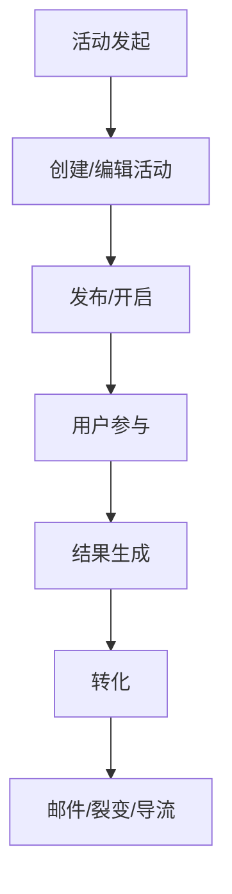
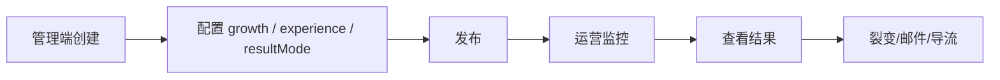

# 全链路活动流程与转化闭环

> 本文档基于当前代码逐环节核实（`src/services/lottery/`、`src/routes/public-lottery.ts`、`frontend/src/views/LotteryView.vue` 等），
> 是本批次「游戏壳展示闭环」（prize-shell-display、growth-config 壳配置、Wheel/Slot 停格、参与人数实时同步）的设计与实现说明。
> 代码中的 `docs/128` 引用均指向本文档。

## 一、链路总览

### 活动生命周期（公开侧）



### 运营闭环（管理侧）



两条链路在同一张 `lottery_draws` 表上闭环：管理端配置决定公开页的参与校验、游戏壳展示与结果生成方式；公开页的每一次参与、中奖、分享又反向喂给管理端的监控与转化。

### 全链路详细流程（参与 → 归因 → 奖励 → 开奖 → 邮件）

```mermaid
flowchart TD
    A[用户访问 /lottery/:slug] --> B[公开详情 API<br/>draw + tiers + entryCount]
    B --> C{participationMode?}
    C -- open --> D[邮箱验证或免验证]
    C -- password --> E[校验 accessPassword]
    C -- invite_code --> F[校验邀请码]
    C -- roster --> G[白名单校验<br/>lottery_roster_members]
    C -- registered --> G1[校验已登录<br/>identityType=user_id]

    D --> H["POST /join<br/>joinDraw() 事务<br/>写入 entry + initialSpinsForJoin"]
    E --> H
    F --> H
    G --> H
    G1 --> H

    H --> H1{shareCode 归因?}
    H1 -- 是 --> H2["recordAttributedJoin<br/>shareRecords.joinedCount +1<br/>activityEvents: attributed_join"]
    H2 --> H3[maybeTriggerReward]
    H3 --> H4{"[1] grantViralSpinsToSharer<br/>仅 resultMode=instant<br/>spinsLeft +N (CAS)"]
    H3 --> H5["[4] processReferralRewardsEngine<br/>referralRewardDefs<br/>incentive-engine 计算"]
    H1 -- 否 --> J

    H --> J{resultMode?}
    J -- instant --> K["performInstantSpin<br/>扣次 → 加权抽档 → CAS 占码<br/>→ INSERT spins/winners"]
    J -- scheduled --> L["状态 → drawing<br/>定时器触发 performDraw"]
    J -- manual --> M["管理端手动触发<br/>仅 drawing 态可执行"]

    K --> N{won=1 本 spin?}
    N -- 是 --> O["INSERT lottery_winners<br/>notificationStatus=pending"]
    N -- 否 --> P["返回未中结果"]

    O --> Q["异步: sendWinnerNotifications<br/>Resend 邮件"]
    Q --> Q1{邮件发送成功?}
    Q1 -- 是 --> Q2["notificationStatus=sent"]
    Q1 -- 否 --> Q3["notificationStatus=failed<br/>不回滚开奖结果"]

    L --> R["performDraw 生成结果<br/>按权重抽样 + 码池 CAS"]
    R --> S["drawn 状态 + winners 落库"]
    S --> R2["grantLeaderboardRewards<br/>排行榜奖励发放"]
    R2 --> Q

    P --> T["导流 CTA 展示<br/>after_win / after_loss / productLink"]
    O --> T

    T --> U{viral.enabled?}
    U -- 是 --> V["分享裂变<br/>shareCode → 邀请计数<br/>排行榜 + 里程碑奖励"]
    U -- 否 --> W["结束"]

    V --> W

    style H4 fill:#cce5ff,stroke:#004085
    style H5 fill:#cce5ff,stroke:#004085
    style K fill:#d4edda,stroke:#28a745
    style O fill:#d4edda,stroke:#28a745
    style R2 fill:#cce5ff,stroke:#004085
    style Q2 fill:#d4edda,stroke:#28a745
    style Q3 fill:#fff3cd,stroke:#ffc107
    style P fill:#f5f5f5,stroke:#999
```

> 图例：🟢 绿色 = 正常完成 | 🔵 蓝色 = 奖励/邮件 | 🟡 黄色 = 异常不回滚 | ⚪ 灰色 = 未中
> 注：旧路径 [2] processReferralMilestoneRewards 已收敛到 [4]（docs/255 P1-2）

## 二、核心状态机（lottery_draws.status）

`src/db/schema.ts` 定义 `status` 默认 `"draft"`，取值与流转：

```
draft → open（发布） → drawing（开奖中，scheduled 定时触发） → drawn（已开奖）
  │         │                │
  └───── paused（暂停）←─────┘
  │
  cancelled（取消，仅可删态）
```

- `public-lottery.ts:379`：公开参与仅接受 `open / paused / drawing / drawn`，其余状态（draft/cancelled）拒绝。
- `admin-lottery-draw-ops.ts:639`：开奖接口仅允许 `drawing` 状态进入结果生成（防重复开奖）。
- `draw-execution.ts` 的 `healDrawingState` 可把异常中断的 `drawing` 恢复，避免活动卡死（docs/078）。

## 三、三个独立维度（互相不可推导）

| 维度 | 字段 | 取值 | 描述 |
| --- | --- | --- | --- |
| 参与模式 | `participation_mode` | open / password / roster / invite_code / registered | 谁可以参加、如何验证 |
| 体验类型 | `experience_type` | submit / wheel / slot / scratch / card | 用户看到什么交互 |
| 结果模式 | `result_mode` | manual / scheduled / instant | 结果什么时候产生 |

三者独立配置，互不推导（AGENTS.md 核心数据模型）。本次壳展示策略（`promotion_config.experience`）与体验类型解耦：同一个 wheel 可以按结果模式切换「仪式短语」与「真奖名」两种壳文案。

## 四、参与链路（后端）

代码位置：`src/routes/public-lottery.ts` + `src/services/lottery/participation.ts`

1. **`/join` 四种模式校验**（public-lottery.ts，公开路由层）：
   - `open`：直接参与（邮箱验证按活动开关，docs/064）。
   - `password`：校验 `accessPassword`（哈希比对，`utils.ts:hashAccessPassword`）。
   - `invite_code`：校验邀请码。
   - `roster`：白名单校验（`lottery_roster_members` 表按邮箱匹配）；`registered` 要求已登录。
   - 邮箱验证关闭（bypass）时也要带上 accessPassword/inviteCode，否则 password/invite 模式永远失败（public-lottery.ts:355）。

2. **`joinDraw` 事务内写参与记录**（participation.ts:47）：
   - 事务内写 `lottery_entries`（participation 表）+ joined 记录，保证「归因 + 参与」原子性。
   - 归因：新用户带 `shareCode` 参与时，写入邀请关系（裂变闭环入口）。
   - 奖励意图：归因成功后 `triggerRewardEarned`（reward.ts）入队 webhook，失败不影响参与主流程（try/catch 包裹）。

3. **spinQuota 回填 spins**（spin-quota.ts）：
   - `initialSpinsForJoin`：加入即得初始次数（默认 1）。
   - `computeViralSpinGrant`：裂变邀请额外发放 spins（instant 加权模型，docs/108/122）。

4. **draw-execution 生成结果**：
   - `instant`：参与/转盘触发即时开奖（`notifyInstantSpinWinner`，按 prizeIndex 停扇）。
   - `scheduled`：定时器进入 `drawing` → `performDraw` 统一开奖。
   - `manual`：管理端手动触发（仅 `drawing` 态可执行）。

## 五、转化闭环（后端）

代码位置：`src/services/lottery/reward.ts`、`src/services/lottery/viral-weight.ts`、`src/services/email-service.ts`

### 1. 导流 CTA（promotion_config）

- `destination`：关联商品（productLink 导流，中奖/结果页展示跳转）。
- `after_win` / `after_loss`：中奖后 / 未中奖后 CTA（URL + 标题），把结果页转化为运营触点。

### 2. 裂变（viral）

- 配置在 `promotion_config.viral`：`enabled`、`extraEntriesPerInvite`、`maxExtraEntries`、`leaderboardEnabled`。
- instant 模式双写 `extraSpinsPerInvite` / `maxExtraSpins`（docs/122，与 runtime grant 对齐）。
- `viral-weight.ts:computeViralDrawWeight`：开奖时按邀请人数加权，邀请多的人中奖概率更高（公式审计见 docs/109）。
- 归因闭环：`shareCode` → joinDraw 归因 → `share_records` → 排行榜（docs/110 裂变身份恢复）。

### 3. 邮件（email-service.ts，Resend）

4 个真实模板（与代码一一对应）：

| 模板 | 主题 | 触发点 |
| --- | --- | --- |
| `email_access_code` | 您的抽奖验证码 | 参与时 OTP 验证码（6 位） |
| `lottery_winner` | 🎉 恭喜中奖！奖品卡密已发放 | 开奖结果生成（含卡密/订单号/履约信息） |
| `draw_reminder` | ⏰ 开奖提醒 | scheduled 开奖前提醒 |
| `loser_consolation` | 🎁 开奖结果 + 专属优惠 | 未中奖安慰（配合 loser reward 发券） |

铁律：**邮件失败不回滚开奖结果**（docs/076）——`sendWinnerNotifications` 失败只记日志/重试，`drawn` 状态与中奖记录已落库。

### 4. 裂变奖励意图（reward.ts）

`triggerRewardEarned`（docs/111 §5 阶段一）：归因成功后检查 `activityConfig.reward`，双配额校验（perUserPerDay 先、globalPerDay 后，原子 `checkDbRateLimit`）→ 记录 `reward_earned` 事件（唯一真相源）→ 入队 webhook 由中转站生成兑换码。失败静默跳过，不影响现有活动。

## 六、前端公开页

代码位置：`frontend/src/views/LotteryView.vue` + `frontend/src/views/lottery/`

### 1. 参与人数实时同步（docs/125 收口）

- 公开详情/查结果/参与/裂变等动态接口统一 `Cache-Control: no-store`。
- 前端请求显式 `cache: 'no-store'`；参与成功后先乐观 +1，再立即重拉公开详情以服务端权威计数覆盖；409 已参与同样重拉。
- 页面获得焦点/回到前台/网络恢复时静默刷新——不依赖 30 秒轮询作为首个同步机制。

### 2. shell 奖品面板（本次闭环核心，docs/128）

- 奖池条：`prizePoolStripFor(draw)`，按 `prizePoolDisplay`（full/summary/hidden）渲染「活动有什么奖」，诚实公示、不宣称「你已中」。
- 游戏壳扇面：`shellPrizesFor(draw)` 走 `buildPublicPrizeShellPayload`，delayed 默认仪式短语、instant 真奖名+图。
- 仪式壳提示：`showPrizeShellRitualHint` 仅对 lottery + 壳未用真奖 + wheel/slot/grid 交互时展示一行「扇面为氛围非中奖」，降低误读。
- 结果弹窗 + 查结果链接：中奖结果、卡密、订单号展示（docs/100/102/104）。
- `normalizePublicDraw` 显式保留 `prizePanelMode / shellLabels / shellUsesRealPrizes / prizePoolDisplay`，防下游漏传。

### 3. 游戏组件停格细节（docs/128）

- `WheelGame.vue`：空名用中性「·」，禁止硬编码「奖品」（与 i18n 语言解耦）；四字短语完整显示、6 字以上截断（中文扇面可读上限）。
- `SlotGame.vue`：spin 前无动画复位到 0 再完整滚动（避免上次停位导致行程过短）；结束时**停在整格不弹回 0**，避免「滚完又跳回」的廉价感（docs/128）。

## 七、管理端配置闭环

代码位置：`frontend/src/views/admin/AdminLotteryView.vue` + `frontend/src/views/admin/lottery/growth-config.ts`

### 1. growth-config 回填（防擦铁律）

- `growthFieldsFromDraw`：编辑时从 `promotion_config` 解析 productLink / viral / after_win / after_loss / **experience（壳）** 全部回填表单。
- `buildPromotionConfigPayload`：**编辑态始终写出 `experience` 块**（默认 `{ prizePanelMode: 'auto' }`），即使清空增长配置也不静默擦掉壳配置；仅创建态且无任何增长才返回 `undefined`。
- 二次保存场景测试锁定：`growth-config.test.ts` 新增「编辑态必须携带 experience 块」「自定义壳配置回填后二次保存不丢」用例。

### 2. 壳展示配置 UI（docs/128）

管理端新增「游戏壳奖品展示」section（仅 lottery）：

- `prizePanelMode` 五选一：
  - `auto`（推荐）：instant → `full_on_shell`；manual/scheduled → `shell_ritual_pool_full`
  - `full_on_shell`：扇面真奖名（适合即时开奖）
  - `shell_ritual_pool_full`：扇面仪式短语 + 奖池完整公示
  - `shell_ritual_pool_summary`：扇面仪式短语 + 奖池仅档位摘要
  - `ritual_only`：仅仪式（隐藏奖池条，强悬念）
- `ritualPhrasesText`：每行一条仪式短语；2～8 字为宜；禁止「中奖/一等奖」等词（保存前清洗）。
- 与 `experienceType` 解耦：同一转盘可换「壳文案策略」，不新增表列（配置落 `promotion_config.experience`）。

## 八、游戏壳展示算法（前后端双副本）

- `src/lib/prize-shell-display.ts`（服务端）：公开 API `/draws/:slug` 计算 `prizePanelMode / shellLabels / shellUsesRealPrizes / prizePoolDisplay`。
- `frontend/src/views/lottery/prize-shell-display.ts`（前端副本）：算法对齐，避免 C 端打包拉入服务端树；单测锁契约防漂移（vitest.config.ts 注册）。

关键不变量：

1. **体验壳 ≠ 结果机**（docs/115）：delayed 随机停格不得暗示「中了该奖」→ 壳用仪式短语。
2. **instant 必须能用真奖名/图对准 prizeIndex**（docs/116）→ 壳用真奖名。
   **红线降级**：`full_on_shell` 仅允许 instant；手动/定时/空 result_mode 下 `resolvePrizePanelMode` 强制降级为 `shell_ritual_pool_full`（防「真奖名+随机停格」假装中奖）。三层防线：公开端降级（前后端对称）+ 发布闸门 `promotion.experience.conflict` 阻断 + 管理端红色警告文案。
3. **仪式短语清洗**（`sanitizeRitualPhrases`）：去空白 → 截断 8 字 → 去重 → 拒收中奖语义词（`中奖/一等奖/…/恭喜获得`，防运营误配语义灾难）→ 上限 16 条。
4. **默认中性词**：8 条默认短语（好运连连/感谢参与/期待开奖/…），禁止默认成「中奖/一等奖」。前后端各一份副本，修改需同步。
5. **灾难防护（双向）**：
   - 方向一：非 full 模式却拿到与奖品名完全相同的 labels → 重建仪式短语（防御历史脏数据）。
   - 方向二（对称，前端独有）：`full_on_shell` 却拿到全是仪式短语的 labels → 重建为真奖名，防「仪式词 + 真奖图」错配（docs/115 语义红线）；用「全部不是奖名」判定，避免奖名真叫「好运连连」时误伤。
6. **索引对齐不变量**：`tierName` 保存时三级兜底（`奖项 N` → 公开 API `name || tierName`）恒非空 → `prizeNames` 无空洞 → `labels[i] ↔ prizes[i] ↔ spin.prizeIndex` 停扇严格对齐；禁止在 `buildShellLabels` 过滤空名后重新索引。
7. **奖池条与壳解耦**：默认可 full 公示目录（信任），不暗示「你已中」。
8. **配置落点**：`promotion_config.experience`（`prizePanelMode` + `ritualPhrases`），不新增表列；服务端保存整体 JSON 序列化无键白名单、发布闸门不校验 experience 键，消费方仅 prize-shell-display 读取，无兼容风险。

## 九、测试与验收

- `src/lib/prize-shell-display.test.ts`（服务端）：result_mode 判定、auto 分支、sanitize 清洗、instant 真奖上壳、delayed 不含奖品名、summary 档位摘要。
- `frontend/src/views/lottery/prize-shell-display.test.ts`（前端）：与后端契约对齐、优先服务端 shell 字段、服务端缺模式时本地重建、**full_on_shell 仪式 labels 对称防护重建**、奖名恰为默认词不误伤、delayed 壳无奖品图、JSON 字符串配置兜底。
- `frontend/src/views/admin/lottery/growth-config.test.ts`：编辑态防擦契约、`normalizePrizePanelMode` 非法回退、`sanitizeRitualPhrasesForSave` 清洗规则（本次补强）。
- `src/routes/p0-flow.test.ts`（API 层集成）：公开详情壳字段契约——delayed 返回 `shell_ritual_pool_full` 且 labels 不含奖名、instant 返回 `full_on_shell` 且 labels 含真奖名。
- 回归要求：`npx tsc --noEmit` 0 错误 + `npx vitest run` 全绿（AGENTS.md 铁律）。

验收标准映射：多租户隔离（公开 slug 不暴露内部 ID）、卡密不跨租户不重复发放、并发开奖不重复中奖、邮件失败不回滚开奖结果、公开链接用 public_slug。

## 十、已死磕 UX 清单（本批次）

| 项 | 内容 | 落点 |
| --- | --- | --- |
| a1 | 增长配置回填不擦 experience（壳配置二次保存不丢） | growth-config.ts + AdminLotteryView.handleEdit |
| a3 | Wheel/Slot 停格动画无复位（停整格不弹回） | SlotGame.vue / WheelGame.vue |
| a5 | 参与人数实时同步（no-store 双保险 + 焦点刷新） | public-lottery.ts + public-helpers（docs/125） |
| 新 | shell 奖品 UI 闭环（full/summary/ritual 三态） | prize-shell-display 前后端 + LotteryView.vue |
| 新 | 壳配置红线三层防线（delayed 禁真奖名降级/闸门阻断/管理端警告） | resolvePrizePanelMode 前后端 + publish-check + AdminLotteryView |
| 新 | 保存后回显清洗结果 + auto 动态分支说明 | AdminLotteryView（sanitize 同源回写） |

## 十一、壳策略作用边界（重要）

`prizePanelMode` 的**扇面策略只作用于有奖品扇面的体验**：

| 体验 | 互动内容 | 壳策略效果 |
| --- | --- | --- |
| wheel / slot | 奖品扇面 / 卷轴格 | **prizePanelMode 完全生效**（真奖名或仪式短语上壳） |
| scratch / card / grid | 固定氛围内容（刮开揭晓 / 翻牌 / ❓→✨翻转，不使用 prizes） | 扇面策略无效；**奖池条策略（prizePoolDisplay）仍生效** |

这是 docs/115 精神的另一种实现：scratch/card/grid 的互动内容天然是氛围，无需壳策略；
其「不暗示中奖」由固定文案（`gameScratchReveal`/`gameGridPickHint` 等）保证。
新增体验组件时注意：若新组件渲染 prizes，需评估是否纳入壳策略；否则保持固定氛围内容。
