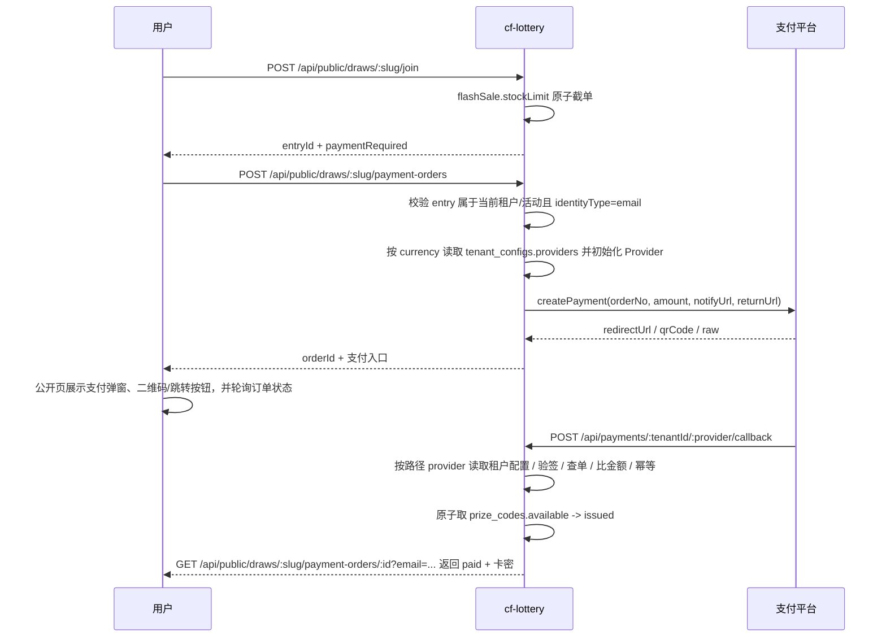

# 131 秒杀卡密多租户直付方案

> 日期：2026-08-07  
> 状态：P0 直付闭环已接入（`tenant_configs` 为正式落点；`@usethink/cf-core@0.4.17` 的 EasyPay/ZPay 已接入；L2 支付配置自检、订单列表、人工补发已接入；区块链支付暂不进入当前目录）
> 取代范围：只取代 docs/130 中“导流到 cf-shop 购买发卡”的承接方式；`paymentRequired=false` 的轻秒杀展示/导流壳仍可保留  
> 关联：docs/128 转化闭环、docs/130 秒杀体验壳历史方案、AGENTS.md 技术选型

## 0. 评审结论

决定在 cf-lottery 内接入支付是合理的，但边界必须收紧：本次只做 **秒杀卡密直付**，不是把 cf-shop 的商品、购物车、余额、分销、退款中心搬进来。

原 131 最大问题是提出了 `tenant_payment_configs`，但当前代码和迁移已经采用通用 `tenant_configs`。继续新增支付专表会造成租户配置入口割裂。修订后方案采用：

| 模块 | 正式落点 | 结论 |
| --- | --- | --- |
| 租户支付配置 | `tenant_configs.providers` JSON | 保留通用租户配置表，支付只是其中一个子域 |
| 支付订单 | `payment_orders` | 必须保留，承担订单状态、幂等、支付凭证与发卡关联 |
| 秒杀名额 | `lottery_entries` + `flashSale.stockLimit` | 沿用 docs/130 原子截单，不新增库存表 |
| 卡密发放 | `prize_codes` | 支付成功后从可用码池原子领取，状态写 `issued` |

## 1. 产品边界

### 做什么

1. 用户在公开活动页完成「抢名额 → 创建支付订单 → 支付 → 自动发卡」。
2. L2 租户管理员在自己的后台配置自己的收款渠道和凭据。
3. 支付 Provider 复用 `@usethink/cf-core/features/payment`。当前直付自动发卡渠道为易支付兼容协议（Provider 名称 `easypay`，ZPay 通过 `EASYPAY_API_BASE` 配置）、支付宝、Stripe；区块链支付暂时放弃，不进入当前 L2 配置、发布预检、公开下单链路。
4. 每个订单严格绑定 `tenantId + drawId + entryId`，一条参与记录最多一笔有效订单。

### 不做什么

1. 不做商品 SKU、购物车、余额、充值、分销返佣。
2. 不做平台代收再结算给租户；收款账户由租户自己配置。
3. 不复用 cf-shop 的订单域对象，不引入 cf-shop 代码依赖。
4. 不把支付成功写成中奖记录；直付秒杀是购买履约，不是抽奖开奖。

## 2. 当前代码事实

| 能力 | 现状 | 需要补齐 |
| --- | --- | --- |
| `tenant_configs` | `src/db/schema.ts` 和 `migrations/0031_payment_tables.sql` 已定义；`/api/admin/payment-config` 已可读写并审计；`/api/admin/payment-config/check` 已提供静态自检 | 后续迁移 cf-pay 时保持同一配置语义 |
| `payment_orders` | 已定义，`entry_id` 唯一；创建、重试、查询、回调发卡、`providerTradeNo` 下单落库、L2 订单列表、人工补发已接入 | 退款仍属后续项 |
| Provider catalog | `src/services/payment/catalog.ts` 为 UI、发布预检、下单和订单筛选共同来源；已接入 `easypay`、`alipay`、`stripe`；Stripe 币种按当前 cf-core Provider 对齐，不声明 CNY | 区块链支付后续单独设计 |
| 支付服务 | `src/services/payment/payment-service.ts` 已按 provider / currency 加载租户配置，回调按路径 provider 精确验签；已有 pending 订单可复用 orderNo 重新生成支付入口；`paid_fulfillment_failed` 可由管理端补发；公开下单要求 Provider 支持直付自动发卡 | 退款仍属后续项 |
| 秒杀体验壳 | docs/130 对应代码已落地；后台表单已可配置 `paymentRequired / priceCents / currency / title`，区分展示型秒杀与直付秒杀；公开端已接支付弹窗、跳转/二维码、状态轮询和卡密展示 | 暂不支持 registered 身份直付 |

## 3. 数据模型

### `tenant_configs`（通用租户配置）

不再新增 `tenant_payment_configs`。`tenant_configs` 是一租户一行的通用配置表，`providers` 字段承载支付渠道，未来可扩展风控、履约、通知等租户级配置。

```ts
export const tenantConfigs = sqliteTable("tenant_configs", {
  tenantId: text("tenant_id").primaryKey(),
  providers: text("providers").notNull().default("{}"),
  enabled: integer("enabled").notNull().default(0),
  createdAt: text("created_at").notNull().default(sql`(datetime('now'))`),
  updatedAt: text("updated_at").notNull().default(sql`(datetime('now'))`),
});
```

推荐 JSON 结构：

```json
{
  "stripe": {
    "enabled": true,
    "STRIPE_SECRET_KEY": "enc:...",
    "STRIPE_WEBHOOK_SECRET": "enc:..."
  },
  "easypay": {
    "enabled": true,
    "EASYPAY_PID": "1000",
    "EASYPAY_KEY": "enc:...",
    "EASYPAY_API_BASE": "https://zpayz.cn",
    "EASYPAY_PAY_TYPE": "alipay",
    "EASYPAY_ENABLED_PAY_TYPES": "alipay,wxpay,qqpay"
  },
  "alipay": {
    "enabled": false,
    "ALIPAY_APP_ID": "app_id",
    "ALIPAY_PRIVATE_KEY": "enc:...",
    "ALIPAY_PUBLIC_KEY": "enc:..."
  }
}
```

约束：

1. Provider 名称必须以 `src/services/payment/catalog.ts` 为唯一来源：当前为 `easypay`、`alipay`、`stripe`。ZPay 不是独立 Provider，只是易支付兼容网关实例，统一使用 `easypay` + `EASYPAY_API_BASE`。
2. 支付订单页的 provider 筛选必须来自后端返回的当前租户已启用渠道，禁止前端硬编码支付种类。
3. 配置字段名必须使用 catalog 中的 env key；禁止同一字段同时存在 camelCase、小写、别名三套写法。
4. 敏感字段必须用 `CREDENTIALS_ENCRYPTION_KEY` 加密后存储为 `enc:*`。
5. `tenant_configs.enabled=0` 时，订单创建必须 fail closed，不能回退到平台全局支付账号。

### `payment_orders`（支付订单）

```ts
export const paymentOrders = sqliteTable("payment_orders", {
  id: text("id").primaryKey(),
  tenantId: text("tenant_id").notNull(),
  drawId: text("draw_id").notNull(),
  entryId: text("entry_id").notNull().unique(),
  amountCents: integer("amount_cents").notNull(),
  currency: text("currency").notNull().default("cny"),
  status: text("status").notNull().default("pending"),
  provider: text("provider").notNull(),
  providerTradeNo: text("provider_trade_no"),
  prizeCodeId: text("prize_code_id"),
  paidAt: text("paid_at"),
  createdAt: text("created_at").notNull().default(sql`(datetime('now'))`),
  updatedAt: text("updated_at").notNull().default(sql`(datetime('now'))`),
});
```

订单状态机：

```text
pending -> paid       支付确认成功，并已完成或尝试完成发卡
pending -> expired    超时未支付，释放名额
pending -> cancelled  用户或后台取消（可选）
paid    -> refunded   退款完成（后续阶段）
```

`cancelled` / `expired` 不是终局失败，它们允许在同一 `entryId` 上重新发起支付，复用原订单号以保持一参与一订单的约束。

风险约束：

1. `entryId` 唯一只能防止同一参与重复下单，不能替代回调幂等；回调仍必须以 `payment_orders.id` 做状态判断。
2. `providerTradeNo` 建议增加唯一约束或至少在回调中按 `tenantId + provider + providerTradeNo` 做重复检测，防止平台重复流水串单。
3. `amountCents` 是 cf-core 的历史字段名，实际表示币种最小单位；当前业务目录只开放 CNY 与常规法币，区块链精度问题留到后续专项。

## 4. 价格来源

直付秒杀必须有确定价格，不能从奖品文案或卡密价值推导。

当前实现使用扁平字段，避免前后端同时维护嵌套 `price` 与旧字段：

```json
{
  "flashSale": {
    "enabled": true,
    "paymentRequired": true,
    "stockLimit": 100,
    "priceCents": 9900,
    "currency": "cny",
    "title": "秒杀卡密"
  }
}
```

规则：

1. `paymentRequired=true` 时，发布预检必须校验 `priceCents > 0`、`currency` 被启用 Provider 支持、存在且只存在一个卡密奖品、可用码数不少于 `stockLimit`。
2. 订单创建时重新从数据库读取活动价格，禁止相信前端传入金额。
3. 支付回调金额、币种必须与订单一致；不一致直接拒绝。
4. 公开端可展示价格文案，但后端只信任 `priceCents + currency`。
5. 当前直付订单查询和发卡授权以 `email` 校验身份；`registered` 模式在发布预检阶段阻断，避免已参与但无法下单。

## 5. 主流程



## 6. 支付确认策略

| Provider | 确认方式 | 要求 |
| --- | --- | --- |
| Stripe | webhook | 必须保留原始 JSON body 和 `Stripe-Signature` 验签，回调路径不能依赖用户登录态 |
| 易支付/ZPay | notify callback | Provider 名称统一为 `easypay`；必须验签，金额和币种二次校验 |
| 支付宝 | notify callback | 必须验签，金额和币种二次校验 |

区块链支付暂时放弃：当前 `PAYMENT_PROVIDER_CATALOG` 不包含 USDT/TRC20，活动编辑页不展示 USDT，发布预检和公开下单都不会把区块链配置视为可用渠道。后续如果重新启用，必须先补齐链上到账、合约地址、金额、确认数、订单 memo 的唯一匹配策略，再进入统一发卡流程。

## 7. 发卡与事务边界

支付成功后的核心写入必须在一个数据库事务内完成：

1. 读取订单并确认仍是 `pending`。
2. 根据 `tenantId + drawId` 找到当前活动绑定的 `code` 奖品。
3. 从 `prize_codes` 中原子领取一条 `available` 卡密，写为 `issued`，`winnerId=entryId`。
4. 更新 `payment_orders.status=paid`、`providerTradeNo`、`paidAt`、`prizeCodeId`。
5. 提交后再发邮件、投递 webhook、返回用户结果。

如果卡密不足，不能把订单静默标记为 paid 且 `prizeCodeId=null`。当前实现会写 `paid_fulfillment_failed`，并由发布预检提前阻断“码池少于名额”的配置。

## 8. 名额释放（已实现——P0 软释放）

直付秒杀如果"抢到名额但不支付"，会产生占位风险。**已实现软释放**：

1. 订单创建后 30 分钟仍为 `pending`，标记 `expired`；同步更新关联 `lottery_entries.payment_status='expired'`。
2. 公开详情 `total` 查询排除 `payment_status='expired'` 的 entry，`claimed` 不占名额。
3. 不删除 entry（保留审计链），已释放用户因 UNIQUE 约束不能重复参与同一活动。
4. 状态机：`join → (payment_status='')` → `createPaymentOrder → payment_status='pending'` → `回调 paid → payment_status='paid'` / `超时 expired → payment_status='expired'`。

**实现**：`src/services/payment/payment-service.ts`(expireOverdueOrders) + `src/routes/public-lottery.ts`(total 排除 expired) + `migrations/0032_add_payment_status.sql`。

## 9. 管理后台

新增 L2 后台「支付设置」页：

1. 只允许 `owner/admin` 写入，普通成员只读或不可见。
2. 从 `PAYMENT_PROVIDER_CATALOG` 渲染字段，避免前后端重复定义。
3. 保存时只回显非敏感字段和敏感字段占位，不返回密文明文。
4. 每次保存写租户审计日志，包含 provider、启用状态、字段摘要，不包含密钥。
5. 提供“配置自检”：密钥完整性、Provider 可用性、币种支持，不真实扣款。

新增 L2 后台「支付订单」页：

1. `GET /api/admin/payment-orders` 只返回当前租户订单，支持 `status/provider/drawId` 过滤和分页。
2. 订单列表展示活动、参与者、金额、渠道、状态、是否已发卡；不返回卡密明文和 secret。
3. 支付渠道筛选由后端返回当前租户已启用 Provider，前端不得硬编码 `alipay/stripe/easypay` 等选项。
4. `POST /api/admin/payment-orders/:id/retry-fulfillment` 仅允许 `owner/admin` 对 `paid_fulfillment_failed` 订单补发。
5. 补发必须在事务内原子领取一张可用卡密，并写租户审计 `tenant.payment_order.retry_fulfillment`。

活动编辑页「秒杀体验壳」已经增加直付字段：

1. `paymentRequired`：显式开启 cf-lottery 直付发卡；未开启时仍是 docs/130 展示/导流壳。
2. `priceCents`：支付金额最小单位，后端订单创建只信任该字段。
3. `currency`：必须被租户已启用 Provider 支持，发布预检会阻断错配。
4. `title`：订单描述，不参与金额计算。

## 10. API 边界

公开端：

| 方法 | 路径 | 说明 |
| --- | --- | --- |
| `POST` | `/api/public/draws/:slug/payment-orders` | 通过 `entryId` 创建订单；已有 pending 订单复用原 orderNo 重新生成支付入口；直付卡密只接受 `identityType=email` 的 entry |
| `GET` | `/api/public/draws/:slug/payment-orders/:id?email=...` | 查询订单状态；必须带 `email` 且与参与记录一致，paid 时返回授权后的卡密 |
| `POST` | `/api/payments/:tenantId/:provider/callback` | Provider 回调；不依赖登录态，只依赖签名和订单租户校验 |

公开下单响应必须始终返回 `orderNo/status/amountCents/currency/provider`，新建订单和复用 pending 订单不得出现字段形状分叉。回调验签异常必须 fail closed 返回失败，不能冒泡成 500；Provider 返回的币种大小写先归一后再与订单币种比较，避免 EasyPay 返回 `CNY` 而订单存 `cny` 时误判失败。

管理端：

| 方法 | 路径 | 说明 |
| --- | --- | --- |
| `GET` | `/api/admin/payment-config` | 读取当前租户支付配置摘要 |
| `PUT` | `/api/admin/payment-config` | 保存当前租户支付配置 |
| `GET` | `/api/admin/payment-config/check` | 静态自检当前租户支付配置；不发起真实支付 |
| `GET` | `/api/admin/payment-orders` | 查询当前租户订单；不返回卡密明文 |
| `POST` | `/api/admin/payment-orders/:id/retry-fulfillment` | owner/admin 人工补发 `paid_fulfillment_failed` 订单 |

## 11. 安全清单

| 风险 | 要求 |
| --- | --- |
| 凭据泄露 | 敏感字段加密存储；API 永不返回明文 |
| 跨租户串单 | 每个读写条件都带 `tenantId`；回调从订单反查租户后再加载配置 |
| 金额篡改 | 金额只从活动配置读；回调二次比对 |
| 币种错配 | 创建订单按 `currency` 选择 Provider；发布预检阻断“币种无已启用渠道” |
| 回调错配 | 回调路径里的 `provider` 必须等于订单 provider，再按该 provider 加载租户配置验签 |
| 重复回调 | paid 状态直接返回成功，不重复发卡 |
| 卡密泄露 | 查询订单卡密必须验证参与身份（当前实现要求 `email` 与 entry.identityValue 一致）；后台导出遵循现有码池权限 |
| 身份错配 | 直付秒杀当前只支持 email 身份；发布预检阻断 `registered` 模式，直到 cf-pay 支持 user_id 授权 |
| 区块链误发卡 | 当前目录不开放区块链支付；后续启用前必须查链上到账、合约地址、金额、确认数，不能只信前端截图 |
| 回调 URL 污染 | notifyUrl 使用服务端拼接的公开 base URL，不接收前端传入 |

## 12. 实施顺序

| 阶段 | 内容 | 门禁 |
| --- | --- | --- |
| P0 | 对齐 `tenant_configs.providers` schema、Provider 命名、字段映射、价格配置 | 单测覆盖配置加载和价格解析 |
| P0 | 订单创建路由、查询路由、回调路由 | 多租户隔离 + entry 唯一幂等测试 |
| P0 | 统一 `markPaidAndIssueCode` 事务函数 | 重复回调不重复发卡；卡密不足有显式失败 |
| P0 | 发布预检增加直付秒杀门禁 | 无支付配置/无价格/码池不足不能发布 |
| P0 | 公开端支付弹窗/跳转/二维码/轮询 | 支付成功能看到卡密，已参与未支付可回到支付单 |
| P1 | L2 支付配置 UI + 审计 + 自检 | 敏感字段不回显，owner/admin 权限测试 |
| P1 | L2 支付订单列表 + 人工补发 | 不泄露卡密明文；补发写审计；码池不足显式 409 |
| P1 | 区块链支付专项 | 不能走 webhook 假闭环；确认规则不充分前不进入当前 catalog |
| P2 | 退款、订单导出 | 退款不自动回收已泄露卡密，需单独策略 |

## 13. 当前 P0 审查发现

1. **HIGH：原文档数据模型错误。** 已采用 `tenant_configs`，不应再新增 `tenant_payment_configs`。
2. **HIGH：区块链支付不能混入当前闭环。** 当前暂不开放 USDT/TRC20，避免链上确认策略不充分造成误发卡。
3. **HIGH：回调 URL 不能混入 `/api/public`。** 当前实现已改为服务端固定拼 `/api/payments/:tenantId/:provider/callback`，并修正 Hono 子路由挂载。
4. **HIGH：创建和回调必须按 currency/provider 精确选路。** 当前实现已使用 cf-core `selectOnline(currency)`，回调按路径 provider 加载配置。
5. **HIGH：价格来源必须落在 `flashSale.priceCents`。** 订单金额不能由前端传入。
6. **HIGH：卡密不足路径不能静默 paid。** `payment_orders.prizeCodeId=null` 会造成“已付款未发卡”不可见事故；当前实现写 `paid_fulfillment_failed`。
7. **HIGH：直付秒杀必须限制 email 身份。** 订单查询需要 `email` 授权，当前已在发布预检中阻断 `registered` 模式。
8. **MEDIUM：易支付/ZPay 已通过 cf-core 接入。** `cf-lottery` 依赖 `@usethink/cf-core@0.4.17`，`easyPayFactory` 已从 `@usethink/cf-core/features/payment` 导出；业务侧只配置 `easypay`，禁止新增 `zpay` Provider。
9. **MEDIUM：Provider 配置字段必须以 catalog 为单一事实源。** 避免后台保存成功但服务读取失败。
10. **MEDIUM：管理端订单页不能暴露卡密明文。** 订单列表只显示是否已发卡和关联 ID；明文查看仍应走现有码池权限面。
11. **HIGH：未闭环 Provider 不能进入直付发卡。** 区块链支付已从当前 catalog 移除；后续只有查询确认策略闭环后才能重新进入。

## 14. 验收标准

1. `npx tsc --noEmit` 0 errors。
2. `npx vitest run` 全绿，新增支付单测覆盖配置加载、创建订单、回调幂等、发卡事务、金额不符、跨租户隔离。
3. `cd frontend && npx vue-tsc -b --pretty false` 0 errors。
4. 租户 A/B 各自配置支付，互不可见；回调用 A 的订单不能加载 B 的配置。
5. 秒杀抢到名额后创建订单，支付确认后卡密状态从 `available` 变 `issued`，同一订单重复确认不重复发卡。
6. 卡密不足、支付配置缺失、价格缺失、Provider 不支持币种时发布或下单阶段必须显式失败。
7. 区块链支付重新上线前必须有查询确认闭环，不使用 webhook 伪闭环；当前版本不进入支付目录、不自动发卡。
