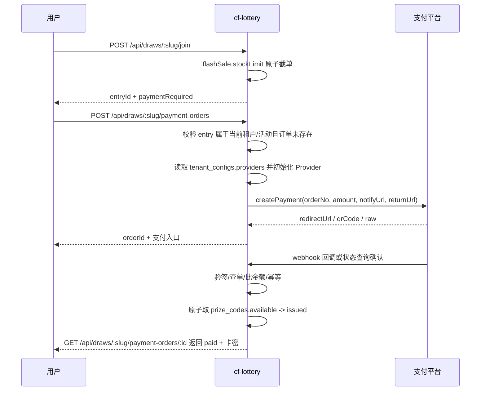

# 131 秒杀卡密多租户直付方案

> 日期：2026-08-07  
> 状态：方案评审后修订（以 `tenant_configs` 为正式落点；待继续实现与验证）  
> 取代：docs/130 的 cf-shop 导流购买闭环  
> 关联：docs/128 转化闭环、docs/130 秒杀体验壳历史方案、AGENTS.md 技术选型

## 0. 评审结论

决定在 cf-lottery 内接入支付是合理的，但边界必须收紧：本次只做 **秒杀卡密直付**，不是把 cf-shop 的商品、购物车、余额、分销、退款中心搬进来。

原 131 最大问题是提出了 `tenant_payment_configs`，但当前代码和迁移已经采用通用 `tenant_configs`。继续新增支付专表会造成租户配置入口割裂。修订后方案采用：

| 模块 | 正式落点 | 结论 |
| --- | --- | --- |
| 租户支付配置 | `tenant_configs.providers` JSON | 保留通用租户配置表，支付只是其中一个子域 |
| 支付订单 | `payment_orders` | 必须保留，承担订单状态、幂等、支付凭证与发卡关联 |
| 秒杀名额 | `lottery_entries` + `flashSale.stockLimit` | 沿用 docs/130 原子截单，不新增库存表 |
| 卡密发放 | `prize_codes` | 支付成功后从可用码池原子领取，状态写 `issued` |

## 1. 产品边界

### 做什么

1. 用户在公开活动页完成「抢名额 → 创建支付订单 → 支付 → 自动发卡」。
2. L2 租户管理员在自己的后台配置自己的收款渠道和凭据。
3. 支付 Provider 复用 `@usethink/cf-core/features/payment`，支持 Stripe、支付宝、USDT-TRC20。
4. 每个订单严格绑定 `tenantId + drawId + entryId`，一条参与记录最多一笔有效订单。

### 不做什么

1. 不做商品 SKU、购物车、余额、充值、分销返佣。
2. 不做平台代收再结算给租户；收款账户由租户自己配置。
3. 不复用 cf-shop 的订单域对象，不引入 cf-shop 代码依赖。
4. 不把支付成功写成中奖记录；直付秒杀是购买履约，不是抽奖开奖。

## 2. 当前代码事实

| 能力 | 现状 | 需要补齐 |
| --- | --- | --- |
| `tenant_configs` | `src/db/schema.ts` 和 `migrations/0031_payment_tables.sql` 已定义 | 后台 CRUD、字段校验、审计 |
| `payment_orders` | 已定义，`entry_id` 唯一 | 状态机细化、查询接口、超时任务 |
| Provider catalog | `src/services/payment/catalog.ts` 已有 Stripe/支付宝/USDT-TRC20 元数据 | catalog 字段与服务读取必须保持同一来源 |
| 支付服务 | `src/services/payment/payment-service.ts` 已有加载配置、创建订单、回调发卡雏形 | 路由接入、事务边界、TRC20 轮询、测试 |
| 秒杀体验壳 | docs/130 对应代码已落地 | 文案需从“导流购买”改为“直付发卡” |

## 3. 数据模型

### `tenant_configs`（通用租户配置）

不再新增 `tenant_payment_configs`。`tenant_configs` 是一租户一行的通用配置表，`providers` 字段承载支付渠道，未来可扩展风控、履约、通知等租户级配置。

```ts
export const tenantConfigs = sqliteTable("tenant_configs", {
  tenantId: text("tenant_id").primaryKey(),
  providers: text("providers").notNull().default("{}"),
  enabled: integer("enabled").notNull().default(0),
  createdAt: text("created_at").notNull().default(sql`(datetime('now'))`),
  updatedAt: text("updated_at").notNull().default(sql`(datetime('now'))`),
});
```

推荐 JSON 结构：

```json
{
  "stripe": {
    "enabled": true,
    "STRIPE_SECRET_KEY": "enc:...",
    "STRIPE_WEBHOOK_SECRET": "enc:..."
  },
  "alipay": {
    "enabled": false,
    "ALIPAY_APP_ID": "app_id",
    "ALIPAY_PRIVATE_KEY": "enc:...",
    "ALIPAY_PUBLIC_KEY": "enc:..."
  },
  "usdt_trc20": {
    "enabled": false,
    "TRC20_WALLET_ADDRESS": "T...",
    "TRONGRID_API_KEY": "enc:..."
  }
}
```

约束：

1. Provider 名称必须以 `src/services/payment/catalog.ts` 为唯一来源：`stripe`、`alipay`、`usdt_trc20`。
2. 配置字段名必须使用 catalog 中的 env key；禁止同一字段同时存在 camelCase、小写、别名三套写法。
3. 敏感字段必须用 `CREDENTIALS_ENCRYPTION_KEY` 加密后存储为 `enc:*`。
4. `tenant_configs.enabled=0` 时，订单创建必须 fail closed，不能回退到平台全局支付账号。

### `payment_orders`（支付订单）

```ts
export const paymentOrders = sqliteTable("payment_orders", {
  id: text("id").primaryKey(),
  tenantId: text("tenant_id").notNull(),
  drawId: text("draw_id").notNull(),
  entryId: text("entry_id").notNull().unique(),
  amountCents: integer("amount_cents").notNull(),
  currency: text("currency").notNull().default("cny"),
  status: text("status").notNull().default("pending"),
  provider: text("provider").notNull(),
  providerTradeNo: text("provider_trade_no"),
  prizeCodeId: text("prize_code_id"),
  paidAt: text("paid_at"),
  createdAt: text("created_at").notNull().default(sql`(datetime('now'))`),
  updatedAt: text("updated_at").notNull().default(sql`(datetime('now'))`),
});
```

订单状态机：

```text
pending -> paid       支付确认成功，并已完成或尝试完成发卡
pending -> expired    超时未支付，释放名额
pending -> cancelled  用户或后台取消（可选）
paid    -> refunded   退款完成（后续阶段）
```

风险约束：

1. `entryId` 唯一只能防止同一参与重复下单，不能替代回调幂等；回调仍必须以 `payment_orders.id` 做状态判断。
2. `providerTradeNo` 建议增加唯一约束或至少在回调中按 `tenantId + provider + providerTradeNo` 做重复检测，防止平台重复流水串单。
3. `amountCents` 是 cf-core 的历史字段名，实际表示币种最小单位。USDT 使用 6 位精度时不能按人民币“分”理解。

## 4. 价格来源

直付秒杀必须有确定价格，不能从奖品文案或卡密价值推导。

推荐在 `promotion_config.flashSale` 增加支付子字段：

```json
{
  "flashSale": {
    "enabled": true,
    "stockLimit": 100,
    "price": {
      "amountMinor": 9900,
      "currency": "cny",
      "label": "¥99.00"
    },
    "paymentRequired": true
  }
}
```

规则：

1. `paymentRequired=true` 时，发布预检必须校验 `price.amountMinor > 0`、`currency` 被启用 Provider 支持、存在卡密奖品且可用码数不少于 `stockLimit`。
2. 订单创建时重新从数据库读取活动价格，禁止相信前端传入金额。
3. 支付回调金额、币种必须与订单一致；不一致直接拒绝。
4. 公开端可展示 `label`，但后端只信任 `amountMinor + currency`。

## 5. 主流程



## 6. 支付确认策略

| Provider | 确认方式 | 要求 |
| --- | --- | --- |
| Stripe | webhook | 必须验签，回调路径不能依赖用户登录态 |
| 支付宝 | notify callback | 必须验签，金额和币种二次校验 |
| USDT-TRC20 | 轮询 `queryStatus` | TRC20 无官方 webhook，不能走 `verifyCallback` 主路径 |

TRC20 的特殊要求：

1. `provider.createPayment` 返回收款地址和待付金额后，订单保持 `pending`。
2. 前端轮询订单状态；后端定时或按查询触发 `provider.queryStatus`。
3. 达到确认条件后进入统一 `markPaidAndIssueCode` 流程。
4. 超时未确认进入 `expired`，并释放名额。

## 7. 发卡与事务边界

支付成功后的核心写入必须在一个数据库事务内完成：

1. 读取订单并确认仍是 `pending`。
2. 根据 `tenantId + drawId` 找到当前活动绑定的 `code` 奖品。
3. 从 `prize_codes` 中原子领取一条 `available` 卡密，写为 `issued`，`winnerId=entryId`。
4. 更新 `payment_orders.status=paid`、`providerTradeNo`、`paidAt`、`prizeCodeId`。
5. 提交后再发邮件、投递 webhook、返回用户结果。

如果卡密不足，不能把订单静默标记为 paid 且 `prizeCodeId=null`。建议状态扩展为 `paid_fulfillment_failed` 或写入补偿事件，运营后台必须可见。第一版更严格：发布预检确保可用码数覆盖 `stockLimit`，回调阶段卡密不足则阻断发卡并报警。

## 8. 名额释放（已实现——P0 软释放）

直付秒杀如果"抢到名额但不支付"，会产生占位风险。**已实现软释放**：

1. 订单创建后 30 分钟仍为 `pending`，标记 `expired`；同步更新关联 `lottery_entries.payment_status='expired'`。
2. 公开详情 `total` 查询排除 `payment_status='expired'` 的 entry，`claimed` 不占名额。
3. 不删除 entry（保留审计链），已释放用户因 UNIQUE 约束不能重复参与同一活动。
4. 状态机：`join → (payment_status='')` → `createPaymentOrder → payment_status='pending'` → `回调 paid → payment_status='paid'` / `超时 expired → payment_status='expired'`。

**实现**：`src/services/payment/payment-service.ts`(expireOverdueOrders) + `src/routes/public-lottery.ts`(total 排除 expired) + `migrations/0032_add_payment_status.sql`。

## 9. 管理后台

新增 L2 后台「支付设置」页：

1. 只允许 `owner/admin` 写入，普通成员只读或不可见。
2. 从 `PAYMENT_PROVIDER_CATALOG` 渲染字段，避免前后端重复定义。
3. 保存时只回显非敏感字段和敏感字段占位，不返回密文明文。
4. 每次保存写租户审计日志，包含 provider、启用状态、字段摘要，不包含密钥。
5. 提供“配置自检”：密钥完整性、Provider 可用性、币种支持，不真实扣款。

## 10. API 边界

公开端：

| 方法 | 路径 | 说明 |
| --- | --- | --- |
| `POST` | `/api/draws/:slug/payment-orders` | 通过 `entryId` 创建或返回已有 pending 订单 |
| `GET` | `/api/draws/:slug/payment-orders/:id` | 查询订单状态；paid 时返回脱敏/授权后的卡密 |
| `POST` | `/api/payments/:tenantId/:provider/callback` | Provider 回调；不依赖登录态，只依赖签名和订单租户校验 |

管理端：

| 方法 | 路径 | 说明 |
| --- | --- | --- |
| `GET` | `/api/admin/payment-config` | 读取当前租户支付配置摘要 |
| `PUT` | `/api/admin/payment-config` | 保存当前租户支付配置 |
| `GET` | `/api/admin/payment-orders` | 查询当前租户订单 |

## 11. 安全清单

| 风险 | 要求 |
| --- | --- |
| 凭据泄露 | 敏感字段加密存储；API 永不返回明文 |
| 跨租户串单 | 每个读写条件都带 `tenantId`；回调从订单反查租户后再加载配置 |
| 金额篡改 | 金额只从活动配置读；回调二次比对 |
| 重复回调 | paid 状态直接返回成功，不重复发卡 |
| 卡密泄露 | 查询订单卡密必须验证参与身份；后台导出遵循现有码池权限 |
| TRC20 假付款 | 必须查链上到账、合约地址、金额、确认数；不能只信前端截图 |
| 回调 URL 污染 | notifyUrl 使用服务端拼接的公开 base URL，不接收前端传入 |

## 12. 实施顺序

| 阶段 | 内容 | 门禁 |
| --- | --- | --- |
| P0 | 对齐 `tenant_configs.providers` schema、Provider 命名、字段映射、价格配置 | 单测覆盖配置加载和价格解析 |
| P0 | 订单创建路由、查询路由、回调路由 | 多租户隔离 + entry 唯一幂等测试 |
| P0 | 统一 `markPaidAndIssueCode` 事务函数 | 重复回调不重复发卡；卡密不足有显式失败 |
| P0 | 发布预检增加直付秒杀门禁 | 无支付配置/无价格/码池不足不能发布 |
| P1 | L2 支付配置 UI + 审计 | 敏感字段不回显，owner/admin 权限测试 |
| P1 | 公开端支付弹窗/跳转/轮询 | 支付成功能看到卡密，刷新后可恢复 |
| P1 | TRC20 轮询确认 | 不能走 webhook 假闭环 |
| P2 | 退款、人工补发、订单导出 | 退款不自动回收已泄露卡密，需单独策略 |

## 13. 当前 P0 审查发现

1. **HIGH：原文档数据模型错误。** 已采用 `tenant_configs`，不应再新增 `tenant_payment_configs`。
2. **HIGH：TRC20 不能走 webhook。** cf-core 的 TRC20 Provider 明确通过查询确认，131 必须单独设计轮询。
3. **HIGH：价格来源缺失。** 当前 `flashSale` 配置没有价格字段；订单金额不能由前端传入。
4. **HIGH：卡密不足路径不能静默 paid。** `payment_orders.prizeCodeId=null` 会造成“已付款未发卡”不可见事故。
5. **MEDIUM：名额释放策略未落表。** 只依赖 `lottery_entries` 计数会被未支付占位拖死。
6. **MEDIUM：Provider 配置字段必须以 catalog 为单一事实源。** 避免后台保存成功但服务读取失败。

## 14. 验收标准

1. `npx tsc --noEmit` 0 errors。
2. `npx vitest run` 全绿，新增支付单测覆盖配置加载、创建订单、回调幂等、发卡事务、金额不符、跨租户隔离。
3. `cd frontend && npx vue-tsc -b --pretty false` 0 errors。
4. 租户 A/B 各自配置支付，互不可见；回调用 A 的订单不能加载 B 的配置。
5. 秒杀抢到名额后创建订单，支付确认后卡密状态从 `available` 变 `issued`，同一订单重复确认不重复发卡。
6. 卡密不足、支付配置缺失、价格缺失、Provider 不支持币种时发布或下单阶段必须显式失败。
7. USDT-TRC20 通过查询确认闭环，不使用 webhook 伪闭环。
