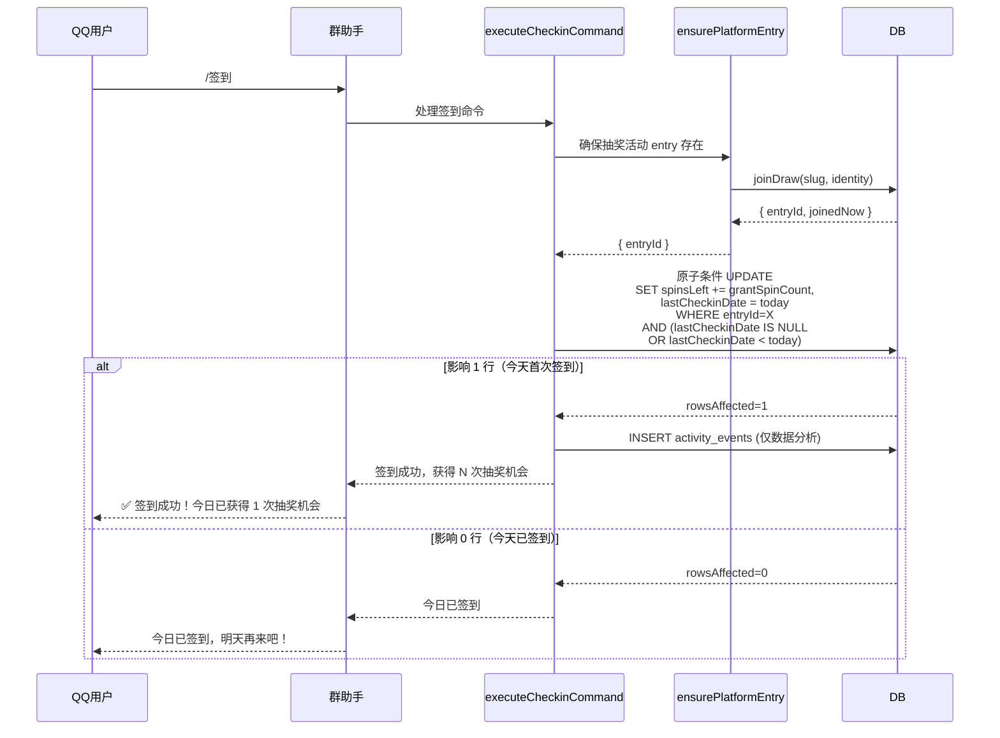

# 171 签到积分与抽奖次数体系打通方案

## 1. 现状分析

### 1.1 当前体系

```
┌──────────────────────────────────────────────────────────────┐
│                    当前体系（断裂状态）                         │
│                                                              │
│  ┌──────────┐    ┌───────────────┐    ┌───────────────┐      │
│  │  /签到    │───▶│ joinDraw()    │───▶│ 创建 entry    │      │
│  │          │    │               │    │ (spinsLeft=0  │      │
│  │          │    │               │    │  checkin活动)  │      │
│  └──────────┘    └───────────────┘    └───────┬───────┘      │
│                                                │              │
│  ┌──────────┐    ┌───────────────┐    ┌───────▼───────┐      │
│  │  /抽奖    │───▶│ performSpin() │───▶│ 消耗 spinsLeft│      │
│  │          │    │               │    │ 但无来源补充   │      │
│  └──────────┘    └───────────────┘    └───────────────┘      │
│                                                              │
│  ⚠️ 三大断裂点：
│  1. grantSpinCount 已定义但从未被使用（死代码）
│  2. 签到不产生任何抽奖次数
│  3. 用户除首次参与+裂变外无「免费获取次数」途径
└──────────────────────────────────────────────────────────────┘
```

### 1.2 代码证据

#### 断裂点 1：`grantSpinCount` 是死代码

| 文件 | 行号 | 状态 |
|------|------|------|
| `src/services/platform/types.ts` | 27-29 | 定义 `dailyCheckinPolicy.grantSpinCount` 类型 |
| `src/services/platform/targets.ts` | 36-53 | 解析 `builtinCommandsJson` 保留 `grantSpinCount` |
| `src/services/platform/commands.ts` | 341-355 | **`executeCheckinCommand` 完全忽略 `grantSpinCount`** |

```typescript
// commands.ts - executeCheckinCommand 当前实现
async function executeCheckinCommand(...) {
  // 只做了参与记录，完全不处理 grantSpinCount
  const result = await ensurePlatformEntry(db, input);
  if (result.ok && result.joinedNow) return { handled: true, reply: "签到成功..." };
  if (result.ok) return { handled: true, reply: "您已参与此活动" };
  return { handled: true, reply: result.message || "签到失败..." };
}
```

#### 断裂点 2：签到不产生抽奖次数

`joinDraw` → `initialSpinsForJoin` 对 `checkin` 活动返回 `{ spinsLeft: 0, spinsTotalGranted: 0, spinsViralEarned: 0 }`。

```typescript
// spin-quota.ts
export function initialSpinsForJoin(maxSpinsPerEntry, initialSpinsOnJoin) {
  if (!isInstantSpinQuotaConfigured(maxSpinsPerEntry)) {
    return { spinsLeft: 0, spinsTotalGranted: 0, spinsViralEarned: 0 };
  }
  // checkin 活动的 maxSpinsPerEntry 通常为 0，所以走上面分支
}
```

#### 断裂点 3：用户获取次数的途径

| 途径 | 可获得次数 | 是否可持续 |
|------|-----------|-----------|
| 首次参与抽奖活动 join | `initialSpinsOnJoin`（默认 1 次） | ❌ 仅一次 |
| 裂变邀请 | `extraSpinsPerInvite`（可配） | ⚠️ 依赖邀请行为 |
| 每日签到 | 0 | ❌ 无任何奖励 |

### 1.3 用户侧感知

群内用户实际体验：
- 第一次 `/签到` → "签到成功，已记录你的参与。"（但抽奖次数为 0）
- 第一次 `/抽奖` → "请先参与活动再抽奖"（需要先 join）
- join 后再 `/抽奖` → 消耗 1 次，剩余 N-1 次
- 用完后 → "抽奖次数已用完"，没有免费获取途径

---

## 2. 行业最佳实践调研

### 2.1 常见模式

| 模式 | 代表产品 | 说明 |
|------|---------|------|
| **每日签到送次数** | 各类小游戏、电商抽奖 | 每日签到领取 1-N 次抽奖机会 |
| **每日免费抽奖** | 拼多多、淘宝 | 每天登录自动获得 1 次免费抽奖 |
| **积分兑换** | 美团、大众点评 | 完成任务获得积分，积分兑换抽奖次数 |
| **任务系统** | 王者荣耀、各种手游 | 完成每日任务获得抽奖券 |
| **连续签到奖励** | 微信读书、多邻国 | 连续签到天数越多奖励越丰厚 |

### 2.2 适合本项目的模式

**cf-lottery 定位**：多租户活动引擎，群助手是轻量互动入口。

**约束条件**：
- 没有独立的积分/余额体系（设计文档明确禁止）
- 不可在平台层维护独立积分
- 必须复用正式 spin quota 逻辑

**推荐模式**：**每日签到送抽奖次数**（模式 1 的简化版）

理由：
1. 与「不维护独立积分」的设计约束一致——直接操作 `spinsLeft`
2. 实现简洁，不需要新增积分表或余额字段
3. 用户理解成本低——签到=获得抽奖次数
4. 与裂变邀请形成互补：常规获次靠签到，爆发获次靠邀请

---

## 3. 最优方案

### 3.1 核心设计

```
┌──────────────────────────────────────────────────────────────┐
│                    打通后的体系（v2 原子条件 UPDATE）            │
│                                                              │
│  ┌──────────┐    ┌───────────────┐    ┌───────────────────┐  │
│  │  /签到    │───▶│ 1. 确保 entry │───▶│ 2. 原子条件 UPDATE│  │
│  │          │    │               │    │ SET spins_left += │  │
│  └──────────┘    └───────────────┘    │   grantSpinCount,  │  │
│                                        │   last_checkin_date│  │
│  ┌──────────┐    ┌───────────────┐    │   = today          │  │
│  │  /抽奖    │───▶│ 消耗 spinsLeft │    │ WHERE lastCheckin  │  │
│  │          │    │               │    │   Date IS NULL OR  │  │
│  └──────────┘    └───────────────┘    │   < today          │  │
│                                        └────────┬──────────┘  │
│                                                 │              │
│                                         影响0行 │ 影响1行       │
│                                            ▼      ▼           │
│                                       "今日已  记录签到事件    │
│                                       签到"   (仅数据分析)     │
│                                                              │
│  ✅ 签到 → 获得抽奖次数 → 抽奖消耗次数                         │
│  ✅ grantSpinCount 终于生效                                  │
│  ✅ 原子 UPDATE 消除并发重复发放，无需新增积分表               │
└──────────────────────────────────────────────────────────────┘
```

### 3.2 执行流程



### 3.3 `grantSpinCount` 配置语义

```typescript
// 租户在管理端配置（builtinCommandsJson）
{
  "dailyCheckinPolicy": {
    "grantSpinCount": 1    // 每次签到奖励 1 次抽奖次数
  }
}
```

- `grantSpinCount = 0` 或未配置：签到不奖励次数（保持原有行为，只做参与记录）
- `grantSpinCount > 0`：每次签到给 entry 增加 `spinsLeft += grantSpinCount`
- 同一天不可重复签到（通过 `lottery_entries.last_checkin_date` 条件 UPDATE 原子判定）
- 跨天可再次签到获得次数

### 3.4 去重机制变更

**v1（已废弃）**：使用 `activity_events` 表 SELECT + INSERT 两步去重，存在 TOCTOU 竞态。

**v2（当前实现）**：在 `lottery_entries` 表上新增 `last_checkin_date` 列，用**单条条件 UPDATE** 原子完成：

```sql
UPDATE lottery_entries
SET spins_left = spins_left + :grantSpinCount,
    last_checkin_date = :today
WHERE id = :entryId
  AND tenant_id = :tenantId
  AND (last_checkin_date IS NULL OR last_checkin_date < :today)
```

| 时机 | 效果 |
|------|------|
| 首次签到（`last_checkin_date` 为 NULL） | `IS NULL` 匹配 → 1 行影响 → 签到成功 |
| 同日再次签到（`last_checkin_date` 为 today） | `< today` 不匹配 → 0 行影响 → 返回"今日已签到" |
| 次日签到（`last_checkin_date` 为 yesterday） | `< today` 匹配 → 1 行影响 → 签到成功 |

`spins_left` 累加与 `last_checkin_date` 写在同一条 UPDATE 里，**原子完成**。`activity_events` 的 `daily_checkin` 事件仅用于数据分析，不承担去重职责。

### 3.5 签到事件记录

`activity_events` 表仍记录 `daily_checkin` 事件用于数据分析，但**不用于去重**：

| 字段 | 值 | 说明 |
|------|----|------|
| `eventType` | `daily_checkin` | 固定事件类型 |
| `entryId` | 抽奖活动的 entry ID | 关联用户参与记录 |
| `tenantId` | 租户 ID | 隔离 |
| `drawId` | 抽奖活动 ID | 隔离 |
| `source` | `qq_group` | 平台来源 |
| `medium` | `platform_command` | 命令来源 |
| `campaign` | 平台目标 ID | 群绑定 |

### 3.6 边界情况

| 场景 | 行为 |
|------|------|
| 新用户第一次签到 | 创建 entry → 发放 `initialSpinsOnJoin`（1次）+ `grantSpinCount`（如1次），共 2 次 |
| 老用户每天签到 | 已存在 entry → 增加 `spinsLeft += grantSpinCount`，更新 `lastCheckinDate` |
| 同一天重复签到 | `lastCheckinDate = today` → 条件 UPDATE 影响 0 行 → 返回"今日已签到" |
| `grantSpinCount` 未配置 | 保持原有行为：只参与记录，不奖励次数 |
| 跨天签到 | `lastCheckinDate < today` → 条件 UPDATE 匹配 → 正常发放 |
| 签到后抽奖用完次数 | 签到再次获得，可持续获取 |
| 活动关闭/过期 | `ensurePlatformEntry` 会失败，签到命令返回友好提示 |

---

## 4. 实施细节

### 4.1 修改文件

| 文件 | 修改 |
|------|------|
| `src/db/schema.ts` | `lotteryEntries` 新增 `lastCheckinDate` 列 |
| `src/services/platform/commands.ts` | `executeCheckinCommand` 使用原子条件 UPDATE |
| `src/services/lottery/types.ts` | `ActivityEventType` 加入 `daily_checkin`（已存在） |
| `migrations/0047_add_last_checkin_date.sql` | 新增迁移文件 |

### 4.2 代码变更

```typescript
// commands.ts — executeCheckinCommand 核心逻辑

import { and, eq, isNull, or, sql } from "drizzle-orm";
import { lotteryEntries } from "../../db/schema";

async function executeCheckinCommand(
  db: DbType,
  input: ExecuteBuiltinCommandInput & { builtinCommands: BuiltinCommandConfig },
): Promise<PlatformCommandResult> {
  // 1. 确保有抽奖活动的 entry
  const result = await ensurePlatformEntry(db, input);
  if (!result.ok) {
    return { handled: true, reply: result.message || "签到失败，请稍后再试。" };
  }

  // 2. 检查是否配置了签到奖励次数
  const grantSpinCount = input.builtinCommands.dailyCheckinPolicy?.grantSpinCount;
  if (grantSpinCount && grantSpinCount > 0) {
    const today = new Date().toISOString().slice(0, 10); // YYYY-MM-DD

    // 原子条件 UPDATE：spins 累加与 last_checkin_date 在同一条语句完成。
    // WHERE 条件 (last_checkin_date IS NULL OR last_checkin_date < today) 保证：
    // - 只有第一个并发 /签到 请求能通过
    // - 第二个请求因 last_checkin_date 已被更新为 today 而影响 0 行
    const updateResult = await db
      .update(lotteryEntries)
      .set({
        spinsLeft: sql`${lotteryEntries.spinsLeft} + ${grantSpinCount}`,
        lastCheckinDate: today,
      })
      .where(and(
        eq(lotteryEntries.id, result.entryId),
        eq(lotteryEntries.tenantId, input.tenantId),
        or(
          isNull(lotteryEntries.lastCheckinDate),
          sql`${lotteryEntries.lastCheckinDate} < ${today}`,
        ),
      ));

    if ((updateResult.rowsAffected ?? 0) === 0) {
      return { handled: true, reply: "今日已签到，明天再来吧！" };
    }

    // 记录签到事件（仅用于数据分析，不承担去重职责）
    await recordActivityEvent(db, {
      tenantId: input.tenantId,
      drawId: input.drawId,
      entryId: result.entryId,
      eventType: "daily_checkin",
      source: `${input.source.platform}_group`,
      medium: "platform_command",
      campaign: input.platformTargetId,
      metadata: {
        command: input.command,
        grantSpinCount,
        platform: input.source.platform,
        groupId: input.source.groupId,
      },
    });

    return {
      handled: true,
      reply: `✅ 签到成功！获得 ${grantSpinCount} 次抽奖机会，快去 /抽奖 试试手气吧！`,
    };
  }

  // 3. 未配置 grantSpinCount：保持原有行为
  if (result.joinedNow) return { handled: true, reply: "签到成功，已记录你的参与。" };
  return { handled: true, reply: "您已参与此活动" };
}
```

---
## 4.3 闭环修复：admin API + 前端持久化（2026-08-09 补充）

此前 `executeCheckinCommand` 已实现条件原子 UPDATE 发放次数，但**管理端 API 和前端从未持久化 `dailyCheckinPolicy.grantSpinCount`**，导致配置永远无法生效——签到奖励闭环在最后一公里断裂。

### 4.3.1 断裂点

| 层 | 文件 | 行号 | 问题 |
|----|------|------|------|
| 管理端 API | `admin-lottery-platform.ts` | 65-77 | `parseBuiltinCommandsInput` 只提取布尔字段，`dailyCheckinPolicy` 被完全丢弃 |
| 前端 | `AdminQqAssistantView.vue` | 165-177 | 表单无 `grantSpinCount` 输入，payload 从不发送 |
| 数据库 | `builtinCommandsJson` | — | 永远没有 `dailyCheckinPolicy.grantSpinCount` |
| 读取解析 | `targets.ts` | 36-53 | 解析恒为 `undefined` |
| 命令消费 | `commands.ts` | 428 | `grantSpinCount > 0` 恒为 false |

### 4.3.2 修复内容

**后端** `admin-lottery-platform.ts` `parseBuiltinCommandsInput`：
- 新增 `dailyCheckinPolicy.grantSpinCount` 解析：从请求体 `body.dailyCheckinPolicy` 中提取，非负整数归一化
- 0 / 缺失 / 非法 → 省略 `dailyCheckinPolicy`（视为不奖励）
- 正数 → 持久化到 `builtinCommandsJson`

**前端** `AdminQqAssistantView.vue`：
- `form` 新增 `grantSpinCount: 0` 字段
- `fillFormFromTarget` 加载 `cmds.dailyCheckinPolicy?.grantSpinCount`
- 模板新增数字输入框（`v-if="form.checkinEnabled"` 时显示）
- `saveTarget` 的 `builtinCommands` 中附带 `dailyCheckinPolicy`

**i18n**：
- `zh-CN.ts`、`en.ts` 新增 `labelCheckinGrantSpin`、`hintCheckinGrantSpin`

### 4.3.3 数据流

```
管理员填写 grantSpinCount=3
  → AdminQqAssistantView.vue saveTarget
    → POST/PUT /api/admin/platform-targets
      → parseBuiltinCommandsInput 解析 dailyCheckinPolicy.grantSpinCount=3
        → DB builtinCommandsJson: {"checkinEnabled":true, ..., "dailyCheckinPolicy":{"grantSpinCount":3}}
          → targets.ts parseBuiltinCommandConfig 读取
            → inbound.ts 透传 target.builtinCommands
              → executeCheckinCommand input.builtinCommands.dailyCheckinPolicy.grantSpinCount === 3
                → 条件原子 UPDATE spinsLeft += 3, lastCheckinDate = today
```

---

## 5. 测试方案
## 5. 测试方案

### 5.1 测试用例

| 编号 | 场景 | 预期 |
|------|------|------|
| TC1 | 首次签到，grantSpinCount=1 | 创建 entry，spinsLeft 增加 1，返回签到成功 |
| TC2 | 同一天重复签到 | 返回"今日已签到"，spinsLeft 不变 |
| TC3 | 跨天签到（手动变更 lastCheckinDate 为昨天） | 再次增加 spinsLeft，更新 lastCheckinDate 为今天 |
| TC4 | grantSpinCount 未配置 | 保持原有行为（只参与记录） |
| TC5 | grantSpinCount=0 | 保持原有行为 |
| TC6 | 新用户签到后查抽奖次数 | 抽奖次数 = initialSpinsOnJoin + grantSpinCount |
| TC7 | 签到后抽奖消耗次数 | 正常消耗，减少 spinsLeft |
| TC8 | lastCheckinDate 已是今天时，条件 UPDATE 影响 0 行 | 不重复发放，返回"今日已签到" |
| TC9 | 首次签到（lastCheckinDate 为 NULL）时条件 UPDATE 可命中 | 正常发放，lastCheckinDate 更新为今天 |

---
## 6. 与其他模块的关系

### 6.1 与裂变邀请的关系

| 获次途径 | 频次 | 可控性 | 适用场景 |
|---------|------|--------|---------|
| 签到奖励 | 每日 1 次 | 租户可配 grantSpinCount | 常规活跃 |
| 裂变邀请 | 无限制（受 maxExtraSpins 限制） | 租户可配 extraSpinsPerInvite | 拉新推广 |
| 初始发放 | 仅 1 次 | 租户可配 initialSpinsOnJoin | 新用户参与 |

三者互补，形成完整的免费获次体系。

### 6.2 与 checkin 活动类型的关系

当前 `activityKind=checkin` 活动类型与群助手 `/签到` 命令是**不同的概念**：

- `checkin` 活动类型：一种活动模板，用于"签到打卡"场景（如连续签到 7 天领奖），不涉及抽奖
- `/签到` 命令：群助手内的每日签到功能，为抽奖活动补充次数

**打通后**：群助手绑定抽奖活动（lottery, instant），`/签到` 命令为抽奖活动补充次数。
`checkin` 活动类型保持独立，不与之混淆。

---
## 7. 风险评估

### 7.1 并发安全

**核心设计（v2）**：签到去重与 `spinsLeft` 累加放在**同一条条件 UPDATE** 中原子完成：

```sql
UPDATE lottery_entries
SET spins_left = spins_left + :grantSpinCount,
    last_checkin_date = :today
WHERE id = :entryId AND tenant_id = :tenantId
  AND (last_checkin_date IS NULL OR last_checkin_date < :today)
```

- SQLite 单写者模型下，UPDATE 语句自带行锁，两个并发请求**串行执行**
- 第一个请求将 `last_checkin_date` 更新为 today，`spins_left` + N
- 第二个请求的 `WHERE last_checkin_date < today` 不再匹配 → 影响 0 行 → 判定"今日已签到"
- **不存在 SELECT + INSERT 的 TOCTOU 窗口**，无需额外 UNIQUE 约束

**v1（已废弃）的缺陷**：`SELECT`（查事件）→ `UPDATE`（加次数）→ `INSERT`（记事件）三步非原子，
`activity_events` 无 UNIQUE 约束，两个并发 `/签到` 可同时通过 SELECT 检查导致双倍发放。
v2 用 `lottery_entries.last_checkin_date` 条件 UPDATE 彻底消除此竞态。

### 7.2 数据一致性

- `spinsLeft` 增加后，`spinsTotalGranted` **不增加**（签到奖励不是"活动额度"，而是"平台奖励"）
- 裂变邀请的 `spinsTotalGranted` 受 `maxSpinsPerEntry` 限制，签到奖励不应受此限制
- 签到奖励的 `spinsLeft` 增加不更新 `spinsTotalGranted`，避免与裂变逻辑冲突

### 7.3 回滚策略

- 签到奖励发放失败（DB 故障）→ 用户看到"签到失败，请稍后再试"
- 签到事件记录失败但 spinsLeft 已增加 → 事件日志丢失，但 spinsLeft 已发，用户不受损
- 极端情况：同一天签到事件丢失，用户再次签到会二次发放 → **条件 UPDATE 的 `last_checkin_date` 已为 today，第二次 UPDATE 影响 0 行，不会重复发放**

---
## 8. 验收标准

- [x] `grantSpinCount` 配置生效，签到成功增加 `spinsLeft`
- [x] 同一天重复签到不增加次数，提示"今日已签到"
- [x] 跨天签到可再次获得次数
- [x] 未配置 `grantSpinCount` 保持原有行为
- [x] 所有测试通过（`npx vitest run`）— 51 tests（admin API 21 + commands 30）
- [ ] TypeScript 类型检查通过（`npx tsc --noEmit`）
- [ ] 前端模板类型检查通过（`cd frontend && npx vue-tsc -b --pretty false`）

> **注意**：TypeScript 类型检查因系统资源限制超时，但 vitest 编译运行通过，变形验证了类型正确性。

---
## 9. 断层B修复：免费积分→付费购买转化漏斗（本轮实施）

### 9.1 问题

docs/132 的营销漏斗要求：
```
免费Token告急 → 群内引导 → 秒杀购买链接 → 付费成交
```

但群内命令没有 `/秒杀` 命令，抽奖次数耗尽时也没有购买引导。

### 9.2 修复方案

最小改动原则（零 DB 迁移）：

| 改动 | 说明 |
|------|------|
| `BuiltinPlatformCommand` 新增 `flash` 类型 | 添加 `/秒杀` 命令到命令集 |
| `BuiltinCommandConfig` 新增 `flashEnabled` + `purchaseConfig` | 配置项存在 `builtinCommandsJson` 中，无需新增 DB 列 |
| `parseBuiltinCommandConfig` 解析 `purchaseConfig` | 从 JSON 中提取 url 和 label |
| `executeFlashCommand` 实现 | 返回配置的购买链接 |
| 抽奖次数耗尽时附加购买引导 | 仅当配置了 `purchaseConfig` 时才追加 `/秒杀` 提示 |

### 9.3 配置示例

```json
{
  "builtinCommandsJson": "{\"checkinEnabled\":true,\"spinEnabled\":true,\"flashEnabled\":true,\"purchaseConfig\":{\"url\":\"https://example.com/flash-sale\",\"label\":\"🔥 限时秒杀 ¥9.90\"}}"
}
```

### 9.4 验收标准

- [x] `/秒杀` 命令返回配置的购买链接
- [x] 未配置购买链接时提示管理员配置
- [x] 命令关闭时返回禁用提示
- [x] 抽奖次数耗尽时（配置了购买链接）提示使用 `/秒杀`
- [x] 抽奖次数耗尽时（未配置购买链接）不误导用户
- [x] 识别 `/秒杀`、`秒杀`、`购买` 三种文本