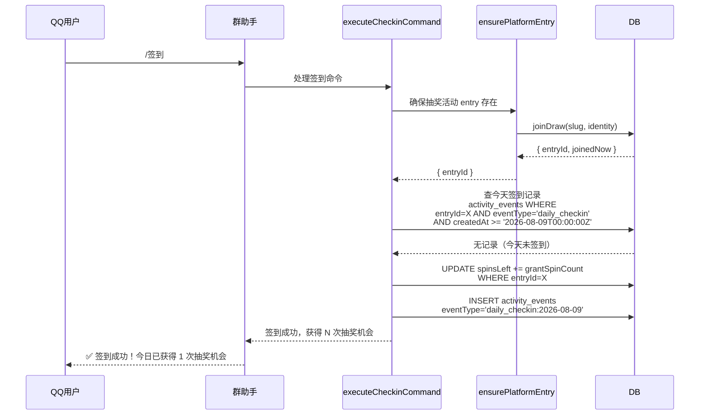

# 171 签到积分与抽奖次数体系打通方案

## 1. 现状分析

### 1.1 当前体系

```
┌──────────────────────────────────────────────────────────────┐
│                    当前体系（断裂状态）                         │
│                                                              │
│  ┌──────────┐    ┌───────────────┐    ┌───────────────┐      │
│  │  /签到    │───▶│ joinDraw()    │───▶│ 创建 entry    │      │
│  │          │    │               │    │ (spinsLeft=0  │      │
│  │          │    │               │    │  checkin活动)  │      │
│  └──────────┘    └───────────────┘    └───────┬───────┘      │
│                                                │              │
│  ┌──────────┐    ┌───────────────┐    ┌───────▼───────┐      │
│  │  /抽奖    │───▶│ performSpin() │───▶│ 消耗 spinsLeft│      │
│  │          │    │               │    │ 但无来源补充   │      │
│  └──────────┘    └───────────────┘    └───────────────┘      │
│                                                              │
│  ⚠️ 三大断裂点：
│  1. grantSpinCount 已定义但从未被使用（死代码）
│  2. 签到不产生任何抽奖次数
│  3. 用户除首次参与+裂变外无「免费获取次数」途径
└──────────────────────────────────────────────────────────────┘
```

### 1.2 代码证据

#### 断裂点 1：`grantSpinCount` 是死代码

| 文件 | 行号 | 状态 |
|------|------|------|
| `src/services/platform/types.ts` | 27-29 | 定义 `dailyCheckinPolicy.grantSpinCount` 类型 |
| `src/services/platform/targets.ts` | 36-53 | 解析 `builtinCommandsJson` 保留 `grantSpinCount` |
| `src/services/platform/commands.ts` | 341-355 | **`executeCheckinCommand` 完全忽略 `grantSpinCount`** |

```typescript
// commands.ts - executeCheckinCommand 当前实现
async function executeCheckinCommand(...) {
  // 只做了参与记录，完全不处理 grantSpinCount
  const result = await ensurePlatformEntry(db, input);
  if (result.ok && result.joinedNow) return { handled: true, reply: "签到成功..." };
  if (result.ok) return { handled: true, reply: "您已参与此活动" };
  return { handled: true, reply: result.message || "签到失败..." };
}
```

#### 断裂点 2：签到不产生抽奖次数

`joinDraw` → `initialSpinsForJoin` 对 `checkin` 活动返回 `{ spinsLeft: 0, spinsTotalGranted: 0, spinsViralEarned: 0 }`。

```typescript
// spin-quota.ts
export function initialSpinsForJoin(maxSpinsPerEntry, initialSpinsOnJoin) {
  if (!isInstantSpinQuotaConfigured(maxSpinsPerEntry)) {
    return { spinsLeft: 0, spinsTotalGranted: 0, spinsViralEarned: 0 };
  }
  // checkin 活动的 maxSpinsPerEntry 通常为 0，所以走上面分支
}
```

#### 断裂点 3：用户获取次数的途径

| 途径 | 可获得次数 | 是否可持续 |
|------|-----------|-----------|
| 首次参与抽奖活动 join | `initialSpinsOnJoin`（默认 1 次） | ❌ 仅一次 |
| 裂变邀请 | `extraSpinsPerInvite`（可配） | ⚠️ 依赖邀请行为 |
| 每日签到 | 0 | ❌ 无任何奖励 |

### 1.3 用户侧感知

群内用户实际体验：
- 第一次 `/签到` → "签到成功，已记录你的参与。"（但抽奖次数为 0）
- 第一次 `/抽奖` → "请先参与活动再抽奖"（需要先 join）
- join 后再 `/抽奖` → 消耗 1 次，剩余 N-1 次
- 用完后 → "抽奖次数已用完"，没有免费获取途径

---

## 2. 行业最佳实践调研

### 2.1 常见模式

| 模式 | 代表产品 | 说明 |
|------|---------|------|
| **每日签到送次数** | 各类小游戏、电商抽奖 | 每日签到领取 1-N 次抽奖机会 |
| **每日免费抽奖** | 拼多多、淘宝 | 每天登录自动获得 1 次免费抽奖 |
| **积分兑换** | 美团、大众点评 | 完成任务获得积分，积分兑换抽奖次数 |
| **任务系统** | 王者荣耀、各种手游 | 完成每日任务获得抽奖券 |
| **连续签到奖励** | 微信读书、多邻国 | 连续签到天数越多奖励越丰厚 |

### 2.2 适合本项目的模式

**cf-lottery 定位**：多租户活动引擎，群助手是轻量互动入口。

**约束条件**：
- 没有独立的积分/余额体系（设计文档明确禁止）
- 不可在平台层维护独立积分
- 必须复用正式 spin quota 逻辑

**推荐模式**：**每日签到送抽奖次数**（模式 1 的简化版）

理由：
1. 与「不维护独立积分」的设计约束一致——直接操作 `spinsLeft`
2. 实现简洁，不需要新增积分表或余额字段
3. 用户理解成本低——签到=获得抽奖次数
4. 与裂变邀请形成互补：常规获次靠签到，爆发获次靠邀请

---

## 3. 最优方案

### 3.1 核心设计

```
┌──────────────────────────────────────────────────────────────┐
│                    打通后的体系                                  │
│                                                              │
│  ┌──────────┐    ┌───────────────┐    ┌───────────────┐      │
│  │  /签到    │───▶│ 1. 确保entry  │───▶│ 2. 查今日签到 │      │
│  │          │    │ 2. 查签到记录  │    │ 记录是否已存在│      │
│  └──────────┘    └───────┬───────┘    └───────┬───────┘      │
│                          │                     │              │
│                          ▼                     ▼              │
│  ┌──────────┐    ┌───────────────┐    ┌───────────────┐      │
│  │  /抽奖    │───▶│ 消耗 spinsLeft│    │ 3. 增加 spins │      │
│  │          │    │               │    │ Left += grant  │      │
│  └──────────┘    └───────────────┘    └───────┬───────┘      │
│                                                │              │
│                                                ▼              │
│                                          ┌───────────────┐  │
│                                          │ 4. 记录签到事件│  │
│                                          │ (防止重复发放)  │  │
│                                          └───────────────┘  │
│                                                              │
│  ✅ 签到 → 获得抽奖次数 → 抽奖消耗次数                         │
│  ✅ grantSpinCount 终于生效                                  │
│  ✅ 无需新增积分表，不违背设计约束                            │
└──────────────────────────────────────────────────────────────┘
```

### 3.2 执行流程



### 3.3 `grantSpinCount` 配置语义

```typescript
// 租户在管理端配置（builtinCommandsJson）
{
  "dailyCheckinPolicy": {
    "grantSpinCount": 1    // 每次签到奖励 1 次抽奖次数
  }
}
```

- `grantSpinCount = 0` 或未配置：签到不奖励次数（保持原有行为，只做参与记录）
- `grantSpinCount > 0`：每次签到给 entry 增加 `spinsLeft += grantSpinCount`
- 同一天不可重复签到（通过 `activity_events` 防止重复发放）
- 跨天可再次签到获得次数

### 3.4 签到记录表选择

使用 `activity_events` 表记录签到事件，不新增表：

| 字段 | 值 | 说明 |
|------|----|------|
| `eventType` | `daily_checkin` | 固定事件类型，日期通过 `createdAt` 筛选 |
| `entryId` | 抽奖活动的 entry ID | 关联用户参与记录 |
| `tenantId` | 租户 ID | 隔离 |
| `drawId` | 抽奖活动 ID | 隔离 |
| `source` | `qq_group` | 平台来源 |
| `medium` | `platform_command` | 命令来源 |
| `campaign` | 平台目标 ID | 群绑定 |

**查询防重复**：`SELECT id FROM activity_events WHERE tenantId=X AND drawId=Y AND entryId=Z AND eventType='daily_checkin' AND createdAt >= '2026-08-09T00:00:00.000Z'`

**eventType 设计**：固定 `daily_checkin` + `createdAt` 日期范围查询，而非日期后缀。原因：
- `recordActivityEvent` 要求 `eventType` 必须是 `ACTIVITY_EVENT_TYPES` 集合中的固定值
- 日期后缀会导致 eventType 动态变化，无法通过类型校验

**优点**：
- 不新增表，减少迁移
- 事件表天然是审计日志，保留签到历史
- 利用现有索引 `idx_activity_events_entry`（tenantId, drawId, entryId, createdAt）

### 3.5 边界情况

| 场景 | 行为 |
|------|------|
| 新用户第一次签到 | 创建 entry → 发放 `initialSpinsOnJoin`（1次）+ `grantSpinCount`（如1次），共 2 次 |
| 老用户每天签到 | 已存在 entry → 增加 `spinsLeft += grantSpinCount`，记录签到事件 |
| 同一天重复签到 | 查到今天的签到记录 → 返回"今日已签到，明天再来吧" |
| `grantSpinCount` 未配置 | 保持原有行为：只参与记录，不奖励次数 |
| 跨天签到 | 查不到今天的签到记录 → 正常发放 |
| 签到后抽奖用完次数 | 签到再次获得，可持续获取 |
| 活动关闭/过期 | `ensurePlatformEntry` 会失败，签到命令返回友好提示 |

---

## 4. 实施细节

### 4.1 修改文件

| 文件 | 修改 |
|------|------|
| `src/services/platform/commands.ts` | `executeCheckinCommand` 增加 `grantSpinCount` 处理逻辑 |

### 4.2 代码变更

需要新增 import：`activityEvents`（schema）、`sql`（drizzle-orm）。

```typescript
// commands.ts 新增核心逻辑

async function executeCheckinCommand(
  db: DbType,
  input: ExecuteBuiltinCommandInput & { builtinCommands: BuiltinCommandConfig },
): Promise<PlatformCommandResult> {
  // 1. 确保有抽奖活动的 entry
  const result = await ensurePlatformEntry(db, input);
  if (!result.ok) {
    return { handled: true, reply: result.message || "签到失败，请稍后再试。" };
  }

  // 2. 检查是否配置了签到奖励次数
  const grantSpinCount = input.builtinCommands.dailyCheckinPolicy?.grantSpinCount;
  if (grantSpinCount && grantSpinCount > 0) {
    // 使用固定 eventType=daily_checkin，通过 createdAt 日期范围判断是否今日已签到
    const today = new Date().toISOString().slice(0, 10); // YYYY-MM-DD
    const todayStartIso = `${today}T00:00:00.000Z`;
    const eventType = "daily_checkin";

    const [existing] = await db
      .select({ id: activityEvents.id })
      .from(activityEvents)
      .where(and(
        eq(activityEvents.tenantId, input.tenantId),
        eq(activityEvents.drawId, input.drawId),
        eq(activityEvents.entryId, result.entryId),
        eq(activityEvents.eventType, eventType),
        // createdAt 存储为 ISO 字符串，用字符串比较等效于时间比较
        sql`${activityEvents.createdAt} >= ${todayStartIso}`,
      ))
      .limit(1);

    if (existing) {
      return { handled: true, reply: "今日已签到，明天再来吧！" };
    }

    // 增加抽奖次数（原子 UPDATE，SQLite 行锁保证并发安全）
    await db
      .update(lotteryEntries)
      .set({ spinsLeft: sql`${lotteryEntries.spinsLeft} + ${grantSpinCount}` })
      .where(and(
        eq(lotteryEntries.id, result.entryId),
        eq(lotteryEntries.tenantId, input.tenantId),
      ));

    // 记录签到事件
    await recordActivityEvent(db, {
      tenantId: input.tenantId,
      drawId: input.drawId,
      entryId: result.entryId,
      eventType,
      source: `${input.source.platform}_group`,
      medium: "platform_command",
      campaign: input.platformTargetId,
      metadata: {
        command: input.command,
        grantSpinCount,
        platform: input.source.platform,
        groupId: input.source.groupId,
      },
    });

    return {
      handled: true,
      reply: `✅ 签到成功！获得 ${grantSpinCount} 次抽奖机会，快去 /抽奖 试试手气吧！`,
    };
  }

  // 3. 未配置 grantSpinCount：保持原有行为
  if (result.joinedNow) return { handled: true, reply: "签到成功，已记录你的参与。" };
  return { handled: true, reply: "您已参与此活动" };
}
```

---
## 5. 测试方案

### 5.1 测试用例

| 编号 | 场景 | 预期 |
|------|------|------|
| TC1 | 首次签到，grantSpinCount=1 | 创建 entry，spinsLeft 增加 1，返回签到成功 |
| TC2 | 同一天重复签到 | 返回"今日已签到" |
| TC3 | 跨天签到 | 再次增加 spinsLeft |
| TC4 | grantSpinCount 未配置 | 保持原有行为（只参与记录） |
| TC5 | grantSpinCount=0 | 保持原有行为 |
| TC6 | 新用户签到后查抽奖次数 | 抽奖次数 = initialSpinsOnJoin + grantSpinCount |
| TC7 | 签到后抽奖消耗次数 | 正常消耗，减少 spinsLeft |

---
## 6. 与其他模块的关系

### 6.1 与裂变邀请的关系

| 获次途径 | 频次 | 可控性 | 适用场景 |
|---------|------|--------|---------|
| 签到奖励 | 每日 1 次 | 租户可配 grantSpinCount | 常规活跃 |
| 裂变邀请 | 无限制（受 maxExtraSpins 限制） | 租户可配 extraSpinsPerInvite | 拉新推广 |
| 初始发放 | 仅 1 次 | 租户可配 initialSpinsOnJoin | 新用户参与 |

三者互补，形成完整的免费获次体系。

### 6.2 与 checkin 活动类型的关系

当前 `activityKind=checkin` 活动类型与群助手 `/签到` 命令是**不同的概念**：

- `checkin` 活动类型：一种活动模板，用于"签到打卡"场景（如连续签到 7 天领奖），不涉及抽奖
- `/签到` 命令：群助手内的每日签到功能，为抽奖活动补充次数

**打通后**：群助手绑定抽奖活动（lottery, instant），`/签到` 命令为抽奖活动补充次数。
`checkin` 活动类型保持独立，不与之混淆。

---
## 7. 风险评估

### 7.1 并发安全

签到奖励的 `UPDATE spinsLeft += grantSpinCount` 是原子操作（SQLite 单写者，UPDATE 自带行锁），无需额外加锁。

查询签到记录使用 `SELECT` + `INSERT` 两步，存在并发窗口：
- 同一用户在同一秒内发送两条 `/签到` 消息可能绕过检查
- 解决方案：在 `activity_events` 上添加 `UNIQUE(tenantId, drawId, entryId, eventType)` 约束兜底

```sql
CREATE UNIQUE INDEX idx_activity_events_checkin_unique
ON activity_events(tenant_id, draw_id, entry_id, event_type);
```

### 7.2 数据一致性

- `spinsLeft` 增加后，`spinsTotalGranted` **不增加**（签到奖励不是"活动额度"，而是"平台奖励"）
- 裂变邀请的 `spinsTotalGranted` 受 `maxSpinsPerEntry` 限制，签到奖励不应受此限制
- 签到奖励的 `spinsLeft` 增加不更新 `spinsTotalGranted`，避免与裂变逻辑冲突

### 7.3 回滚策略

- 签到奖励发放失败（DB 故障）→ 用户看到"签到失败，请稍后再试"
- 签到事件记录失败但 spinsLeft 已增加 → 事件日志丢失，但 spinsLeft 已发，用户不受损
- 极端情况：同一天签到事件丢失，用户再次签到会二次发放 → `UNIQUE` 约束防止

---
## 8. 验收标准

- [ ] `grantSpinCount` 配置生效，签到成功增加 `spinsLeft`
- [ ] 同一天重复签到不增加次数，提示"今日已签到"
- [ ] 跨天签到可再次获得次数
- [ ] 未配置 `grantSpinCount` 保持原有行为
- [ ] 所有测试通过（`npx vitest run`）
- [ ] TypeScript 类型检查通过（`npx tsc --noEmit`）
- [ ] 前端模板类型检查通过（`cd frontend && npx vue-tsc -b --pretty false`）