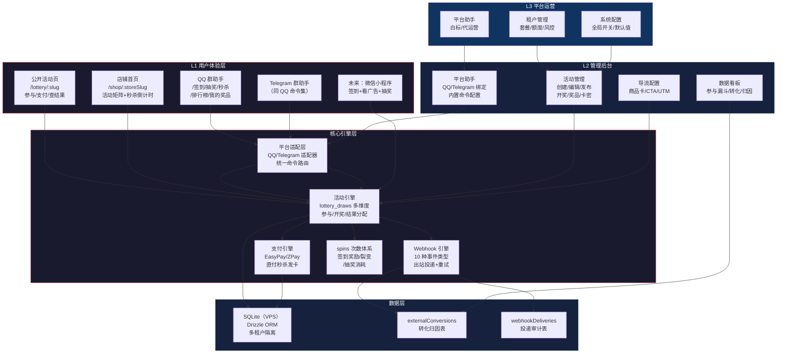
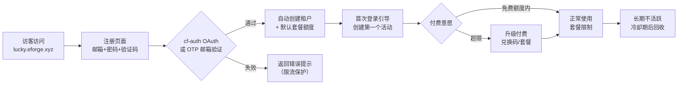
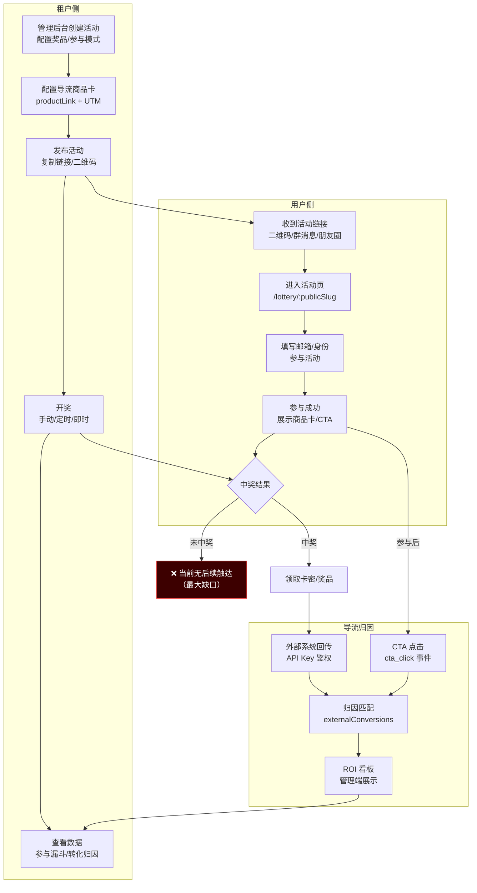
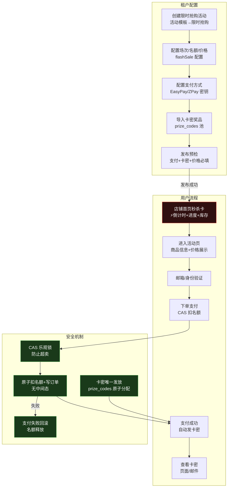
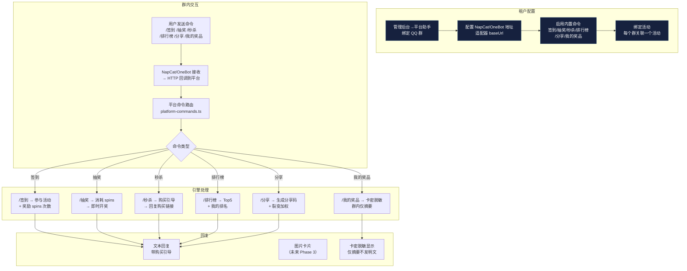
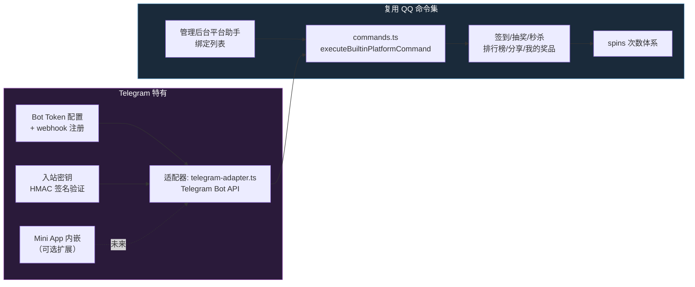
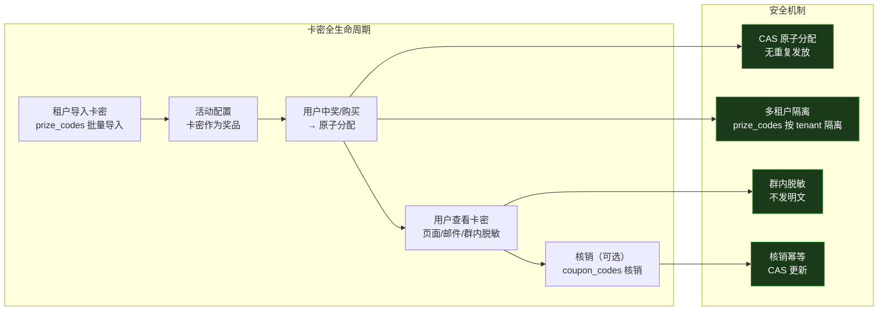
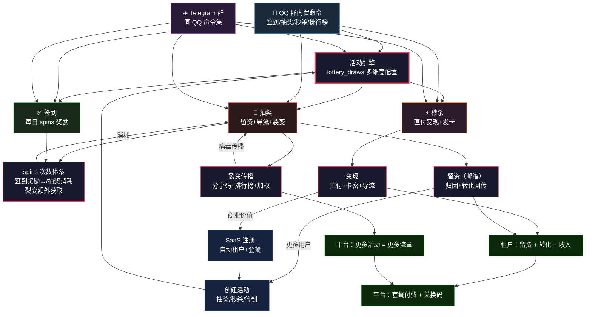

# 209 系统全景流程图：多租户活动引擎的商业闭环

> 日期：2026-08-12
> 角色：专家顾问 / 行业资深用户 / 产品经理 / 营销技术顾问
> 原则：实事求是，所有论断基于现有代码事实（【架构事实】）和已验证方案（【已实施】），不画饼。

---

## 一、一句话定位

**cf-lottery 是一个多租户活动引擎**——SaaS 租户注册后，创建抽奖/秒杀/签到等玩法，通过公开链接、QQ 群、Telegram 群、未来微信小程序等渠道分发，实现「留资→导流→成交→归因」的完整商业闭环。它不是抽奖工具，也不是电商系统，而是「规则驱动的参与与结果分配」引擎。

---

## 二、总览图：五层架构

---

## 三、SaaS 注册与租户生命周期

### 3.1 流程图

### 3.2 关键事实

| 环节 | 状态 | 说明 |
|------|------|------|
| 注册即租户 | ✅ 【已实施】 | 注册自动创建 tenant，无人工审核 |
| cf-auth OAuth | ✅ 【已实施】 | 已生产接入 `auth.eforge.xyz`，支持 GitHub/Google 等 IdP |
| OTP 邮箱验证 | ✅ 【已实施】 | 兜底验证方式，受 rate-limit 保护 |
| 套餐额度 | ✅ 【已实施】 | `PLAN_LIMITS` + 硬编码限流，Free/Pro 两级 |
| 兑换码升级 | ✅ 【已实施】 | `redemption_codes` 表，生成/兑换/历史完整 |
| 白标/独立域名 | ⚠️ 基础 | 有 `brand_config`，但缺独立域名绑定和去平台化 |

### 3.3 商业洞察

---

## 四、抽奖 + 导流店铺：核心变现链路

### 4.1 流程图

### 4.2 关键事实

| 环节 | 状态 | 证据 |
|------|------|------|
| 参与留资（邮箱） | ✅ 【已实施】 | 参与即收集邮箱，`participation` 表 |
| 参与后导流商品卡 | ✅ 【已实施】 | `promotionConfig.destination`，`LotteryView.vue` 展示 |
| CTA 点击追踪 | ✅ 【已实施】 | `cta_click` 事件写入 `activityEvents` |
| 外部转化回传 | ✅ 【已实施】 | `POST /api/integration/conversions`，API Key 鉴权+幂等 |
| 转化归因漏斗 | ✅ 【已实施】 | 管理端 `GET /draws/:id/conversions` |
| 裂变传播 | ✅ 【已实施】 | 分享码+排行榜+开奖加权，已完成闭环 |
| 多状态 CTA | ⚠️ 待实施 | 当前仅 after_join，未扩展 after_win/after_loss |
| **未中奖承接** | ❌ **最大缺口** | 无自动发券/安慰邮件，用户参与后即流失 |

### 4.3 商业洞察

**「参与即留资」是 cf-lottery 最核心的商业价值。** 每个活动都是 Leads Generation 入口。但与行业最佳实践（如 Mailchimp、活动盒子）相比，最大的差距是**活动后承接**——未中奖用户没有自动触达（优惠券、安慰奖、下一活动推荐），这是提升 ROI 性价比最高的优化点（约 4h 工时，见 docs/042a）。

---

## 五、秒杀（限时抢购）：直付变现环

### 5.1 流程图

### 5.2 关键事实

| 环节 | 状态 | 说明 |
|------|------|------|
| 限时抢购模板 | ✅ 【已实施】 | `experience_type=flash_sale`，默认启用 |
| 商品化抢购卡 | ✅ 【已实施】 | 商品名+价格+图片+场次+进度，docs/136 |
| 店铺首页秒杀化 | ✅ 【已实施】 | 英雄横幅+倒计时+进度条+库存+抢购按钮，docs/206 |
| 直付支付 | ✅ 【已实施】 | EasyPay（支付宝模拟）/ ZPay（免密） |
| CAS 防超卖 | ✅ 【已实施】 | UPDATE ... WHERE stock >= requested，docs/198 |
| 卡密原子分配 | ✅ 【已实施】 | 支付成功回调后原子分配，不重复发放 |
| 支付失败回滚 | ✅ 【已实施】 | 名额释放，文档 198 验证 |
| 公开首页活动矩阵 | ⚠️ 待实施 | 方案已定（docs/137），后端 API 待实现 |
| 支付成功率优化 | ⚠️ 持续优化 | 二维码刷新、支付配置页重构，docs/135 |

### 5.3 商业洞察

**秒杀是 cf-lottery 商业化最成熟的玩法。** 它在一个活动内完成了「商品展示→身份验证→支付→发卡→通知」的完整交易闭环，且安全机制（CAS + 原子分配 + 回滚）经过专项审查（docs/198）。对租户而言，这是**零代码搭建付费秒杀活动**的能力——不需要自己开发支付系统。

但要注意边界：cf-lottery **不做电商**——不维护 SKU、不管理库存、不提供购物车。秒杀是「单活动、单商品、先到先得」的简单交易模型，适合会员福利、限量发售、课程秒杀等场景，不适合多 SKU 商城。
---

## 六、QQ 群助手：社群运营核心入口

### 6.1 流程图

### 6.2 关键事实

| 环节 | 状态 | 说明 |
|------|------|------|
| 平台适配层 | ✅ 【已实施】 | `platform-targets` 表 + `adapter-factory.ts`，抽象平台 |
| QQ 适配器 | ✅ 【已实施】 | `qq-adapter.ts`，OneBot HTTP 协议 |
| 内置命令路由 | ✅ 【已实施】 | `commands.ts`，6 个内置命令 |
| 签到→spins 奖励 | ✅ 【已实施】 | 每日签到 + `grantSpinCount` 原子增加，docs/171 |
| /抽奖 → spins 消耗 | ✅ 【已实施】 | CAS 扣次 + 即时开奖 |
| 卡密群内脱敏 | ✅ 【已实施】 | 仅展示 `isNotNull(prizeCodeId)` 标记，不发明文 |
| 并发安全 | ✅ 【已实施】 | 原子 UPDATE + 单写者串行化，docs/171 §11.4.1 |
| 多租户隔离 | ✅ 【已实施】 | 所有查询带 `tenantId` |
| 图片卡片渲染 | ⏳ Phase 3（按需） | 当前纯文本回复 |
| 租户自托管 | ✅ 【已实施】 | 默认模式，每租户独立 NapCat 实例 |
| 平台托管 | ⏳ 白名单/代运营 | 已留接口，未产品化 |

### 6.3 商业洞察

**QQ 群助手是 cf-lottery 的「差异化王牌」。** 市面上做抽奖 SaaS 的产品很多，但能把抽奖、秒杀、签到、排行榜全部集成到 QQ 群内、且租户零代码配置的产品极少。这直接切中了**社群运营者的核心痛点**：

- 不用写 Bot 代码
- 不用理解 webhook
- 不用自己开发签到/抽奖功能
- 群内直接完成「促活→留资→导流→成交」的全链路

**制约因素**：租户需要自托管 NapCat/OneBot 实例，有技术门槛。文档 167 已设计二维码配置向导和连通性测试来降低复杂度，但实际落地后仍需关注租户的部署成功率。

---

## 七、Telegram 群助手：扩展同构

### 7.1 流程图

### 7.2 关键事实

| 环节 | 状态 | 说明 |
|------|------|------|
| Telegram 适配器基础 | ✅ 【已实施】 | `telegram-adapter.ts`，消息发送 |
| Bot Token 加密存储 | ✅ 【已实施】 | `adapterConfigJson` AES 加密入库 |
| Webhook 注册 API | ✅ 【已实施】 | `POST /register-telegram-webhook` |
| 入站密钥 HMAC 验证 | ✅ 【已实施】 | 每目标独立密钥，只存哈希 |
| 命令路由 | ✅ 【已实施】 | 复用 `commands.ts`，与 QQ 同命令集 |
| 管理端 UI 绑定 | ✅ 【已实施】 | 平台助手页支持 Telegram 创建/编辑 |
| Mini App 内嵌 | ⏳ 待定 | 有设计但未实施 |
| 群内图片卡片 | ⏳ Phase 3 | 与 QQ 共享渲染层 |

### 7.3 商业洞察

**Telegram 适配是「低成本扩平台」的典范**——90% 的命令逻辑在 `commands.ts` 中与 QQ 共享，只需新增适配层（`telegram-adapter.ts`）和 Bot Token 配置。这是多租户活动引擎「平台抽象」架构的直接收益（docs/167）。

但对国内 SaaS 租户而言，Telegram 的实用场景有限（主要面向海外用户、跨境社群）。短期建议保持「能用」状态，不投入深度运营资源，等有明确客户需求再推进。

---

## 八、批发（卡密分发的隐形成本）

### 8.1 流程图

### 8.2 关键事实

| 环节 | 状态 | 说明 |
|------|------|------|
| 卡密批量导入 | ✅ 【已实施】 | CSV 批量导入 `prize_codes` |
| 原子分配 | ✅ 【已实施】 | CAS + 事务，不重复发放 |
| 多租户隔离 | ✅ 【已实施】 | 所有查询带 `tenantId` |
| 卡密脱敏展示 | ✅ 【已实施】 | 群内仅摘要，网页/邮件发完整卡密 |
| 核销系统 | ✅ 【已实施】 | `coupon_codes` 表，CAS 核销 |
| 卡密库存预警 | ⚠️ 待补 | 当前无「库存不足」实时通知 |
| 核销后 CRM 联动 | ⚠️ 待补 | 核销事件通过 Webhook 回传 |

### 8.3 商业洞察

**卡密是 cf-lottery 的「白牌货币」**——虚拟卡密（课程兑换码、会员码、代金券）的边际成本趋近于零，是秒杀和抽奖最合适的奖品类型。租户批量导入卡密后，通过抽奖、秒杀、签到等玩法分发，形成「虚拟权益分发平台」。

**但卡密有真实成本的场景（如话费充值卡、实物券）必须谨慎**——广告激励模式（docs/189）的可行性分析指出，单靠广告收入无法覆盖卡密采购成本，必须把广告定位为「获客工具」而非「成本覆盖」。
---

## 九、飞轮效应：所有玩法如何协同

### 9.1 完整飞轮图

---

## 十、诚实评估：能力矩阵与差距

### 10.1 五维能力评分

| 维度 | 评分 | 说明 |
|:----|:---:|:-----|
| **获客** Acquisition | 4/10 | 租户可创建活动 → 链接分发，但无 SEO、无活动聚合页、无 Open Graph 卡片、无嵌入 SDK |
| **激活** Activation | 8/10 | 9 种体验类型 + 4 种参与模式 + 导流商品卡，漏斗基本完整 |
| **留存** Retention | 3/10 | ❌ **最大短板**——只有 2 个邮件模板，无生命周期触达，参与后即流失 |
| **变现** Revenue | 6/10 | 直付秒杀 + 卡密分发 + 导流归因已闭环，但 ROI 仪表盘、多状态 CTA 待补 |
| **传播** Referral | 8/10 | 分享码 + 排行榜 + 开奖加权，已完成核心闭环 |

### 10.2 各玩法成熟度

| 玩法 | 成熟度 | 证据 |
|:----|:-----:|:-----|
| 抽奖（活动引擎） | ⭐⭐⭐⭐⭐ | 最成熟，9 种体验类型 + 4 种参与模式 + 3 种开奖方式 |
| 卡密分发 | ⭐⭐⭐⭐⭐ | 导入/分配/脱敏/核销/多租户隔离，全链路安全 |
| 秒杀（直付） | ⭐⭐⭐⭐⭐ | 商品化卡 + 支付 + 发卡 + CAS 防超卖，已生产 |
| QQ 群助手 | ⭐⭐⭐⭐ | 6 内置命令 + 签到+spins + 脱敏，Phase 1 完成 |
| 裂变传播 | ⭐⭐⭐⭐ | 分享码 + 归因 + 排行榜 + 加权，已闭环 |
| 店铺首页秒杀化 | ⭐⭐⭐⭐ | 倒计时 + 进度 + 库存 + 抢购按钮，已上线 |
| Telegram 群助手 | ⭐⭐⭐ | 适配器 + webhook + 命令复用，但缺图片卡片 |
| 营销自动化 | ⭐⭐ | ❌ 邮件序列、多状态 CTA、未中奖承接待补 |
| 公开首页活动矩阵 | ⭐ | 方案已定（docs/137），API 待实施 |
| 微信小程序 | ⭐ | 方案已定（docs/189），无代码 |

### 10.3 最值得做的 3 件事（按 ROI）

| # | 项目 | 收益 | 成本 | 价值 |
|:-:|:----|:----|:----:|:----:|
| 1 | **未中奖承接**（P0） | 挽回流失用户，提升导流转化率 30%+ | ~4h | 🔴 极高 |
| 2 | **Open Graph 卡片**（P0） | 分享到微信/微博时展示富媒体，点击率提升 3-5x | ~1h | 🔴 极高 |
| 3 | **公开首页活动矩阵**（docs/137） | 所有租户公开活动在一个页面展示，形成「活动货架」 | ~6h | 🟡 高 |

---

## 十一、不做清单（边界清晰）

| 不做 | 原因 |
|:----|:-----|
| 自建电商/商城/SKU 管理 | 定位是活动引擎，不是交易系统 |
| 奖品供应链（兑吧模式） | 重资产、需库存/物流，早期不适合 |
| 复杂 SCRM/营销自动化 | 用轻量 CTA + Webhook 即可，不建完整 CRM |
| 内容社区/UGC 审核 | 审核过重，偏离核心 |
| 集成支付/结算 | 走 EasyPay/ZPay 等已有集成，不自建支付网关 |
| 独立积分/余额体系 | 设计文档明确禁止（docs/171），仅用 spins 次数体系 |
| 视频/直播/电商插件 | 超出活动引擎边界 |

---

## 十二、总结

**一句话总结：** cf-lottery 已经是一个**可用的多租户活动引擎**——抽奖、秒杀、QQ 群助手、卡密分发、裂变传播、导流归因都已闭环。租户注册后能在 10 分钟内创建活动、分发到群、开始收集用户。它的核心价值是**零代码的活动运营工具**，不是平台，不是生态，就是瑞士军刀。

**最大的三个缺口**（按诚实度排序）：① 活动后承接（未中奖用户流失）② 活动分享传播效果（Open Graph 缺失）③ 公开活动矩阵（首页流量入口）。这三个缺口都是 P0 级，总工时约 11h，可以显著提升产品价值。

---

## 参考文档

| 编号 | 文档 |
|:----|:-----|
| docs/007 | 瑞士军刀产品定义 |
| docs/005 | SaaS 多租户顶层设计 |
| docs/038a | 导流促销变现能力深度分析 |
| docs/042a | 营销能力全维度差距分析 |
| docs/137 | 公开首页活动矩阵方案 |
| docs/136 | 秒杀商品化体验与导流门禁整改 |
| docs/167 | 嫁接层顶层设计（平台抽象与 Webhook 体系） |
| docs/171 | 签到积分与抽奖次数体系打通方案 |
| docs/189 | 微信小程序广告激励抽奖整合方案 |
| docs/206 | 店铺首页秒杀化升级 |
| docs/198 | 秒杀与抽奖超发漏发流程专项审查 |
| docs/205 | 容量与边界处理机制行业最佳实践对比 |
**最大的获客杠杆不是投放广告，而是租户的公开活动本身。** 每个租户创建的公开活动（秒杀/抽奖）都会在店铺首页 `/shop/:storeSlug` 和未来公开首页 `/` 展示，形成「活动即流量」的飞轮效应。因此产品优化的核心不是加大推广，而是**降低活动创建门槛、提升活动传播效果**（Open Graph、分享卡片、嵌入 iframe）。