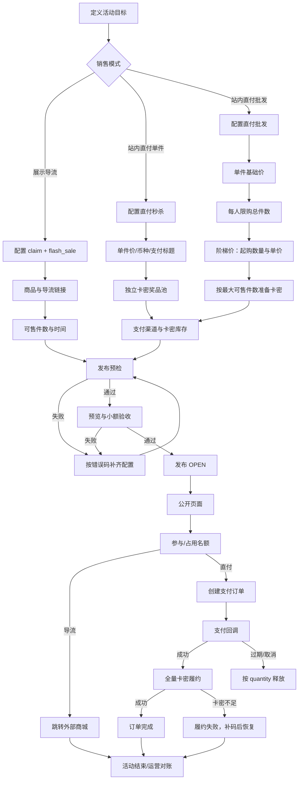
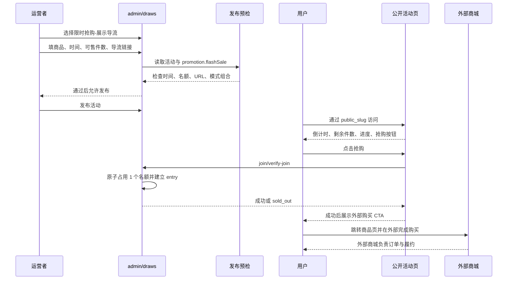
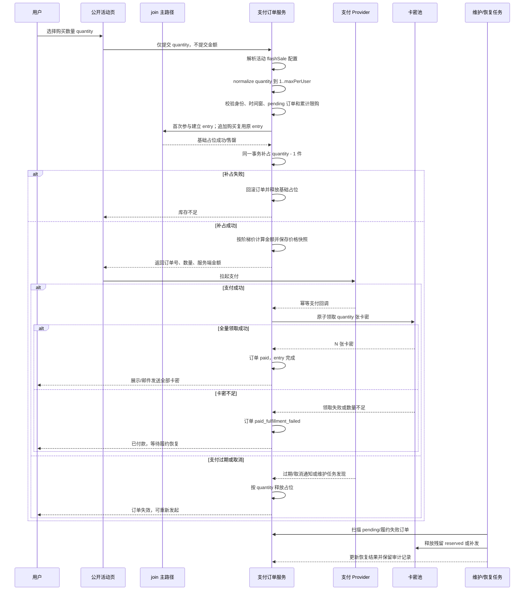
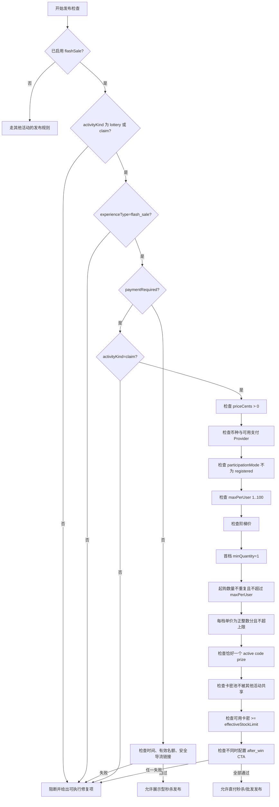
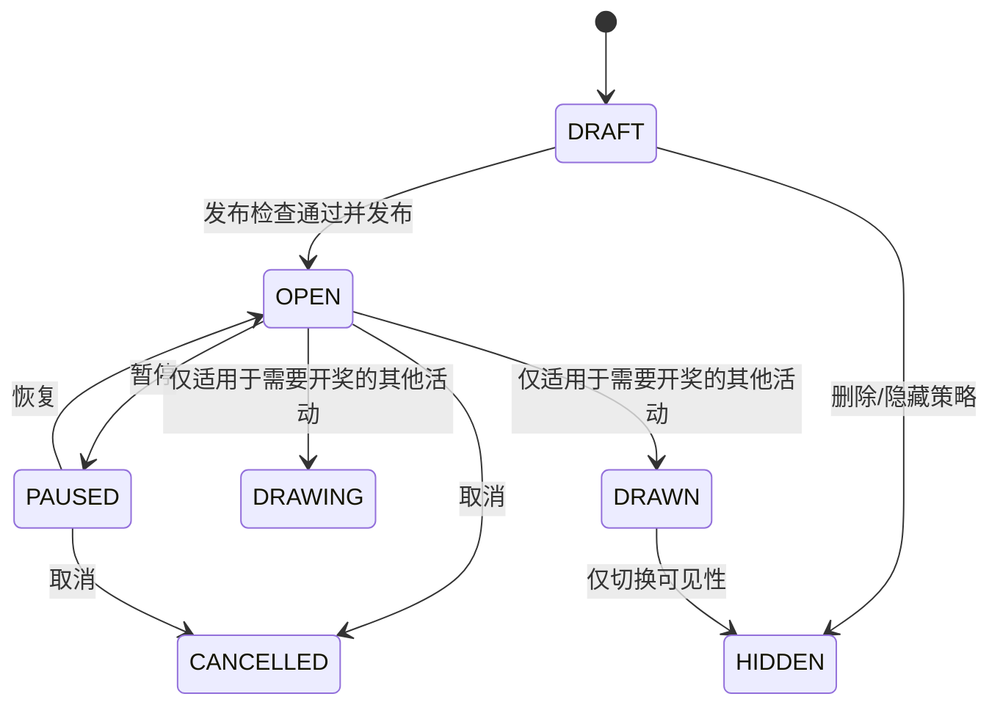
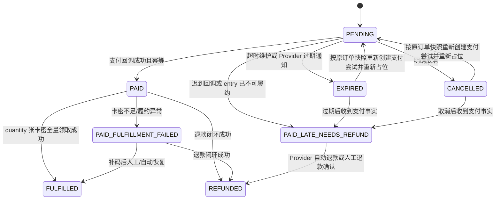

# 222 秒杀与批发活动定义及全链路流程基线

> 日期：2026-08-14  
> 状态：流程基线，后续开发、UI 调整、测试和运营手册均以本文为准。  
> 范围：`admin/draws` 中的秒杀与批发模式，从活动定义、后台创建、发布、公开参与、支付、卡密履约到异常恢复和活动结束。  
> 关联：docs/130、docs/131、docs/141、docs/204、docs/212、docs/221。

## 1. 本文的目的

当前系统的主要风险不是某个按钮或某个字段缺失，而是**业务定义、后端规则和前端表单没有使用同一套语言**。如果不先固定流程，后续每次修 UI 或修接口，都可能出现以下灾难：

- 把“秒杀名额”误当成商品真实库存；
- 把“批发”误做成多条参与记录或多笔订单；
- 前端展示了可以填写的组合，后端发布时却拒绝；
- 前端没有展示后端实际需要的支付、卡密和库存准备；
- 价格由前端提交，造成金额篡改或改价漂移；
- 卡密不足时部分发卡，产生已付款但交付不完整；
- 释放、重试和并发路径没有统一库存口径，造成超卖或名额永久占用。

因此本文先固定**业务不变量和端到端流程**，再讨论 UI 如何实现。任何实现若与本文冲突，应先修订本文中的业务决策，再改代码；不得直接在页面或接口中临时增加例外。

## 2. 先固定核心结论

### 2.1 系统没有独立的 `wholesale` 活动类型

当前“批发”不是 `activity_kind` 的新枚举，也不是单独的活动页面。它是秒杀直付活动中的一种购买策略：

```text
claim
  + experience_type = flash_sale
  + result_mode = instant
  + paymentRequired = true
  + maxPerUser > 1
  + pricingTiers（可选；配置后按阶梯单价计算）
```

因此：

| 业务称呼 | 系统真实定义 | 是否创建新活动类型 |
|---|---|---|
| 展示型秒杀 | 秒杀 UI + 名额登记 + 外部购买链接 | 否 |
| 直付秒杀 | 秒杀 UI + 站内支付 + 卡密自动履约 | 否 |
| 批发 | 直付秒杀的单笔多件；可选阶梯单价 | 否 |

后续 UI 可以把“批发”作为**购买模式**展示，但不能把它实现为新的 `activity_kind`，也不能复制一套独立发布、支付和库存逻辑。

### 2.2 三个独立维度仍然不能互相推导

| 维度 | 字段 | 含义 | 秒杀/批发推荐值 |
|---|---|---|---|
| 活动业务类型 | `activityKind` | 业务结果是什么 | `claim` |
| 参与资格 | `participationMode` | 谁能参加、如何验证 | `open` 或受控模式 |
| 用户交互 | `experienceType` | 用户看到什么界面 | `flash_sale` |
| 结果产生 | `resultMode` | 结果何时确定 | `instant` |

这里需要区分两类合法组合：

- 展示型秒杀可使用 `claim + flash_sale`，也兼容现有的 `lottery + flash_sale` 免费登记语义；
- 直付秒杀和批发必须使用 `claim + flash_sale + paymentRequired=true`；
- `lottery + paymentRequired=true` 永远禁止。

特别注意：`flash_sale` 只决定交互外观，不自动代表付费；`paymentRequired` 才决定是否进入站内支付和卡密履约。

### 2.3 一条订单内完成一次批量购买，允许同一活动追加新订单

当前代码已经是 V2 订单模型，必须按以下方式理解：

```text
1 identity
  : 1 lottery_entry
  : 1 次购买 = 1 payment_order，quantity = N
  : 同一活动可有多笔历史订单，但累计购买量不能超过 maxPerUser
```

批发的一次购买仍然不能拆成多条 entry 或多笔订单：

- 为同一用户创建多条 `lottery_entries`；
- 删除 `lottery_entries` 的身份唯一约束；
- 通过“追加购买”绕过每人累计限购。

当前已支持的追加购买规则：

- 同一 `entry` 仅在前一笔订单为 `paid` 且仍有累计余量时，才可以创建追加订单；
- `pending` 订单不能重复创建，必须恢复原订单；
- `paid` 和 `paid_fulfillment_failed` 订单的 `quantity` 会累计计入 `maxPerUser`；
- `expired`、`cancelled` 订单可以按原价格快照重试，不改变原订单金额；
- `paid_fulfillment_failed` 与 `paid_late_needs_refund` 必须由运营补发或退款，不能让用户追加下单；
- 追加购买需要重新按本次 `quantity` 预约活动容量。

因此，后续 UI 必须区分“本次购买数量”和“本活动累计已购数量”，不能把 `maxPerUser` 文案写成仅限单笔。

## 3. 活动模式定义

### 3.1 展示型秒杀

```text
目的：制造限时、限量和紧迫感，把用户送到外部购买页面。
lottery 侧：活动体验、名额、倒计时、已抢进度、参与登记、导流 CTA。
外部商城：真实商品、支付、订单、商品库存和履约。
```

配置要求：

- `activityKind = claim`，或兼容现有免费登记语义的 `lottery`；
- `experienceType = flash_sale`；
- `resultMode = instant`；
- `promotion.flashSale.enabled = true`；
- `paymentRequired = false`；
- 必须存在安全的 `http/https` 商品或承接链接；
- 必须设置有效名额：`flashSale.stockLimit` 优先，否则使用 `maxParticipants`。

展示型秒杀不要求绑定卡密奖品，也不应该展示“支付成功后自动发卡”的文案。若使用 `lottery`，它仍是免费参与/抽奖语义，不能把它描述成站内购买。

### 3.2 直付秒杀

```text
目的：用户在 cf-lottery 内完成支付，支付成功后自动领取卡密。
```

配置要求：

- `activityKind = claim`；
- `experienceType = flash_sale`；
- `resultMode = instant`；
- `paymentRequired = true`；
- `priceCents > 0`；
- 配置支持该币种并且凭据可用的支付渠道；
- 恰好绑定一个启用中的卡密奖品；
- 可用卡密数量不少于有效名额；
- 活动不得与其他进行中的活动共享同一卡密奖品池；
- 直付时不得再配置 `after_win` 外部导流 CTA；
- 当前实现要求参与身份可形成稳定 email 订单身份，`registered` 模式发布会被阻断。

`activityKind = lottery` 与 `paymentRequired = true` 是禁止组合。历史数据的开奖执行会额外过滤未付款参与者，但抽奖开奖与“付款即履约”仍是两套结果和库存归属模型；正式活动必须使用 `claim`，避免双结果和双履约语义。

### 3.3 批发购买

批发只改变每笔订单的购买数量，不改变活动参与资格；同一身份可以在限购范围内分多笔订单购买。当前代码支持两种定价：

```text
maxPerUser = N
priceCents = 990
pricingTiers（可选） = [
  { minQuantity: 1, unitPriceCents: 990, label: "单件" },
  { minQuantity: 5, unitPriceCents: 890, label: "5件起" },
  { minQuantity: 20, unitPriceCents: 790, label: "20件起" }
]
```

1. 未配置 `pricingTiers`：每件按 `priceCents` 计算，多件同价；
2. 配置了 `pricingTiers`：按 **cliff unit pricing** 计算，命中档位后该订单全部件数使用该档位单价。

配置阶梯价时：

| 购买数量 | 命中档位 | 全部件数单价 | 总价 |
|---:|---|---:|---:|
| 1～4 | 1 件起 | 9.90 元 | 数量 × 9.90 元 |
| 5～19 | 5 件起 | 8.90 元 | 数量 × 8.90 元 |
| 20～上限 | 20 件起 | 7.90 元 | 数量 × 7.90 元 |

服务端根据活动配置计算价格，前端只能提交 `quantity`，不得提交或信任金额。

## 4. 字段契约：哪个字段是事实来源

### 4.1 活动主字段

| 字段 | 来源 | 业务含义 | 秒杀/批发规则 |
|---|---|---|---|
| `title` | `lottery_draws` | 活动对外名称 | 必填，用户第一眼看到的商品/活动名 |
| `description` | `lottery_draws` | 活动说明 | 必须说明买什么、何时开始、如何交付 |
| `startAt` / `endAt` | `lottery_draws` | 参与时间窗 | 所有名额和支付请求都受时间窗约束 |
| `activityKind` | `lottery_draws` | 活动类型 | 直付秒杀和批发固定为 `claim` |
| `participationMode` | `lottery_draws` | 参与资格 | 不因“批发”改变 |
| `experienceType` | `lottery_draws` | UI 交互 | 固定为 `flash_sale` |
| `resultMode` | `lottery_draws` | 结果产生时机 | 固定为 `instant` |
| `maxParticipants` | `lottery_draws` | 活动容量后备值 | `flashSale.stockLimit` 未设置时生效 |
| `publicSlug` | `lottery_draws` | 公开 URL 标识 | 公开链接只能使用它，不能暴露内部 ID |

### 4.2 `promotionConfig.flashSale` 字段

| 字段 | 必填条件 | 运营语言 | 真实语义 |
|---|---|---|---|
| `enabled` | 秒杀/批发 | 启用限时抢购 | 是否启用秒杀体验壳 |
| `sessionLabel` | 建议 | 场次名称 | 例如“12:00 场”，只做展示，不产生独立场次 |
| `stockLimit` | 发布必填之一 | 本场可售数量 | 活动名额/可售件数上限，直付批发按件数消耗 |
| `maxPerUser` | 直付必填 | 每人最多购买 | 单个身份在本活动内的累计购买总件数；不是只限制单次按钮 |
| `ctaLabel` | 可选 | 主按钮文案 | 例如“立即抢购” |
| `showCountdown` | 可选 | 显示倒计时 | 纯展示开关 |
| `showProgress` | 可选 | 显示已售进度 | 纯展示开关，数据必须来自真实计数 |
| `showStock` | 可选 | 显示剩余数量 | 纯展示开关 |
| `paymentRequired` | 直付/批发必填 | 站内收款并自动发货 | 是否进入支付订单和卡密履约 |
| `priceCents` | 直付/批发必填 | 单件基础价 | 服务端金额基准，单位为最小货币单位 |
| `currency` | 直付/批发必填 | 收款币种 | 必须有匹配的可用支付渠道 |
| `title` | 直付/批发建议 | 支付商品名称 | 订单描述和支付展示名称，不等于活动标题 |
| `pricingTiers` | 批发可选 | 批发阶梯价 | 未配置时按 `priceCents` 多件同价；配置时按购买数量命中的全量单价档位 |

### 4.3 不能混用的字段

| 不应混用 | 原因 |
|---|---|
| `productLink.price` 与 `flashSale.priceCents` | 前者只用于外部导流展示，后者是站内支付权威金额 |
| `maxParticipants` 与 `flashSale.stockLimit` | 两者同时存在时 `stockLimit` 优先；最好 UI 明确只保留一个“可售数量”入口并同步主字段 |
| `maxPerUser` 与库存 | `maxPerUser` 是单身份限购，库存是全活动容量 |
| `pricingTiers` 与奖项 tiers | 前者是价格档位，后者是活动奖品绑定；批发卡密仍需绑定一个 code prize，但不是抽奖奖项 |
| `claimed` 与支付成功数 | 直付流程中 claimed 是已占用/未释放的件数，不能简单解释成已支付订单数 |

## 5. 名额与库存不变量

### 5.1 有效名额唯一计算

```text
effectiveStockLimit =
  flashSale.stockLimit > 0
    ? flashSale.stockLimit
    : maxParticipants > 0
      ? maxParticipants
      : null
```

秒杀发布时 `effectiveStockLimit` 必须存在。

### 5.2 直付批发的占用口径

直付活动的 `lottery_draws.active_participant_count` 在该模式下表示：

```text
已预约 + 待支付 + 已支付但尚未释放的购买件数
```

它不是人数，也不是单纯的 `lottery_entries` 行数。

一次购买 `quantity = N`：

1. 用户进入参与主路径，先原子占用 1 件并建立唯一 entry；
2. 创建支付订单时，在同一事务内补占 `N - 1` 件；
3. 任意补占失败，必须释放第 1 件并整体回滚；
4. 支付过期、取消或明确释放时，按订单 `quantity` 释放；
5. 重试支付或履约恢复时，按订单 `quantity` 重新校验和占用。

### 5.3 卡密库存不变量

直付秒杀/批发必须满足：

```text
可用卡密数量 >= 有效名额
```

支付成功后的发卡必须是**全量成功或全量失败**：

- `quantity = N` 就领取 N 张卡密；
- 卡密不足不能部分发放；
- 部分失败进入 `paid_fulfillment_failed`，保留订单和占位，等待运营补码或人工恢复；
- 已付款但履约失败不能回滚成“未付款”。

## 6. 后台创建与发布流程

### 6.1 运营者的正确操作顺序

1. 选择“限时抢购”模板；
2. 先确认销售模式：展示导流、直付单件、直付批发；
3. 填写商品名称、活动说明、商品图和时间；
4. 填写可售件数；
5. 直付时填写币种、单件价、支付商品标题；
6. 批发时设置每人限购总件数和阶梯价；
7. 到奖品管理中建立或选择一个独立卡密奖品池，并导入足够卡密；
8. 到支付设置中启用匹配币种的支付渠道并保存凭据；
9. 草稿保存成功后，后台自动对该活动执行一次服务端发布预检，并在列表钉住首个阻断项；逐项修复错误；
10. 通过预览确认公开页面、价格、库存、倒计时和购买数量展示；
11. 发布活动；
12. 使用真实测试身份完成一笔最小金额或测试支付闭环，再正式推广；
13. 若允许追加购买，确认后台和公开查单能区分本次订单数量、累计已购数量和剩余可购数量。

> 2026-08-15 审查补充：公开页的“已参与”只表示已拥有 `entry`，不表示已达到购买上限。直付批发必须先读取订单状态摘要，再分流为：`pending` 续付、`paid` 且仍有余量时追加购买、已买满时禁止追加、`paid_fulfillment_failed` / `paid_late_needs_refund` 时转人工处理。摘要不得返回卡密；卡密与订单明细仍走 OTP 找回或订单短期访问令牌。

### 6.2 UI 必须按业务模式显示字段

后台不应再让运营者面对一组孤立的“秒杀壳”字段。建议将表单分成以下步骤或明确的业务区块：

### 6.2.1 四种合法组合矩阵

这里的“展示型”按 `activityKind` 分为两种兼容语义；直付只允许 `claim`：

| 组合 ID | `activityKind` | `experienceType` | `paymentRequired` | 业务名称 | 必须录入 | 必须隐藏/禁止 |
|---|---|---|---|---|---|---|
| D1 | `claim` | `flash_sale` | `false` | 资料/商品导流型秒杀 | 标题、时间、可售件数、至少一个安全外链 | 支付价格、币种、卡密奖品、阶梯价 |
| D2 | `lottery` | `flash_sale` | `false` | 免费登记型秒杀 | 标题、时间、可售件数、至少一个安全外链；若是抽奖还要奖项 | 支付价格、支付渠道、卡密履约 |
| P1 | `claim` | `flash_sale` | `true`，`maxPerUser=1` | 直付单件秒杀 | 标题、时间、可售件数、单件价、币种、支付渠道、唯一卡密奖品及库存 | 外部商品链接不是必填；不能配置 `after_win` CTA |
| P2 | `claim` | `flash_sale` | `true`，`maxPerUser>1` 或多档 `pricingTiers` | 直付批发 | P1 全部字段 + 每人累计限购；若启用阶梯价，必须填写首档和各档单价 | 外部商品链接不是必填；不能配置 `after_win` CTA |

禁止组合：

| 组合 | 原因 |
|---|---|
| `lottery + paymentRequired=true` | 即使历史执行有付款过滤，抽奖开奖与付款即履约仍是两套结果和库存归属模型；正式活动必须使用 `claim` |
| `survey/vote/signup_chain/... + experienceType=flash_sale` | 业务类型与秒杀体验不匹配；前端切换类型时应清理残留配置，后端发布预检以 `flash_sale.activity_kind.conflict` 最终阻断 |
| 已启用 `flashSale` 但 `experienceType!=flash_sale` | 配置事实与公开页体验、后台表单可见性脱节；后端以 `flash_sale.experience.required` 阻断，不能只给提示 |
| `activityKind!=claim + paymentRequired=true` | 站内直付和支付回调履约只属于 `claim`；除保留 `lottery` 的专用冲突码外，后端以 `flash_sale.payment.activity_kind.required` 阻断 |
| `claim + paymentRequired=true` 但没有 `priceCents`、支付渠道、唯一卡密奖品或足够库存 | 发布前必须阻断 |

### 6.2.2 当前模板默认值审计

当前 `flash-sale-rush` 模板的默认值不是通用秒杀默认，而是 **P2 直付批发默认**：

```text
activityKind = claim
experienceType = flash_sale
paymentRequired = true
priceCents = 990
maxPerUser = 5（由 1/5 阶梯档位自动对齐）
pricingTiers = 1 件 9.90 元、5 件 8.90 元
stockLimit = 100
currency = cny
```

因此当前模板默认直接产生 P2。后台表单已经提供明确的“销售模式”选择：
展示导流、站内直付单件、站内直付批发；旧活动没有该字段时，前端按
`paymentRequired`、`maxPerUser` 和 `pricingTiers` 兼容推断。运营不应再通过直接勾选
`paymentRequired`、修改 `maxPerUser` 和删除阶梯档位来猜模式。

前端验收必须同时检查四层：

1. 模板默认值：默认组合的每个必填字段都有值，无关字段为空或关闭；
2. 字段可见性：切换组合后只显示该组合需要的字段；
3. 提交 payload：不把隐藏组合的旧值继续写入 `promotion.flashSale`；
4. 发布清单：与后端错误码逐项一致，不能前端多阻断或少阻断。

奖品选择器采用服务端搜索和分页。直付清单计算“恰好一个可用卡密奖品”时，必须合并首屏目录、搜索选中项和旧活动回填项，并按 `prizeId` 去重；不能因为奖品不在首屏而误报未绑定，也不能把同一奖品的两份前端缓存误报为两个码池。导流 URL 的前端校验必须与后端相同：仅允许安全 `http/https`，拒绝本地地址、超过长度上限和带用户名/密码的 URL。

| 区块 | 展示内容 | 适用模式 |
|---|---|---|
| 1. 商品与活动 | 商品名、活动说明、图片、开始/结束时间 | 全部 |
| 2. 销售模式 | 导流 / 站内直付 / 站内直付批发 | 全部，必须单选 |
| 3. 数量规则 | 本场可售件数、每人限购总件数 | 秒杀和批发 |
| 4. 价格规则 | 单件价、币种、批发阶梯价、档位说明 | 直付和批发 |
| 5. 交付准备 | 支付渠道状态、卡密奖品池、可用库存 | 直付和批发 |
| 6. 页面展示 | 倒计时、进度、剩余库存、按钮文案 | 全部 |
| 7. 发布检查 | 错误、警告、下一步跳转 | 全部 |

批发 UI 的核心标签应使用运营语言：

- “本场最多卖出多少件”；
- “每位客户最多购买多少件”；
- “单件售价”；
- “达到多少件后，每件售价是多少”；
- “预计需要多少张卡密”；
- “支付成功后一次发放全部卡密”。

技术字段名可以在帮助说明或高级信息中展示，但不能作为唯一标签。

## 7. 总体流程图：从定义到结束



## 8. 展示型秒杀流程图



### 展示型秒杀的边界

- `cf-lottery` 不记录外部商城订单的支付状态；
- `productLink.price` 只能作为展示文案；
- `paymentRequired=false` 时不能出现“本站支付”“自动发卡”等文案；
- 名额满后公开接口必须返回售罄，前端刷新运行时数据；
- 外部商城购买成功不能反向改变 lottery 的卡密履约状态，除非未来定义正式的 conversion webhook 契约。

## 9. 直付秒杀与批发流程图



## 10. 直付发布门禁流程图



## 11. 状态机与异常处理

### 11.1 活动状态



直付秒杀和批发是 `claim + flash_sale + instant`，不进入统一抽奖的 `DRAWING/DRAWN` 业务路径。活动到 `endAt` 后停止新的参与和新订单；已创建的 pending 订单在允许的活动状态下可恢复支付，存量订单按支付/履约状态继续收尾。暂停期间可恢复已有 pending 订单，但不能创建新订单。

### 11.2 支付订单状态



约束：

- `PAID` 不是“已发货”，还必须经过卡密履约；
- `paid_late_needs_refund` 表示支付事实已经产生，但原订单已过期、被替代或无法继续履约；它必须进入退款/人工收尾，不能当作正常 `PAID`；
- 订单重试沿用原订单的 `quantity`、单价和价格快照；
- 运营修改活动价格不影响已经创建的 pending 订单；
- 邮件发送失败不回滚支付和卡密领取，必须进入可重发状态；
- 退款必须同时处理订单、支付尝试、订单项、已发卡密和活动占位。

## 12. 前后端必须共享的发布清单

前端清单不能只检查“字段是否有值”，必须与后端发布错误码逐项对齐：

| 清单项 | 前端必须展示 | 后端必须最终裁决 |
|---|---|---|
| 活动类型组合 | 当前模式说明，仅允许 `lottery/claim + flash_sale`；直付只能 `claim` | `flash_sale.activity_kind.conflict` / `flash_sale.experience.required` / `promotion.lottery_payment.conflict` / `flash_sale.payment.activity_kind.required` |
| 时间 | 开始、结束、是否已过期 | `basic.time.*` |
| 可售件数 | 明确“件数”，显示实际生效来源 | `flash_sale.stock.required` / `flash_sale.stock.mismatch` |
| 导流链接 | 仅展示型秒杀要求安全 URL | `promotion.url.invalid` / `flash_sale.destination.missing` |
| 单件价格 | 用元展示，保存为分 | `flash_sale.payment.price.*` |
| 每人限购 | 说明是累计总件数 | `flash_sale.payment.max_per_user.invalid` |
| 阶梯价 | 起购数量、整单单价、首档 1 件 | `flash_sale.payment.pricing_tier.*` |
| 支付渠道 | 显示币种、渠道和凭据是否可用 | `payment.provider.*` |
| 卡密奖品 | 恰好一个 active code prize | `payment.fulfillment.code_prize.*` |
| 卡密库存 | 显示可用数与所需数 | `payment.fulfillment.codes.insufficient` |
| CTA 冲突 | 直付不能同时配置中奖后导流 | `flash_sale.payment.cta_conflict` |

前端可以提前提示，但不能替代后端检查；草稿保存后可以对**当前活动**主动执行一次预检，把支付渠道、码池占用和可用库存等服务端事实前移。列表加载不得为每一行预拉预检（避免 N+1）；正式发布时必须重新执行预检，防止保存后库存或渠道状态变化。后端拒绝时必须返回稳定错误码和可理解的下一步。

## 13. 当前代码事实与主要脱节点

### 13.1 已经形成闭环的部分

- `src/lib/flash-sale-config.ts` 统一解析秒杀配置、数量和阶梯价；
- `src/services/publish-check-service.ts` 负责直付发布门禁；
- `frontend/src/views/admin/lottery/growth-config.ts` 负责表单回填和 payload；
- `frontend/src/views/admin/lottery/flash-sale-readiness.ts` 已有前端清单；
- `frontend/src/views/admin/AdminLotteryView.vue` 已展示秒杀、直付和阶梯价字段；
- 支付服务按 `quantity` 计算订单金额并执行批量履约；
- `docs/141` 是早期 V1 方案记录，不能继续作为当前订单契约；当前基线以 docs/158 和现有代码为准：单 entry、每次购买一笔订单、同活动允许追加订单，并按累计数量限购。

### 13.2 仍然存在的产品语义脱节

1. **模式字段与旧配置的兼容推断必须保持稳定**：新活动使用销售模式，旧活动没有该字段时按既有配置推断；不得让同一份配置在编辑、复制和提交时得到不同模式。
2. **字段仍偏技术名**：`stockLimit`、`maxPerUser`、`paymentRequired`、`priceCents` 不能单独承担运营说明，UI 必须用“可售件数、每人累计限购、站内直付、单件价格”等业务语言。
3. **“本场可售件数”和 `maxParticipants` 的双入口容易误解**：两者同时存在时 `stockLimit` 优先，当前 UI 已展示最终生效值；后续仍应避免新增第三个容量入口。
4. **卡密准备不在活动定义流程中**：直付活动如果只在活动页填写价格，运营可能直到发布最后一步才发现需要独立卡密奖品池。
5. **“购买数量”和“参与人数”容易混淆**：批发按件数占用容量，不能继续用“参与人数”作为唯一文案。
6. **支付与履约不是同一个状态**：页面必须区分“支付成功”“发卡成功”“等待补码”，不能只展示“成功/失败”。
7. **导流模式和直付模式的 CTA 语义不同**：导流应引导去购买，直付应引导支付并自动发卡，不能共用一套结果文案。

## 14. 后续开发顺序

### 14.0 本轮复核发现并已修正的偏差

本次对文档重新逐段对照了 `payment.ts`、`payment-service.ts`、`payment-status.ts`、`flash-sale-config.ts`、`publish-check-service.ts` 和后台前端清单，确认并修正以下两处高风险偏差：

1. **订单模型偏差**：初版文档误写为“同一活动一条 entry 只能对应一笔订单，并禁止追加购买”。实际代码已经是 V2：一条 entry 可以有多笔历史订单；pending 订单必须恢复原订单，expired/cancelled 可以按原快照重试，paid/paid_fulfillment_failed 的 quantity 会累计参与 `maxPerUser` 限购。当前基线已按 V2 修正。
2. **活动组合偏差**：初版文档把展示型秒杀收窄为 `claim + flash_sale`。实际发布预检允许免费展示型 `lottery + flash_sale`，真正禁止的是 `lottery + paymentRequired=true`。当前基线已明确“展示型可兼容 lottery，直付/批发必须 claim”。
3. **前端直付误阻断**：前端清单初始无条件要求商品 URL，但后端直付模式不要求外部链接；现已改为仅展示/导流模式要求 URL，并补充直付无链接和展示导流缺链接回归测试。
4. **状态机缺项**：初版状态图遗漏 `paid_late_needs_refund`；实际这是支付事实已经产生但订单已过期、被替代或无法履约时的资金安全状态，现已补入退款收尾路径。
5. **错误码泛化过度**：初版把可售件数错误码写成 `flash_sale.stock_limit.*`，实际发布预检使用 `flash_sale.stock.required` 和 `flash_sale.stock.mismatch`，现已按代码修正。

这些不是文字细节，而是会影响数据库唯一性、订单恢复、资金收尾、前端模式选择和发布门禁的架构事实，后续不得重新写回旧结论。

### P0：业务入口已落地，后续只允许按基线验收

1. 已在创建表单中增加“销售模式”单选：
   - 展示导流；
   - 站内直付；
   - 站内直付批发。
2. 已根据销售模式显示对应字段，不让运营直接面对技术字段组合。
3. 已在预览区同步展示最终生效的：
   - 活动类型；
   - 可售件数；
   - 每人限购；
   - 单件价；
   - 阶梯价；
   - 支付/履约方式。

### P1：把准备工作前移

1. 直付/批发模式选择后立即显示支付渠道状态；
2. 显示“需要一个独立卡密奖品池”和“需要 N 张可用卡密”；
3. 提供跳转支付设置、奖品和卡密管理的明确入口；
4. 发布清单中的每一项都要有“去配置”动作。

### P1：统一运行时文案

公开页、支付弹窗、结果页、邮件和后台订单页统一使用：

```text
购买数量 quantity
单件售价 unitPrice
订单总价 amount
本场剩余件数 remaining
每人累计限购 maxPerUser
履约状态 fulfillmentStatus
```

不得再把批发数量称作“抽奖次数”、把卡密称作“中奖奖品”或把支付成功称作“发货完成”。

### P2：补齐验收矩阵

至少覆盖：

- 展示型秒杀：正常、售罄、无链接、过期；
- 直付单件：支付成功、支付过期、重复回调、卡密不足；
- 直付批发：数量 1、命中首档、命中中间档、命中最大档、超限、重复购买；
- 并发：最后一个名额多人竞争；
- 恢复：过期订单重试、履约失败补码、退款释放；
- 多租户：活动、支付配置、卡密池互不串租户。

## 15. 最终验收标准

只有以下问题全部回答“是”，秒杀/批发流程才算真正闭环：

- 运营是否能在第一屏选择自己要做的是导流、直付还是批发？
- 运营是否知道本场卖的是“件”，而不是“人数”？
- 运营是否知道批发是单笔多件，不是多次参与？
- 用户是否能看到服务端权威计算出的数量、档位单价和总价？
- 发布前是否能看到支付渠道、卡密池和所需库存是否就绪？
- `lottery + paymentRequired` 是否在前端和后端都明确阻断？
- 支付成功但卡密不足时，是否明确显示“履约失败待恢复”，且不会部分发卡？
- 订单过期、取消、重试和退款是否按完整 `quantity` 释放或重新占用？
- 活动结束后，是否禁止新参与但允许存量订单继续收尾？
- 公开链接是否只使用 `public_slug`？
- 多租户之间是否不会看到、占用或发放对方的活动和卡密？

本文所定义的状态、字段来源、数量口径和异常处理，是后续 UI、API、测试和运营文档的共同基线。
