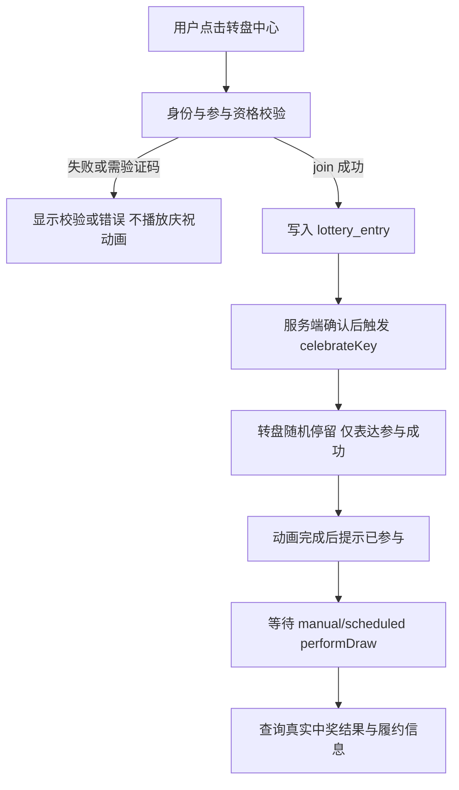
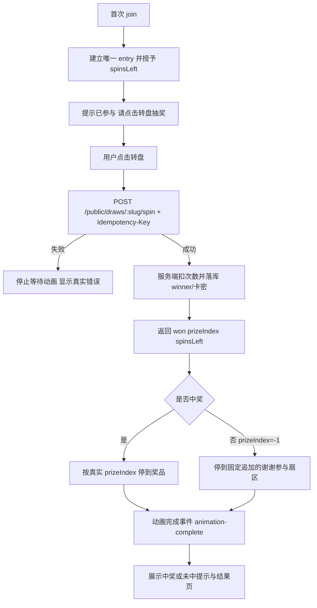

# 224 大转盘适用边界与全链路规范

> 日期：2026-08-15  
> 状态：强制规范。后续大转盘 UI、活动模板、API、发布预检、测试、验收、维护和二开均以本文为准。  
> 范围：`experience_type=wheel` 的适用组合、后台录入项、公开参与、即时抽奖、延迟开奖、奖品展示和履约边界。  
> 关联：docs/116、docs/128、docs/222、docs/223。

## 0. 规范等级与解释方式

本文不是产品建议，也不是临时排查记录，而是大转盘能力的**唯一业务边界规范**。

除非先完成本文第 9 节的变更流程，否则：

- **必须（MUST）**遵守的规则不得放宽；
- **不得（MUST NOT）**做的组合不得通过 UI、API、脚本或数据库直接绕过；
- **应该（SHOULD）**遵守的规则只有在记录风险和验收证据后才能例外；
- 代码、UI、测试或运营文案与本文冲突时，先判定实现偏差，不得以“当前代码能跑”作为规范依据；
- 本文没有明确支持的组合一律视为**不支持**，不得靠默认值、兼容分支或前端隐藏字段推导为支持。

“大转盘”仅指 `experience_type=wheel`。它不等于 `activity_kind`，不等于 `result_mode`，不等于中奖算法，也不等于支付或发卡。

## 0.1 规范的不可变核心

以下规则是上线前置条件，任何二开都不得单方面改变：

1. 真实业务结果只能由服务端产生并落库，客户端动画永远不是结果来源。
2. `wheel` 只允许服务于 `activity_kind=lottery`。
3. `lottery + manual/scheduled` 的转盘只表达参与成功，不表达个人中奖。
4. `lottery + instant` 必须先完成服务端 `/spin`，再按服务端 `prizeIndex` 播放停扇。
5. `claim + flash_sale`、直付、批发、支付和卡密履约不得接入大转盘。
6. 用户无法理解奖品权益时，不得使用即时大转盘；不得把“卡密”本身当作权益说明。
7. `join`、`spin`、支付、履约、查结果是不同业务动作，不得合并成“点击转盘就全部完成”。
8. 任何新增组合必须同时具备：数据契约、API 契约、前端录入项、公开页状态、异常恢复、测试和文档，否则视为未完成。

## 1. 审查结论

大转盘不是活动类型，也不是开奖结果机。它只是 `experience_type=wheel` 的交互组件，必须依附于完整的抽奖业务契约。

当前只允许两类组合：

| 组合 | 结论 | 转盘含义 |
|---|---|---|
| `lottery + wheel + manual/scheduled` | 允许 | 参与成功后的氛围反馈；停留扇区不代表中奖 |
| `lottery + wheel + instant` | 条件允许 | 服务端完成一次真实 spin 后，按 `prizeIndex` 对准结果 |

以下组合不接入大转盘：

| 组合/场景 | 结论 | 原因与替代体验 |
|---|---|---|
| `claim + flash_sale` 展示秒杀 | 禁止 | 使用限时抢购壳和外部承接链接 |
| `claim + flash_sale + paymentRequired=true` 直付/批发 | 禁止 | 使用数量、总价、支付和卡密履约流程 |
| `claim` 普通领取 | 禁止 | 使用 `reveal` 或普通领取/结果展示 |
| signup、waitlist、reservation、checkin、approval、vote、survey | 禁止 | 使用各自的列表、队列、预约、签到、表单或投票体验 |
| 即时抽奖只有“卡密”字样，用户不知道额度、权益或用途 | 不适合 | 先补齐奖品名称、权益说明、使用限制；否则改用普通结果展示 |
| `lottery + paymentRequired=true` | 永久禁止 | 抽奖与直付履约结果机会冲突，见 docs/222 |

结论不是删除 `WheelGame.vue`。组件继续保留并维持统一 `GameProps/GameEmits` 封装，只在满足上述契约时由活动页接入。

## 2. 为什么卡密本身不能成为转盘奖品文案

卡密是履约凭据，不是用户购买或抽中的权益定义。用户应先看到：

- 奖品/权益名称；
- 可理解的价值或额度；
- 使用范围、有效期和关键限制；
- 中奖后如何查看或使用卡密。

例如“10 元代金券”“会员月卡”“某产品兑换资格”可以作为扇区文案；“卡密 A”“随机卡密”“兑换码”不能单独承担奖品语义。

当前数据模型已有 `prizes.name` 和 `prizes.value_text`，可以表达名称与价值说明。代码无法可靠判断自然语言是否真实、是否夸大，因此采用两层门禁：

1. 机器门禁：即时大转盘缺少 `valueText` 时发布预检给出可见 warning；
2. 人工门禁：运营必须确认用户看到名称后能理解具体权益，否则不使用大转盘。

不使用关键词猜测“卡密是否有价值”，避免误判正常奖品或放过包装后的模糊文案。

## 3. 组合矩阵与默认录入项

### 3.0 奖品定义与卡密池的强制对应关系

当前系统的数据关系是：

```text
1 lottery_prize_tier
  -> 1 prize definition
     -> N prize_codes
```

这不是“一个奖品只能有一张卡密”，而是：

> **一个奖品定义只能表达一种用户可感知的权益；该奖品下面可以有多张等价卡密作为库存。**

`prizes.name`、`description`、`value_text`、图片和履约说明定义用户看到的奖品；`prize_codes` 只保存
`code`、`secret`、`note`、状态和履约关联，没有结构化的面额、套餐、地区、有效期规则或中奖概率字段。
当前发码逻辑只按 `tenantId + prizeId + status=available` 领取一张码，不读取 `note` 判断价值，也不会按
每张码的价值重新计算奖项、权重或转盘扇区。

因此，当前版本必须遵守：

1. 同一 `prizeId` 下的所有可用卡密必须具有相同的业务权益和用户价值；
2. 卡密文本可以不同，但面额、套餐、适用产品、适用地区、有效期规则和主要使用限制必须等价；
3. `note` 仅可用于内部备注，不能作为隐藏的面额或权益字段；
4. 不同价值的卡密必须创建不同 `prize` 和不同码池；
5. 每个不同价值的 `prize` 在活动中绑定独立 `lottery_prize_tier`，分别配置名额、权重、档位名和展示文案；
6. 不得先展示统一的“卡密奖品”，中奖后再从混合池中发出价值不确定的卡密；
7. 不得依赖卡密导入顺序实现“高价值先发”“低价值后发”或随机价值分配。

正确基数：

```text
1 种权益 : 1 prize : 1 同质码池 : N 张等价卡密
```

禁止模型：

```text
1 prize = “随机卡密”
  ├─ 10 元卡
  ├─ 50 元卡
  ├─ 100 元卡
  └─ 不同地区/期限/套餐卡
```

当前代码对禁止模型只会按码池顺序发卡，页面、中奖记录和通知仍显示同一个 `prize.name/valueText`。
这会造成展示价值与实际履约不一致、概率无法审计、用户投诉和财务对账困难，因此属于数据污染，不是运营技巧。

#### 多价值卡密的正确组织方式

例如希望配置 10 元、50 元、100 元三种卡密：

| 奖项 | prize | valueText | 独立码池 | instant weight / delayed 名额 |
|---|---|---|---|---|
| 一等奖 | `100元代金券` | `100 元` | 只导入 100 元卡 | 单独配置 |
| 二等奖 | `50元代金券` | `50 元` | 只导入 50 元卡 | 单独配置 |
| 三等奖 | `10元代金券` | `10 元` | 只导入 10 元卡 | 单独配置 |

即时大转盘中，每个奖项对应独立扇区和服务端 `prizeIndex`；延迟开奖中，每个奖项独立配置中奖名额。
这样展示、概率、库存、中奖记录、通知和最终卡密价值使用同一个奖品定义。

#### 可以放在同一码池的差异

仅以下不改变用户权益的技术差异可以共存：

- 卡号和密码文本不同；
- 上游批次号不同，但权益完全相同；
- 内部采购备注不同；
- 单码核销状态不同。

以下差异必须拆分奖品：

- 面额或市场价值不同；
- 商品、套餐、会员等级或数量不同；
- 可用地区、渠道或平台不同；
- 有效期规则有实质差异；
- 最低消费、适用范围或主要限制不同；
- 履约方式不同，例如自动卡密与人工发放；
- 运营希望为其配置不同中奖概率、名额、扇区名称或图片。

#### “随机价值盲盒”边界

当前版本不支持“先中一个盲盒奖品，再从内部多价值卡密中二次随机”的模型。原因是系统没有：

- 每张卡密的结构化权益/价值字段；
- 二次随机算法、概率配置和算法版本；
- 每价值库存与名额的独立 CAS；
- 用户展示、中奖记录、通知和审计中的二级结果；
- 对应的发布预检和统计报表。

如果未来确需支持，必须作为新的 V2 结果模型设计，不能复用 `prize_codes.note` 或导入顺序实现。

### 3.1 延迟开奖大转盘

固定组合：

```text
activityKind = lottery
experienceType = wheel
resultMode = manual | scheduled
paymentRequired = false
```

必须录入：

| 分区 | 字段 |
|---|---|
| 基础 | 活动名称、说明 |
| 时间 | 开始时间、结束时间；scheduled 还需开奖时间 |
| 资格 | participationMode 及其密码/名单/邀请码附加字段 |
| 奖项 | 每个奖项的奖品、档位名、中奖名额 |
| 转盘展示 | `prizePanelMode=auto` 或仪式短语模式 |

不得要求：

- `maxSpinsPerEntry`；
- instant weight；
- 支付价格、币种、购买数量和阶梯价；
- 卡密必须即时发放。

### 3.2 即时大转盘

固定组合：

```text
activityKind = lottery
experienceType = wheel
resultMode = instant
paymentRequired = false
```

必须录入：

| 分区 | 字段 |
|---|---|
| 基础 | 活动名称、说明 |
| 时间 | 开始时间、结束时间；不录统一开奖时间 |
| 资格 | participationMode 及其附加字段 |
| 次数 | `maxSpinsPerEntry >= 1` |
| 奖项 | 奖品、档位名、`weight > 0`、中奖名额 |
| 奖品语义 | 用户可理解的奖品名称、权益/价值说明；码类准备足够库存 |
| 转盘展示 | `prizePanelMode=auto/full_on_shell`，扇区顺序必须与服务端 `prizeIndex` 一致 |

不得要求：

- 手动/定时统一开奖；
- 秒杀库存、购买数量、价格、支付渠道；
- 用户在看到服务端结果前相信客户端随机停扇。

### 3.3 “谢谢参与”扇区

若即时抽奖允许未中奖，转盘必须存在可映射的未中奖语义。不能只有真实奖品扇区，却在服务端返回未中奖后随机停到某个奖品上。

最终规则以 docs/116 的即时结果机为准：

- 服务端中奖返回 `won=true` 与真实奖品 `prizeIndex>=0`；未中奖返回 `won=false, prizeIndex=-1`；
- 前端只消费结果，不计算中奖；
- 前端必须把未中奖映射到固定追加的“谢谢参与”扇区，不得随机停在真实奖品上；
- 无有效中奖索引时不得宣称停留扇区是中奖结果。

## 4. 全链路流程

### 4.1 延迟开奖



不变量：F 的扇区不能写成“你已中奖”，也不能在开奖前展示个人中奖提示。

### 4.2 即时开奖



不变量：

- `join` 只建立参与记录和次数，不直接抽奖；
- `/spin` 只支持 `lottery + instant`；
- 动画开始前已经有服务端结果；
- 动画结束后才展示结果提示；
- 卡密只在受保护的结果/履约页面展示，不进入扇区。

## 5. 组件边界

`WheelGame.vue` 只负责：

- 绘制扇区、图片和中心按钮；
- `loading` 时提供轻量等待反馈；
- `celebrateKey` 变化后播放动画；
- 有 `targetSectorIndex` 时对准服务端结果；
- 动画结束 emit `animation-complete`。

`loading=true` 的等待反馈只允许改变中心按钮、指针或外圈灯光，**不得让盘面开始连续旋转**。这是为了避免用户把网络等待中的视觉运动误解为客户端已经决定或正在决定结果。正式盘面旋转只能由服务端成功结果对应的 `celebrateKey` 触发；失败、超时或取消不得播放结果停扇。

它不得负责：

- 身份、OTP、资格和时间窗校验；
- 计算中奖、权重、保底或剩余次数；
- 创建订单、计算价格、支付或发卡；
- 把客户端随机角度写回为业务结果。

这样保留封装后，转盘可以继续用于合适的抽奖活动，但不会污染秒杀、批发、领取、问卷等业务模型。

## 6. 当前代码审查结果

### 已符合

- `performInstantSpin` 强制 `activityKind=lottery` 且 `resultMode=instant`；
- `/spin` 使用幂等键、服务端扣次数并返回 `prizeIndex`；
- `LotteryView` 在服务端成功后才递增 `celebrateKey`；
- `WheelGame` 只消费 `targetSectorIndex`，不计算中奖；
- delayed 模式使用仪式壳，发布预检禁止手动/定时开奖把真奖名放到随机停扇上；
- 动画完成后再显示即时中奖/未中提示；
- 即时未中奖固定停到追加的“谢谢参与”扇区，不会随机落到真实奖品；
- 剩余次数展示在活动顶部状态区，不再挤占转盘中心区域。

### 本次修正

- 后台非 lottery 活动不能再选择 `wheel`；
- API 或旧客户端把非 lottery 活动保存为 `wheel` 时，发布预检阻断；
- 即时大转盘奖品缺少权益/价值说明时，发布预检给出 warning；
- 即时大转盘模板直接提示“原始卡密且额度/用途不明时不要使用大转盘”。
- `WheelGame` 已移除请求期间的盘面 idle 旋转；停扇角度由独立纯函数计算，并以单元测试锁定“服务端扇区索引对齐顶部指针”和“至少完整转圈数”。

### 保留风险

- 自然语言是否清晰无法完全自动判断，仍需运营审核；
- 已经发布的历史误配活动不会被本次发布门禁自动改写，重新编辑/发布时必须修正；
- reduced-motion 用户不会观看长动画，组件会直接进入终态并触发结果提示，这是无障碍要求，不是流程绕过。

## 7. 验收清单

- [ ] 非 lottery 活动的后台体验下拉不能选择大转盘；
- [ ] 非 lottery + wheel 经 API 写入草稿后发布会被阻断；
- [ ] delayed 转盘停留扇区不会显示个人中奖结果；
- [ ] instant 首次 join 后仍需显式 spin；
- [ ] spin 失败不播放结果动画；
- [ ] spin 成功后停扇与服务端 `prizeIndex` 一致；
- [ ] 中奖/未中提示在动画结束后出现；
- [ ] `spinsLeft=0` 时不能继续 spin，顶部显示剩余次数；
- [ ] 卡密不出现在公开扇区或 toast，仅在受保护结果中展示；
- [ ] 即时大转盘缺少 `valueText` 时发布确认可看到 warning；
- [ ] 秒杀/批发始终使用 `flash_sale`，不加载大转盘组件；
- [ ] TypeScript、Vue 模板类型检查、前后端 Vitest 和前端构建全部通过。

## 8. 开发、测试、验收的强制判定表

### 8.1 允许发布的最小条件

| 检查项 | 延迟开奖大转盘 | 即时大转盘 |
|---|---:|---:|
| `activityKind=lottery` | 必须 | 必须 |
| `experienceType=wheel` | 必须 | 必须 |
| `resultMode` | `manual/scheduled` | `instant` |
| `maxSpinsPerEntry` | 不适用 | `>=1` |
| 每个奖项 `weight>0` | 不适用 | 至少一个有效档位 |
| 统一开奖时间 | manual/scheduled 按规则填写 | 必须为空/不生效 |
| 奖品名称 | 必须 | 必须 |
| 权益/价值说明 | 应填写 | 缺失必须出现可见 warning，运营确认不适合时不得发布 |
| 直付支付 | 禁止 | 禁止 |
| 秒杀/批发字段 | 禁止 | 禁止 |

### 8.2 必须验证的事实

测试不得只断言按钮可点击或页面出现“转盘”。至少必须证明：

- 非 `lottery` 的 `wheel` 无法通过发布预检；
- `lottery + paymentRequired=true` 无法发布；
- delayed join 失败时不播放庆祝动画；
- delayed join 成功后动画只表达参与成功；
- instant join 不产生中奖记录；
- instant spin 失败不扣除成功次数、不触发中奖提示；
- instant spin 成功后只使用服务端 `prizeIndex` 停扇；
- 重复请求使用幂等键不会重复扣次数或重复发奖；
- `spinsLeft=0` 后前端、API、结果查询三处都拒绝继续抽奖；
- 卡密不出现在转盘扇区、公共列表、toast 或普通活动标签中；
- 直付/批发页面只进入数量、总价、订单、支付和履约链路；
- 活动状态、时间窗、身份、租户隔离和异常恢复仍然有效。

### 8.3 验收不通过条件

出现以下任一情况，验收必须判定不通过，不得用“后续优化”带过：

1. 客户端可以在服务端结果返回前显示中奖结论；
2. 任意非抽奖活动可以通过配置或 API 使用大转盘；
3. 即时大转盘停扇与服务端 `prizeIndex` 不一致；
4. 失败请求仍然播放中奖动画或扣减展示次数；
5. 直付/批发被转盘流程截断，无法继续支付或查单；
6. 卡密语义不清但 UI 仍以“中奖”或具体价值暗示用户；
7. UI 展示字段与发布预检要求不一致，导致“能保存但不能发布”；
8. 新增代码没有同步更新本文、测试和变更记录。

## 9. 规范变更流程

大转盘属于跨业务边界能力。任何人提出“让转盘支持某个新模式”时，必须先提交变更说明，至少包含：

1. 新组合的三维定义：`activityKind`、`participationMode`、`experienceType`、`resultMode`；
2. 参与、结果、支付、履约和查结果的完整时序图；
3. 服务端真实结果来源、幂等键、状态转换和并发不变量；
4. 后台默认录入项、隐藏项、错误提示和发布预检；
5. 公开页所有状态：未开始、开放、提交中、成功、失败、次数用尽、结束和异常；
6. 至少一条成功、失败、重复请求、并发和数据恢复测试；
7. 对现有两类允许组合和秒杀/批发链路的回归影响；
8. 文档、代码、测试和验收标准的同步修改。

变更在以下条件全部满足前，不得合并：

- 规范文档已更新并明确旧规则是否废止；
- 后端门禁先于前端入口落地；
- 前端默认项与后端发布预检逐项对齐；
- 关键路径测试通过；
- 代码审查确认没有把动画、展示字段或客户端随机数当成业务事实。

## 10. 禁止的实现捷径

以下做法无论短期是否能“快速上线”，均禁止：

- 通过 `Math.random()` 或客户端停扇角度决定中奖；
- join 成功后直接把活动奖品名当成“你已中奖”；
- 为复用转盘，把 `claim`、秒杀、批发、问卷或投票改写成 `lottery`；
- 为绕过发布预检，直接写数据库、删字段或在前端隐藏错误；
- 用 `paymentRequired`、`flashSale` 或 `maxPerUser` 推导出转盘资格；
- 用“卡密”“兑换码”“随机奖励”等模糊文案代替权益定义；
- 新增一个特殊接口，只为了让某个页面看起来像转盘；
- 只修改 UI 不修改 API/测试/文档，或只修改 API 不补前端录入和错误状态。

## 11. 规范归属与问题处理

当代码、测试、UI 截图或运营需求出现冲突时，按以下顺序处理：

1. 先以数据库和服务端事务事实确认真实状态；
2. 再以本文确认该状态是否属于允许组合；
3. 若不属于允许组合，优先关闭入口或阻断发布，不做隐式兼容；
4. 若属于允许组合但 UI 表达错误，修 UI 和测试，不改变服务端结果；
5. 若本文无法覆盖需求，先走第 9 节变更流程，不在业务代码中增加临时例外。

本节用于防止后续开发、测试、验收、维护和二开各自形成一套“自认为正确”的大转盘规则。
