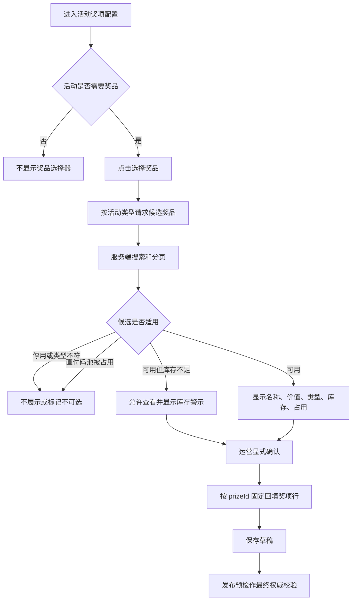

# 225 大量活动与奖品下的后台信息架构规范

> 日期：2026-08-15  
> 范围：`/admin/draws` 活动列表与活动创建/编辑、`/admin/prizes` 奖品目录与码池管理。  
> 性质：基于当前代码事实的结论性规范。本轮只确定边界和实施顺序，不修改业务代码。

## 0. 2026-08-15 二次审查结论

二次审查确认总体方向正确，但首版第 5～7 节把部分 P1 目录能力写进了“最小 API”，容易让实施范围膨胀。现修正如下：

1. **P0 只修复活动选奖闭环**，不同时重做 `/admin/prizes`；
2. 不引入新表、新依赖、分类、标签、SKU、收藏、最近使用或独立搜索服务；
3. 不要求 P0 实现奖品的草稿/进行中活动数量统计；
4. P0 只扩展现有 `/api/admin/prizes`，不另建一套重复的奖品查询体系；
5. 直付码池冲突判断必须抽取并复用现有服务端规则，禁止在选择器里复制一套状态判断；
6. 候选页的可用库存必须按 `prize_codes.status=available` 计算，不能简单使用 `totalCount-usedCount` 充当权威值；
7. `/admin/prizes` 的筛选和反向引用保留为 P1，只有真实运营量证明需要时再实施。

修正后的 P0 仍然解决第 51 个奖品不可选、历史绑定无名称、停用奖品可见、模板误绑定和直付码池误选，实施面保持在一个现有接口、一个选择组件和少量共享校验逻辑内。

## 1. 结论

当前方案在奖品较少时可用，但在奖品超过 50 个后已经不是单纯的“下拉框效率低”，而是会产生**候选集不完整和误绑定**：

1. `/admin/draws` 只请求 `/api/admin/prizes` 的默认第一页，后端默认 `limit=50`；
2. 活动奖项使用原生 `<select>` 渲染这 50 条，并把它们误当成完整奖品库；
3. 第 51 条及更早的奖品无法被新活动选择；
4. 编辑活动时，如果已绑定奖品不在当前 50 条中，选择框只有 `prizeId`，没有对应名称；
5. 奖品接口默认包含停用奖品，但保存奖项时后端只接受 `active=1`；
6. 套用抽奖模板时会自动绑定当前第一页第一条奖品。奖品很多、名称相似或码池有业务归属时，该行为存在严重误配置风险。

因此：

> **必须取消“预加载第一页 + 原生大下拉框 + 自动选第一项”的活动选奖方式。**

推荐方案不是把 50 改成 200、1000 或全部加载，而是：

> **`/admin/prizes` 继续作为唯一奖品目录和库存工作台；`/admin/draws` 使用服务端检索、分页、带业务状态的奖品选择器。**

活动创建页只负责“查找并绑定已有奖品”或“快速创建后绑定”，不得复制完整奖品管理能力。

## 2. 代码事实

### 2.1 活动创建只看到默认前 50 个奖品

- `frontend/src/views/admin/AdminLotteryView.vue:2631-2635`：`loadPrizeOptions()` 无查询参数请求 `/api/admin/prizes`；
- `src/routes/admin-lottery-prizes.ts:38`：奖品列表默认 `limit=50`，最大 `200`；
- `src/routes/admin-lottery-prizes.ts:51-53`：按创建时间倒序后分页；
- `frontend/src/views/admin/AdminLotteryView.vue:1326-1329`：奖品用原生 `<select>` 展示。

所以活动创建页当前实际语义不是“选择租户奖品”，而是“从最新 50 个奖品中选择”。这是功能缺失。

### 2.2 当前候选项不能支持可靠判断

下拉选项只显示 `prize.name`，没有显示：

- 奖品类型；
- 权益/价值说明；
- 是否启用；
- 可用卡密数量；
- 是否已被进行中的直付活动占用；
- 是否满足当前活动所需库存；
- 已绑定的其他活动数量。

名称相同或相近的奖品无法区分。例如多个“10 元券”可能属于不同平台、地区、有效期或码池，不能只靠名称选择。

### 2.3 前后端候选规则不一致

- 奖品列表接口没有默认过滤 `active`；
- `src/routes/admin-lottery-draw-ops.ts:548-553` 保存奖项时要求奖品属于当前租户且 `active=1`；
- `src/services/publish-check-service.ts:248-268` 规定直付秒杀必须且只能绑定一个启用中的卡密奖品；
- `src/services/publish-check-service.ts:271-297` 规定直付秒杀不能与其他进行中活动共享同一码池；
- `src/services/publish-check-service.ts:300-320` 还会按活动库存上限校验可用卡密。

当前 UI 先允许选择，保存或发布时才拒绝。对于可以提前判断的条件，这是不必要的失败路径。

### 2.4 自动绑定第一条奖品必须移除

`frontend/src/views/admin/AdminLotteryView.vue:3690-3698` 在应用抽奖模板时自动绑定 `prizeOptions[0]`。

该行为在大量奖品下没有可靠业务依据：

- 第一条只表示最新创建，不表示最适合；
- 可能是停用奖品；
- 可能是空码池；
- 可能是其他活动正在使用的码池；
- 可能与活动奖项名称、价值和用户展示不一致。

规定：**模板只能创建空奖项行，不得自动选择具体奖品。奖品绑定必须由运营者显式确认。**

### 2.5 `/admin/prizes` 已有可保留的基础

当前奖品页已有：

- 服务端分页；
- 按名称搜索；
- 按奖品类型筛选；
- 可用/已用数量展示；
- 批量启用、停用；
- 码池分页、状态筛选和码值搜索。

因此不应推倒重做。问题主要是目录检索维度和活动关联信息不足。

## 3. 业务对象边界

### 3.1 奖品不是活动

`prize` 表达一种用户可感知的权益及其履约方式；`draw tier` 表达该活动如何使用这个奖品。

```text
奖品定义
  ├─ 名称、图片、权益/价值、说明
  ├─ 履约类型：卡密 / 人工
  └─ 卡密奖品：一个同质码池

活动奖项
  ├─ 引用 prizeId
  ├─ 本活动内奖项名称
  ├─ 中奖名额或直付交付目标
  └─ 即时抽奖权重
```

不同价值、套餐、地区、有效期或使用限制的卡密必须拆成不同奖品和不同码池，不能为了减少奖品数量而混池。

### 3.2 奖品复用规则

| 场景 | 是否允许复用同一 prize | 选择器要求 |
|---|---|---|
| 人工履约奖品用于多个抽奖活动 | 可以 | 显示“被 N 个活动使用”，不阻断 |
| 卡密奖品用于非同时进行的活动 | 可以，但需核对剩余库存和权益是否仍一致 | 显示库存及历史/当前使用情况 |
| 卡密奖品用于多个同时进行的普通抽奖 | 当前运行时会竞争同一码池，不应默认鼓励 | 警示并显示进行中活动占用 |
| 卡密奖品用于直付秒杀/批发 | 进行中活动之间禁止共享 | 已被其他进行中活动占用时不可选 |
| 停用奖品 | 不允许新绑定 | 默认不出现在候选结果；编辑旧绑定时只读展示并提示 |

直付场景的“不可选”必须与服务端发布门禁一致，不能只靠前端猜测。

## 4. `/admin/draws` 规定性方案

### 4.1 活动列表

活动列表已有服务端搜索、状态/类型/时间筛选、分页和游标能力，应继续保留。大量活动下不建议按活动展开全部奖品，也不建议把奖品管理嵌入每一行。

列表行只显示活动运营所需摘要：

- 活动名称；
- 类型和状态；
- 时间；
- 参与人数；
- 发布/库存异常标记；
- 操作入口。

奖品详情只在活动详情或编辑器中按需加载。

### 4.2 活动奖品选择器

每个奖项行显示一个“选择奖品”按钮或紧凑选择框。点击后打开选择面板，而不是展开全部奖品。

选择面板的默认行为：

1. 默认只查启用中的奖品；
2. 首屏沿用最近创建排序，并增加 `id` 作为稳定次排序，但不得自动选中；
3. 输入名称或权益关键字后，防抖请求服务端；
4. 服务端分页，每次返回 20～50 条；
5. 每条候选项显示名称、价值、类型和可用库存；直付场景额外显示是否被其他进行中活动占用；
6. 运营者点击一条后显式确认绑定；
7. 已选择奖品以摘要形式保留在奖项行，不依赖当前搜索结果；
8. 编辑旧活动时，必须按 ID 单独加载已绑定奖品，即使它已停用或不在当前搜索页；
9. 同一活动已选择的其他奖品不得再次选择，与后端“同一奖品不能重复配置为多个奖项”一致。

候选行最小信息：

```text
[奖品名称]  [卡密/人工]  [启用状态]
权益：10 元代金券
库存：可用 380 / 总数 500
直付占用：无
```

不得在候选行展示卡密码值或密钥。

### 4.3 按活动场景收窄候选集

| 当前活动 | 默认候选 | 不可选 |
|---|---|---|
| 普通抽奖 | 启用中的卡密奖品和人工履约奖品 | 停用奖品；本活动已选奖品 |
| 即时抽奖/大转盘 | 同上，且优先显示权益说明完整的奖品 | 停用奖品；本活动已选奖品 |
| 直付秒杀/批发 | 启用中的卡密奖品 | 人工履约奖品；被其他进行中活动占用的码池；本活动已选奖品 |
| 不需要奖项的活动 | 不显示奖品选择器 | 所有奖品 |

库存不足不应在普通抽奖编辑阶段一律隐藏，因为运营可能先绑定再补库存；应明确警示，并由发布预检继续作最终阻断。直付场景可按当前售卖上限显示“还差 N 张卡密”。

### 4.4 快速创建

快速创建可以保留，但必须是受控的最小流程：

1. 从当前奖项行发起；
2. 录入名称、类型、权益/价值；
3. 创建成功后按返回的 `id` 直接绑定当前行；
4. 卡密奖品若没有库存，明确显示“已创建，发布前仍需导入 N 张卡密”；
5. 复杂编辑、批量导码和码池审计跳转 `/admin/prizes` 完成。

不得重新加载第一页后靠名称或数组位置寻找新奖品。

### 4.5 选择流程图



## 5. `/admin/prizes` 规定性方案

### 5.1 页面定位

`/admin/prizes` 是“奖品目录 + 库存运营”工作台，不是活动选择器，也不承担活动规则编辑。

页面应围绕三个问题组织：

1. 这是什么权益；
2. 还有多少可履约库存；
3. 哪些活动正在使用它。

### 5.2 P1 目录目标筛选

在现有名称搜索、类型筛选基础上增加：

- 状态：启用 / 停用；
- 库存：充足 / 低库存 / 空库存，仅对卡密奖品适用；
- 使用状态：未使用 / 有草稿使用 / 有进行中活动使用；
- 搜索范围：名称 + `valueText`。描述不建议作为首期主搜索字段，避免结果噪声。

列表的核心列建议调整为：

| 列 | 作用 |
|---|---|
| 奖品 | 图片、名称、权益/价值 |
| 履约 | 卡密或人工 |
| 库存 | 可用/总数及低库存状态 |
| 活动使用 | 草稿数、进行中数量；可进入使用详情 |
| 状态 | 启用/停用 |
| 更新时间 | 判断近期运营变更 |
| 操作 | 码池、编辑、启停 |

长描述不应占据主表格宽度，可在详情抽屉或展开区查看。

### 5.3 P1 活动反向引用

奖品页必须能看到奖品被哪些活动使用，至少返回：

- `draftUsageCount`；
- `activeUsageCount`，状态范围与直付共享检查保持一致；
- 可选的最近活动名称；
- 对直付码池标识是否被进行中活动独占。

停用奖品前：

- 若没有活动引用，可正常停用；
- 若只有草稿引用，确认框列出影响；
- 若有进行中活动引用，不应无提示停用。是否硬阻断需按现有“进行中活动可修改字段”规则统一设计，不能只在前端静默禁止。

### 5.4 目录规模和索引

当前 `prizes` 没有针对租户列表、状态、类型和创建时间的复合索引，名称搜索还是前置 `%keyword%` 模糊匹配。奖品达到数千或数万时会逐渐退化。

P0 不需要立即引入 Elasticsearch 或新的搜索服务。应先：

1. 保持租户隔离；
2. 为常用过滤/排序路径建立合适的普通索引；
3. 对选择器使用小页服务端查询；
4. 记录真实数据量和查询耗时；
5. 只有普通数据库检索不能满足目标时，再评估全文索引。

## 6. P0 最小 API 变更

P0 不创建新的目录系统，直接小幅扩展现有奖品列表接口：

```text
GET /api/admin/prizes
  search=
  prizeType=
  active=
  ids=
  includeAvailability=
  directSaleDrawId=
  limit=
  offset=
```

参数职责：

- `active=1`：新绑定只查启用奖品；
- `prizeType=code`：直付活动只查卡密奖品；
- `ids=`：编辑时一次回填当前活动已绑定的少量奖品，不受普通搜索页和启停筛选限制；
- `includeAvailability=1`：仅选择器需要精确可用库存时执行当前页库存聚合，避免普通列表请求无条件增加查询；
- `directSaleDrawId=`：仅直付选择器传入，用于返回码池是否被该活动之外的其他进行中活动占用；
- `search`、`limit`、`offset`：沿用现有分页查询。

P0 候选结果只增加两个派生字段：

```text
availableCount
directSaleConflict
```

其他字段继续复用现有奖品行，不增加 `draftUsageCount`、`activeUsageCount`、`usageState` 或通用 `selectionEligibility`。

实现约束：

1. 只有 `includeAvailability=1` 时计算 `availableCount`；对当前分页中的奖品 ID 做一次分组统计，条件必须是当前租户、当前奖品且 `status=available`，禁止每行单独查询；
2. `directSaleConflict` 必须调用与 `publish-check-service` 相同的共享判定函数，状态范围保持 `open/paused/drawing`；
3. 普通抽奖不请求、不计算直付冲突信息；
4. `ids=` 是独立回填模式：只按当前租户和 ID 查询，可以返回停用奖品，但不允许与普通搜索条件混用；ID 数量不得超过单活动奖项上限 10；
5. 列表排序改为 `createdAt DESC, id DESC`，保证分页稳定；
6. 人工履约奖品的 `availableCount` 返回 `null`，不得伪装成 0 库存；
7. UI 提示只是提前反馈，保存奖项和发布预检仍是最终权威门禁。

P1 才考虑增加 `stockState`、`usageState`、活动引用数量和目录筛选。P2 才评估游标分页；当前奖品管理的前后页模式可以继续使用 `offset`，无需为 P0 同时改造分页协议。

### 6.1 P0 回归测试基线

以下场景是选择器和目录接口的最小回归集，后续修改不得删除或弱化：

1. 51 个以上奖品时，候选列表分页稳定且跨页奖品可按名称或权益/价值搜索；
2. `ids` 回填可以显示停用的历史绑定奖品，但最多 10 个且不得混用普通筛选；
3. 普通 `/admin/prizes` 默认仍能管理启用和停用奖品；活动选择器必须显式传 `active=1`；
4. `availableCount` 只在 `includeAvailability=1` 时返回；人工履约奖品必须为 `null`，不是 0；
5. 新建直付活动能看到其他进行中活动的独占码池冲突；编辑当前活动时必须排除自身；
6. 所有查询都以 `tenantId` 作为首要条件，任一租户不得通过 `ids`、搜索或直付参数读取其他租户奖品。

## 7. 实施优先级

### P0：修复功能不完整和误绑定

1. 移除模板自动绑定第一页第一条奖品；
2. 活动奖项改为服务端搜索、分页选择；
3. 默认只提供启用中的适用奖品；
4. 已选奖品按 ID 独立加载并保留显示；
5. 选择项展示类型、权益、可用库存；
6. 直付场景只显示卡密奖品，并复用服务端共享校验展示占用状态；
7. 只新增一个可复用的奖品选择组件，不重构整个活动编辑器；
8. 增加前后端测试，覆盖 51 个以上奖品、停用奖品、旧绑定跨页、同名奖品和直付占用。

### P1：提高运营效率和防误操作

1. `/admin/prizes` 增加启停、库存、使用状态筛选；
2. 搜索覆盖名称和权益/价值；
3. 增加活动反向引用；
4. 停用时提示受影响活动；
5. 列表改为核心列，描述移出主表；
6. 根据实际查询建立索引并记录慢查询。

P1 每一项独立评估和实施，不作为 P0 上线前置条件。

### P2：有数据依据后再做

以下能力只有出现明确业务需求和数据规模后再建设：

- 稳定业务编码/SKU；
- 标签或业务分类；
- 最近使用和收藏；
- 批量克隆奖品定义；
- 全文搜索；
- 独立搜索服务。

不得为了“以后可能很多”提前建设复杂分类树、审批流、供应商系统或通用商品中心。

## 8. 明确拒绝的方案

| 方案 | 结论 | 原因 |
|---|---|---|
| 把接口上限从 50 改成 1000 | 拒绝 | 只是推迟失效点，增加加载和渲染成本，仍无法表达库存和占用 |
| 加载全部奖品后在前端搜索 | 拒绝 | 数据量随租户增长，首屏、内存和移动端体验不可控 |
| 继续使用原生下拉框 | 拒绝 | 不适合大量同名/近似项，也不能承载库存、类型和占用信息 |
| 自动选择最近创建的奖品 | 拒绝 | “最新”不等于“适用”，容易绑定错误码池 |
| 在活动页复制完整奖品管理 | 拒绝 | 形成两个真相源，码池、停用和审计能力容易漂移 |
| 立即引入复杂分类/SKU/搜索中台 | 暂不采用 | 当前没有数据证明收益高于复杂度 |
| 每个活动都强制创建新奖品 | 拒绝 | 人工履约和非并发场景可以合理复用，会制造大量重复定义 |
| 所有奖品都允许自由复用 | 拒绝 | 卡密池会被并发活动竞争，直付链路已明确禁止 |

## 9. 验收标准

### 9.1 功能

1. 租户有 500、5000 个奖品时，活动编辑器不预加载全部奖品；
2. 第 51 条以后的奖品可以通过搜索选中；
3. 两个同名奖品可通过价值、类型、库存和占用信息区分；
4. 编辑已绑定旧奖品时名称始终可见；
5. 停用奖品不允许新绑定，但历史绑定可被明确识别；
6. 直付活动不能选择人工履约奖品或被其他进行中活动占用的卡密池；
7. 库存不足在选择时可见，发布时仍由服务端阻断；
8. 模板不再自动绑定任意奖品；
9. 创建新奖品后直接按返回 ID 绑定，不依赖重新加载第一页；
10. 多租户之间无法搜索、按 ID 获取或查看对方奖品及使用关系。

### 9.2 性能

1. 选择器单次返回不超过 50 条；
2. 搜索输入防抖并取消或忽略过期请求；
3. 翻页结果顺序稳定，不重复、不遗漏；
4. 活动列表不为每一行展开查询完整奖品和码池；
5. 奖品目录常用筛选在目标数据量下有可测量的响应时间基线。

### 9.3 测试

必须新增正式测试覆盖：

- 51/201 条奖品下的服务端分页与检索；
- 5000 条奖品作为独立性能基线或专项测试数据，不要求每个普通单元测试重复构造；
- 当前租户隔离；
- P0：`active`、类型、精确可用库存和直付冲突；
- P1 实施对应功能时：库存状态和使用状态筛选；
- 按 ID 回填已绑定奖品；
- 同一活动重复奖品；
- 直付活动共享码池；
- 快速创建后绑定；
- 请求竞态下旧搜索结果不能覆盖新结果。

## 10. 最终规定

1. `/admin/prizes` 是奖品定义和库存的唯一管理入口；
2. `/admin/draws` 只引用奖品，不复制奖品管理；
3. 大量候选对象一律服务端检索和分页，不使用全量原生下拉框；
4. 奖品选择必须显示足以判断正确性的业务摘要；
5. UI 提前过滤和提示，服务端保存与发布预检负责最终权威校验；
6. 不以提高 `limit` 作为规模化解决方案；
7. 不自动绑定任何真实奖品；
8. 不把不同权益的卡密合并到同一奖品池；
9. 先完成 P0 闭环，再依据真实数据决定 P1/P2，禁止无数据支撑的重型设计。
