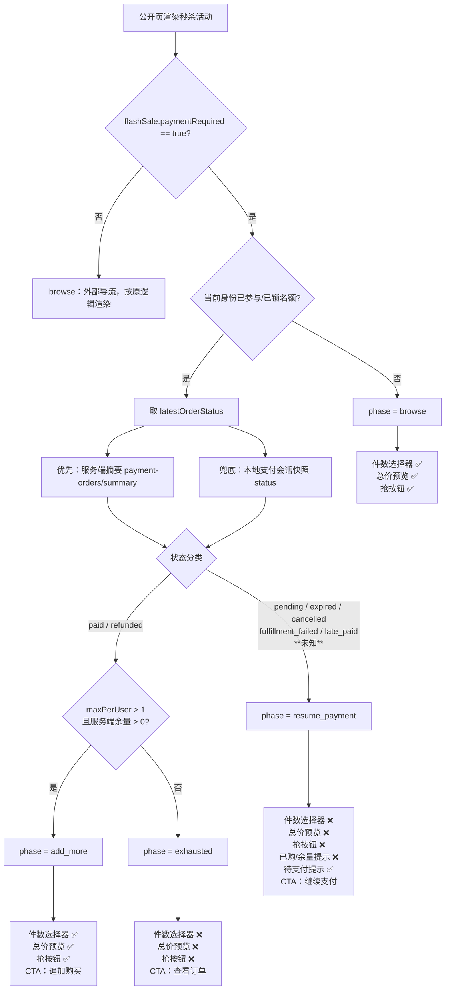
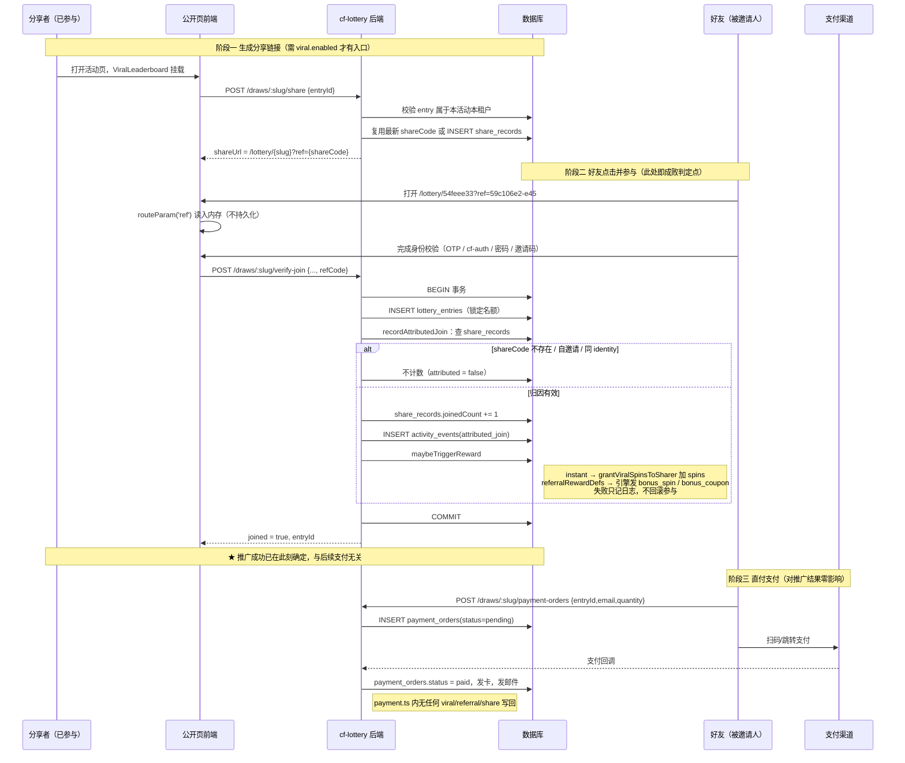
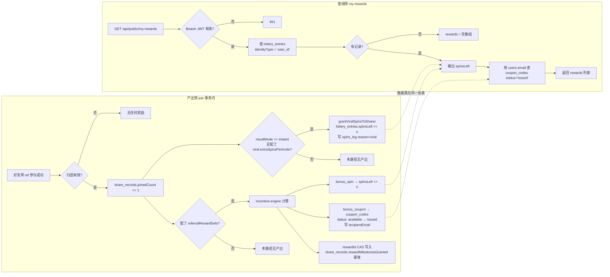

# 257 直付秒杀「待支付态」UI 收敛 + 推广归因与奖励链路分析

- 日期：2026-08-21
- 触发场景：`https://lucky.eforge.xyz/lottery/54feee33`（限时抢购，直付秒杀）
- 涉及范围：公开活动页购买阶段状态机、`?ref=` 推广归因、`/my-rewards` 奖励聚合
- 相关文档：docs/130（秒杀体验壳）、docs/202（支付弹窗）、docs/240（低库存紧迫感）、docs/250~255（referralRewardDefs 闭环）

---

## 一、问题现场（用户报告）

1. 已参加活动（**锁定了名额但没有支付**）后，公开页仍然渲染：
   - 购买件数的「减少 / 增加」控件
   - `总价：¥9.90` / `单价：¥9.90` / `当前档位：单件`
   - 一颗「抢」按钮
   用户预期：**这个阶段只应该出现支付相关入口**，否则会误以为还要再抢一次、或者以为可以改件数。
2. 想确认 `https://lucky.eforge.xyz/lottery/54feee33?ref=59c106e2-e45` 这类推广链接，**是否必须对方付款形成有效订单才算推广成功**。
3. `https://lucky.eforge.xyz/my-rewards` 显示"暂无任何奖励。参与活动并邀请好友可获得抽奖次数和优惠券"，需要说清为什么。

## 二、该活动的真实线上配置（现场取证，非推测）

通过公开接口 `GET /api/public/draws/54feee33` 取到的关键字段：

| 字段 | 值 | 含义 |
|---|---|---|
| `activityKind` | `claim` | 直领类活动 |
| `experienceType` | `flash_sale` | 使用秒杀体验壳 |
| `resultMode` | `instant` | 即时结果 |
| `status` | `open` | 进行中 |
| `flashSale.paymentRequired` | `true` | **直付模式**（站内下单支付） |
| `flashSale.priceCents` | `990` | 单价 ¥9.90 |
| `flashSale.maxPerUser` | `5` | 单用户累计限购 5 件 |
| `flashSale.ctaLabel` | `抢` | 主 CTA 文案 |
| `flashSale.pricingTiers` | `[{1,990,"单件"},{5,890,"5件起"}]` | 阶梯价，`当前档位：单件`由此而来 |
| `promotionConfig.viral` | **不存在** | 同场裂变模块未启用 |
| `promotionConfig.referralRewardDefs` | **不存在** | 推荐奖励定义未配置 |
| `participationMode` | `open` | 邮箱身份参与（非 registered） |

> `sanitizePublicPromotionConfig`（`src/lib/activity-utils.ts:41`）只剔除 `pity`/`dailyFreeSpins`/`referralRewards`/`viral.leaderboardRewards`，**`viral` 与 `referralRewardDefs` 都会原样下发**。公开响应里两者都没有，说明该活动确实没有配置裂变与推荐奖励。这一条直接决定了第三个问题的答案。

---

## 三、问题 1：待支付态 UI 为什么会漏出购买入口

### 3.1 根因（四处判断口径不一致）

修复前，四个 UI 元素各自独立判断，没有共享同一个状态结论：

| UI 元素 | 修复前判断依据 | 待支付时的实际结果 |
|---|---|---|
| 件数选择器 | `flashSalePurchaseState.latestOrderStatus ∈ {pending,expired,cancelled}` 才隐藏 | **摘要没加载 → 显示** |
| 总价/单价/档位 | 只要 `buildFlashSalePurchaseSummary` 有值就显示（**完全不看是否已参与**） | **必然显示** |
| 秒杀壳「抢」按钮 | `gameDisabled()`：摘要缺失时回退 `maxPerUser <= 1` | maxPerUser=5 → **按钮可点** |
| 底部状态条 | `isDrawJoined && isDirectPaymentDraw` → 显示支付按钮 | 正确 |

关键在于「摘要没加载」这一步：购买摘要来自 `POST /api/public/draws/:slug/payment-orders/summary`，而

- `refreshPaymentOrderStatus()` 只在订单状态 **不是** `pending` 时才回拉摘要（`LotteryView.vue`，注释原意是避免覆盖用户可见结果）；
- `hydrateJoinedStateFromSession()` 只恢复"是否已参与"，**从不拉取购买摘要**。

于是「已锁名额 + 订单 pending」恰好是唯一一个摘要永远为空的状态，三处回退逻辑同时失效，一起漏出购买入口。这不是样式问题，是**状态来源缺失 + 回退方向选错**。

### 3.2 修复：把四处判断收敛成一个状态机

新增纯函数 `resolveFlashSalePurchasePhase()`（`frontend/src/views/lottery/payment-ux.ts`），把直付购买收敛为四个互斥阶段：

| 阶段 | 进入条件 | 件数选择器 | 总价预览 | 秒杀壳「抢」 | 底部主 CTA |
|---|---|---|---|---|---|
| `browse` | 非直付，或未锁名额 | 显示 | 显示 | 显示 | 抢购/参与 |
| `resume_payment` | 已锁名额 且 最近订单为 `pending` / `expired` / `cancelled` / `paid_fulfillment_failed` / `paid_late_needs_refund` / **状态未知** | 隐藏 | 隐藏 | **隐藏** | 继续支付 / 重新发起支付 / 查看订单 |
| `add_more` | 已锁名额 且 最近订单 `paid` 且 `maxPerUser > 1` 且余量 > 0 | 显示 | 显示 | 显示 | 追加购买 |
| `exhausted` | 已锁名额 且 订单终结 且 无余量（含单件直付） | 隐藏 | 隐藏 | 隐藏 | 查看订单 |

设计要点：

- **状态未知（摘要还没回来 / 确实没有订单）归入 `resume_payment`**。宁可少给一个购买入口，也不能在有在途订单时放出第二个下单入口造成重复支付。回退方向与修复前相反，这是本次修复的核心。
- 底部 CTA 文案按阶段分流：`pending` → 「继续支付」（不再是含糊的「继续支付或追加购买」），`expired/cancelled` → 「重新发起支付」，`paid + 有余量` → 「追加购买」。
- 新增待支付提示条：「订单待支付，完成支付后才算购买成功；本活动名额已为你锁定。」——把"锁名额 ≠ 购买成功"说明白。
- 首屏新增 `hydrateFlashSalePurchaseState()`：已锁名额的直付活动在 `onMounted` 主动拉一次摘要，批发活动才能重新放出「追加购买」入口，不会因为保守回退永久少一个入口。

### 3.3 修复后的渲染决策流程



### 3.4 改动清单

| 文件 | 改动 |
|---|---|
| `frontend/src/views/lottery/payment-ux.ts` | 新增 `resolveFlashSalePurchasePhase` / `allowsFlashSaleQuantityPicker` / `hidesFlashSaleGrabCta` / `flashSalePurchaseCtaI18nKey` |
| `frontend/src/views/lottery/payment-ux.test.ts` | 新增 8 个阶段状态机单测（覆盖 pending、未知、过期、发卡失败、追加、单件、限购用尽） |
| `frontend/src/views/LotteryView.vue` | `flashSalePurchasePhase()` 统一取阶段；`shouldShowFlashSaleQuantityControl` / 新增 `shouldShowFlashSalePricing` / `flashSalePurchaseAvailability` / `gameDisabled` / `flashSaleDisplayForGame` 全部改读阶段；新增待支付提示条与 `hydrateFlashSalePurchaseState()` |
| `frontend/src/components/games/FlashSaleGame.vue` | 支持 `flashSale.hideCta` 收起主 CTA（保留倒计时与进度） |
| `frontend/src/components/games/types.ts` | `FlashSaleDisplay` 增加 `hideCta?: boolean` |
| `frontend/src/views/lottery/lottery-page.css` | 新增 `.lottery-flash-pending-notice` 样式 |
| `frontend/src/i18n/zh-CN.ts` / `en.ts` | 新增 `paymentContinuePaymentOnly` / `paymentReopenOrder` / `paymentBuyMore` / `paymentViewOrder` / `paymentPayNow` / `paymentPendingOrderNotice` |
| `src/routes/payment.ts` | **缺陷 1 修复**：追加购买不再复用旧订单数量/金额，仅重试可重试订单时复用快照 |
| `src/routes/payment.test.ts` | **缺陷 1 回归测试**：追加 3 件断言 quantity=3 / amountCents=26700（mock 隔离支付网络） |
| `frontend/src/views/LotteryView.vue` | **缺陷 2 修复**：exhausted 主按钮/游戏入口分流到 `openMyResult` |
| `src/services/payment/payment-utils.ts` | **新增** `isRetryingPaymentOrder` 函数，路由层不再内联重试语义判断 |
| `src/routes/my-rewards.test.ts` | **新增** 6 个端到端用例：my-rewards 基本行为、推广→奖励→my-rewards 正向闭环、结构性边界（email 身份推广者不可见） |

---

## 四、问题 2：`?ref=` 推广什么时候算成功

### 4.1 结论

**推广成功 = 被邀请人 join 成功（entry 入库），不需要支付、不需要形成有效订单。**

代码依据：

- `recordAttributedJoin()` 在 **join 事务内、entry INSERT 成功后**立即执行：`share_records.joinedCount + 1`，并写 `activity_events(eventType='attributed_join')`
  —— `src/services/lottery/participation.ts:948-1040`，调用点 `:487-497`
- `share_records` 表**没有 pending/confirmed 状态字段**，只有单调递增的 `joinedCount`；不存在"待确认邀请"这一档
- 奖励同样在 join 事务内同步发放（`maybeTriggerReward`，`participation.ts:738-793`）：
  - `resultMode === 'instant'` → `grantViralSpinsToSharer()` 给邀请人加抽奖次数
  - 有 `shareRecordId` → `processReferralRewardsEngine()` 按 `referralRewardDefs` 发 `bonus_spin` / `bonus_coupon`
- **支付回调完全不参与裂变**：`src/routes/payment.ts` 与 `src/services/payment/` 下 grep `viral|referral|shareRecords|refCode|spinsLeft|joinedCount` **零命中**。支付回调只做订单状态流转、发卡、发邮件。

所以对于直付秒杀活动：好友通过 `?ref=` 打开并**锁定名额**的那一刻，推广就已计数并触发奖励；**他之后付不付款，都不会再改变推广结果**。

### 4.2 防刷与失效条件（推广不计数的情况）

| 条件 | 结果 | 代码位置 |
|---|---|---|
| URL 没带 `?ref=` | 不归因 | `participation.ts:959-960` |
| `shareCode` 在本租户+本活动的 `share_records` 中不存在 | 不归因 | `participation.ts:963-975` |
| 分享者 entryId == 参与者 entryId | 自邀请，不计数 | `participation.ts:983-985` |
| 分享者与参与者 identity（邮箱/user_id）相同 | 自邀请，不计数 | `participation.ts:986-1017` |
| 活动类型为 `signup_chain` / `reservation` / `waitlist` | **整条归因路径不执行** | `participation.ts:483-497` |
| 前端参与请求没带上 `refCode` | 不归因 | 见 4.3 |

### 4.3 `?ref=` 在前端的传递（一个真实脆弱点）

`ref` 由 `routeParam('ref')` 直接从 `route.query` 读取（`LotteryView.vue:3647`），**只存在内存里，不写 sessionStorage/localStorage**。它在这些请求里作为 `refCode` 字段发出：

- `POST /draws/:slug/access-code`（`:4105`）
- `POST /draws/:slug/verify-join`（`:4177`、`:4649`）
- OTP 发码/验码路径（`:4549`）
- cf-auth OAuth 往返：跳转前写入 `pendingJoin.refCode`（`:1334`），回跳后优先用它（`:4313`、`:4324`）

**风险**：除 cf-auth 往返有持久化兜底外，其他任何导致 URL query 丢失的跳转（用户手动去掉 `?ref=`、从站内其他页面重新进入活动、复制不带 ref 的链接）都会静默丢失归因。这不是 bug，是当前设计的边界，记录在案。

### 4.4 分享码从哪来

`POST /api/public/draws/:slug/share`（`src/routes/public-lottery-share.ts:241-308`）：

- 校验 `entryId` 属于本活动本租户（防跨租户污染）
- 同一 `sharerEntryId` 已有码则复用最新一条（主链接稳定）
- 新码 = `crypto.randomUUID().slice(0, 12)`，形如 `59c106e2-e45`（与用户给出的 ref 长度形态一致）
- 返回 `shareUrl = /lottery/{slug}?ref={shareCode}`

前端生成入口挂在 `ViralLeaderboard` 上，而它只在 `promotionConfig.viral.enabled` 为真时挂载（`LotteryView.vue:2358`、模板 `v-if`）。**本活动 54feee33 没有 viral 配置，页面上不会出现生成分享链接的入口**。注意 `/share` 接口本身并不校验 `viral.enabled`，所以历史上开过裂变的活动仍可能存在有效 shareCode——归因只看 `share_records` 里有没有这条 `(tenantId, drawId, shareCode)`。

### 4.5 推广归因全链路时序



---

## 五、问题 3：`/my-rewards` 为什么"暂无任何奖励"

### 5.1 接口事实

`GET /api/public/my-rewards`（`src/routes/public-lottery.ts:2052-2131`）：

1. 必须带 `Authorization: Bearer <JWT>`（前端从 `sessionStorage.lottery_registered_token` 取，`MyRewardsView.vue:111-119`）；无 token / 验签失败 → 401
2. 用 `payload.sub` 作为 `userId`，查参与记录时**硬编码 `identityType = 'user_id'`**：
   ```ts
   .where(and(
     eq(lotteryEntries.identityType, "user_id"),
     eq(lotteryEntries.identityValue, userId),
   ))
   ```
3. 命中 0 条 → 直接 `{ rewards: [] }`
4. 每条 entry 输出 `spinsLeft`（剩余抽奖次数）+ `coupons`（`coupon_codes` 中 `tenantId+drawId+recipientEmail=用户邮箱+status='issued'` 的码）
5. **整个查询没有 JOIN `payment_orders`，也没有任何 `paid` 过滤**

### 5.2 为空的原因（针对 54feee33，两条都成立且各自充分）

**原因 A：参与身份是 `email`，不是 `user_id` —— 结构性看不到**

`identityType` 只在 `participationMode === 'registered'` 时被置为 `user_id`（`src/routes/public-lottery.ts:1002-1005`、`:768-775`），其余模式一律 `email`：

```ts
let identityType = "email" as string;
let identityValue = email as string;
if (draw.participationMode === "registered") {
  identityType = "user_id";
  ...
}
```

而 54feee33 的 `participationMode` 是 **`open`**（第二节取证），写入 `lottery_entries` 时 `identityType='email'`（`participation.ts:397-405` 的条件 INSERT 直接透传 `identityType`）。`my-rewards` 硬编码只查 `identityType='user_id'`（`public-lottery.ts:2078-2080`），因此**本活动的参与记录永远不会出现在 `/my-rewards` 里，哪怕真的发了奖励**。

**原因 B：本活动根本没配裂变与推荐奖励 —— 压根没有奖励可发**

`promotionConfig` 里既无 `viral` 也无 `referralRewardDefs`（第二节取证），`maybeTriggerReward` 的两条产出路径全部不成立：

- `grantViralSpinsToSharer` 需要 `viral.extraSpinsPerInvite`（或旧字段回退）
- `processReferralRewardsEngine` 需要 `referralRewardDefs`

**次要原因（本例不构成主因，但列出以备排查）**

| # | 原因 | 判定依据 |
|---|---|---|
| C | 没有有效归因：没人通过 `?ref=` 参与，或全部被自邀请防御拦掉 | `participation.ts:948-1040` |
| D | 优惠券的 `recipientEmail` 不匹配 `users.email`，或状态不是 `issued` | `public-lottery.ts:2098-2116` |

### 5.3 明确回答"已参加但未支付所以没奖励吗"

**不是，两者毫无关系。**

- `my-rewards` 接口**不 JOIN `payment_orders`，没有任何 `paid` 过滤**（`public-lottery.ts:2052-2131` 全文可验）
- 支付回调**不写裂变/奖励**（`payment.ts` 与 `services/payment/` grep 零命中）
- 直付秒杀的 entry 虽然带有 `payment_status='reserved'`（锁定名额，`participation.ts:403`、`src/services/payment/payment-status.ts:36-38`），但 `my-rewards` 完全不读这个字段

真正原因是上面的 A 与 B。页面文案"参与活动并邀请好友可获得抽奖次数和优惠券"描述的是引擎能力，**不代表当前活动开启了该能力**——这是一处产品文案与实际配置脱节的地方，建议后续按活动配置动态调整提示（见第七节）。

### 5.4 奖励产出与查询链路



---

## 六、验证结果

| 项目 | 命令 | 结果 |
|---|---|---|
| 后端类型检查 | `npx tsc --noEmit`（无管道） | exit 0 |
| 前端模板类型检查 | `cd frontend && npx vue-tsc -b --pretty false` | exit 0 |
| 单元测试 | `npx vitest run` | 103 files / 1495 tests 全部通过 |

> 顺带修复：`frontend/src/components/games/wheel-motion.test.ts` 与
> `frontend/src/i18n/landing-nav.test.ts` 两个测试文件**从未被 vitest 的 include
> 白名单登记，一直在静默跳过**（`vitest.config.ts` 是白名单而非 glob）。本次将其
> 与新增的 `payment-phase-copy.test.ts` 一起登记，`npx vitest run` 后总数从
> 99 文件 / 1481 用例增加。
>
> 新增 `src/routes/my-rewards.test.ts`（6 用例）：补齐 my-rewards 路由零测试缺口，
> 覆盖基本行为、推广正向闭环（registered 分享者 → bonus_spin+bonus_coupon → 展示）、
> 结构性边界（open/email 身份推广者的奖励不出现在 my-rewards）。

## 六之二、死磕闭环复查（2026-08-21 二轮）

针对「修复是否真正闭环」逐场景复审，发现并修复两个**既有真实缺陷**（不是新引入）：

### 缺陷 1（后端，灾难级）：追加购买数量被旧订单覆盖

- **场景**：活动 maxPerUser=5，用户已支付 1 件（订单 paid，quantity=1），再次追加 3 件。
- **根因**：`src/routes/payment.ts` 原 `quantity = existing?.quantity ?? calculated.quantity`
  对**任何**已存在订单（含 paid 终态）都复用旧订单数量。追加购买走
  `createPaymentOrder` 新建订单，却收到旧数量 1——订单金额按 1 件算，用户付 1 件钱得
  1 张卡，与所选 3 件不符。`createPaymentOrder` 内部（`payment-service.ts:1004-1032`）
  明确支持追加（`hasPriorOrder=true` 全额预约、entry 允许 `paid` 状态），说明这是
  路由层覆盖逻辑的 bug，不是模型限制。
- **修复**：只有「重试同一笔可重试订单」（expired/cancelled）才复用 existing 快照；
  其余（含 paid 追加）一律用本次前端件数重新计价（`calculated`）。
- **回归测试**：`payment.test.ts` 新增「已有 paid 订单后追加购买按本次件数重新计价」，
  通过 mock `createTenantProvider` + `createPaymentOrder` 隔离支付网络，断言追加 3 件
  时传给下单层的 quantity=3、amountCents=26700（阶梯 ¥89/件），而非旧订单的 1/9900。

### 缺陷 2（前端）：已支付完成（exhausted）的用户无法查看卡密

- **场景**：单件直付支付完成后（maxPerUser=1，remaining=0），页面进入 exhausted，
  底部主按钮「查看订单」→ `handleDirectPaymentAction` → `remainingQuantity <= 0` →
  只弹「已达到本活动购买上限」toast，**用户永远看不到自己买到的卡密**。
- **修复**：exhausted 阶段主按钮分流到 `openMyResult`（查询我的结果）。my-result 对
  直付活动查到 joined 后会自动 `recoverPaymentOrderFromResult`（`LotteryView.vue`），
  paid 订单直接弹支付弹窗展示卡密——「查看订单」从此真正能查看。同处分流
  `handleGamePlay` / `handleJoin` / `handleAlreadyJoined` 三个已参与直付入口。
- 异常态（`paid_fulfillment_failed` / `paid_late_needs_refund`）保持 toast 明确提示
  联系主办方（本身需人工处理，不误导为可自助）。

### 复审确认无问题的路径（逐条验证过代码）

| 场景 | 行为 | 结论 |
|---|---|---|
| 待支付 + 点「继续支付」 | POST payment-orders 对 pending 走 **resumingPending 恢复**分支，复用原订单快照、不新建订单 | 无重复支付风险 |
| 刚 join（无订单）+ 关掉支付弹窗 | 摘要无订单 → 保守 resume_payment → 再点 CTA 创建新订单 | 闭环 |
| 刷新页面恢复 pending 会话 | `restorePaymentSession` 弹支付弹窗 + 轮询；`hydrateFlashSalePurchaseState` 补齐摘要 | 闭环 |
| 弱会话（无 sessionEmail）已参与 | 保守 resume_payment（只给支付入口），点 CTA 提示缺少邮箱 → 「找回支付订单」走 OTP | 不误导 |
| 追加购买（add_more） | 件数选择器上限 = min(maxPerUser, 服务端余量)；下单走新订单 | 闭环（缺陷 1 修复后） |
| 支付完成（exhausted） | 主按钮查结果/卡密；副按钮找回订单 | 闭环（缺陷 2 修复后） |
| 推广归因 | join 事务内 `recordAttributedJoin` + 奖励同步发放，与支付无关 | 闭环 |
| my-rewards 为空 | 结构性（email 身份查询不到）+ 本活动未配置奖励 | 与支付无关，结论成立 |

## 七、遗留待办（不在本次改动范围）

1. **`/my-rewards` 只认 `identityType='user_id'`**，`open`/`password`/`invite_code`/`roster` 模式的邮箱参与者永远看不到自己的奖励——**能力缺口**，需要补一条 `identityType='email' + identityValue=已验证邮箱` 的查询路径（身份来源需 OTP 或 email 已验证的 JWT）。这是本次分析发现的最实质问题。
2. `my-rewards` 页面的空态文案应按当前活动是否启用裂变/推荐奖励动态调整，避免承诺未开启的能力。
3. `?ref=` 只存内存，非 cf-auth 路径的跳转会静默丢失归因；可考虑参与前写入 sessionStorage（带活动维度 key + 过期时间）。
4. `my-rewards` 的 `users.email` 查询在 `entries.map` 内重复执行（N+1），可提到循环外查一次。
5. 若运营希望"推广必须成交才算"，需要新增能力：`share_records` 加确认态 + 支付成功回调回写归因进度。当前架构下**不存在**这个能力，不要在运营话术里承诺。
